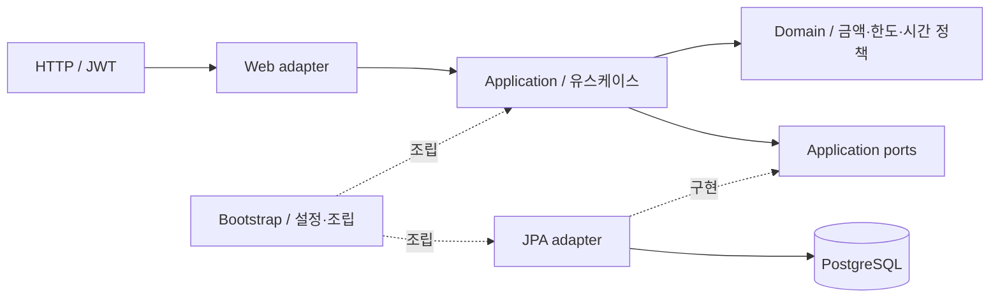

# GlobalRemittance

원화로 USD·JPY 송금 견적을 만들고 접수하는 개인 프로젝트다. Java 17 / Spring Boot 3 / JPA / PostgreSQL(기본, docker-compose)을 사용하며 embedded H2는 `h2` 프로파일로 실행할 수 있고 기본 패키지는 `com.nelson.remittance`다.

환율·수수료를 확정한 견적, 사용자별 일일 한도와 동시 접수, 성공 응답의 멱등 재현, 커서 기반 이력 조회를 구현했다. 접수는 DB에 기록하는 단계까지이며 실제 금융기관 지급과 실시간 시세 공급은 구현하지 않았다.

## 프로젝트에서 보여주려는 것

AI 에이전트의 구현·리뷰·검증을 snapshot 기반 하네스로 관리하고, 송금 서비스의 동시성·멱등성·장애 복구를 재현 실험으로 확인한 AX 포트폴리오다. AI 활용의 초점은 코드 생성량보다 작업 범위, 검증 근거, 실패 후 재작업을 관리하는 개발 절차에 있다.

| 대표 사례 | 확인한 결과 | 상세 근거 |
| --- | --- | --- |
| DB 무응답으로 요청이 끝나지 않는 결함 | 풀 연결 획득 제한으로는 쿼리 대기를 제한할 수 없음을 재현하고 JDBC 소켓 타임아웃 도입 | [문제·수정·검증](docs/portfolio/case-studies.md#1-db-무응답과-타임아웃) |
| DB 커밋 뒤 성공 응답 유실 | COMMIT 전·후를 나눠 결함을 주입하고 같은 키 재시도의 접수·한도 반영이 1회임을 DB로 확인 | [멱등성 검증](docs/portfolio/case-studies.md#2-커밋-응답-유실과-멱등성) |
| AI 작업 중 소유 파일 범위 변경 | 수동 상태 편집 대신 `own` 명령을 추가하고 기존 snapshot 리뷰·검증 게이트 유지 | [개발 절차 개선](docs/portfolio/case-studies.md#3-하네스의-소유-범위-변경) |

처음 읽는다면 [AI 역할과 통제 범위](docs/portfolio/ax-workflow.md) → [대표 사례 3개](docs/portfolio/case-studies.md) → [검증 범위와 한계](docs/portfolio/validation.md) 순서로 보면 된다. 각 설명은 코드·테스트·작업 기록으로 연결된다. 생산성 향상률이나 운영 성능을 측정한 프로젝트는 아니다.

## 구조



domain은 Spring·JPA에 의존하지 않는다. application은 유스케이스 선언용 `@Service`·`@Transactional`만 허용하고, 외부 기술은 port와 adapter로 연결한다. [아키텍처](docs/application/architecture.md)에서 의존성·요청·저장 흐름을 설명한다.

## 먼저 실행하기

Java 17, Docker Compose v2와 저장소 Gradle wrapper를 기준으로 한다. 기본 DB는 PostgreSQL 16이다.

```sh
# 새 로컬 DB용 키·비밀번호 생성 예시: 기존 DB에는 기존 값을 사용한다.
export REMITTANCE_AES_KEY="$(openssl rand -base64 32)"
export REMITTANCE_JWT_SECRET="$(openssl rand -base64 32)"
export REMITTANCE_DB_PASSWORD="$(openssl rand -base64 18 | tr -d '/+=')"
docker compose up -d --wait
./gradlew bootRun
```

AES 키는 Base64 32바이트, JWT 키는 Base64 32바이트 이상이며 DB 비밀번호는 필수다. **기존 암호화 데이터를 읽으려면 AES 키를 유지하고, 기존 DB에는 처음 설정한 비밀번호를 사용한다.** 위 생성 예시를 매번 실행하지 않는다. `secret.local`에 export 구문을 두고 `source ./secret.local`로 읽을 수 있다. 이 파일은 Git에서 제외되며 실제 값을 문서·PR에 기록하지 않는다.

`export` 대신 앱 실행 인자로 전달할 수도 있다. PostgreSQL을 사용할 때는 DB를 먼저 준비하고, Compose에는 비밀번호를 별도로 전달한다. 아래 자리표시자는 기존 키·DB 비밀번호로 바꾼다.

```sh
# 이 명령에만 DB 비밀번호 전달(export 없이 Compose 실행)
REMITTANCE_DB_PASSWORD='<DB 비밀번호>' docker compose up -d --wait
./gradlew bootRun --args="--remittance.aes-key='<Base64 AES 키>' --remittance.jwt-secret='<Base64 JWT 키>' --spring.datasource.password='<DB 비밀번호>' --remittance.usd-to-krw=1350"
```

앱 인자는 같은 속성의 환경변수보다 우선한다. `-Dremittance.aes-key=...`는 Gradle JVM 속성이어서 앱에 자동 전달되지 않는다. 인자 값은 셸 기록·프로세스 목록에 보일 수 있으므로 로컬 개발에서 사용한다.

실행 후 [Swagger UI](http://localhost:8080/swagger-ui.html)에서 회원가입·로그인하고 token을 **Authorize**에 넣는다. OpenAPI JSON은 `/v3/api-docs`이며 두 경로는 기본 공개다. `REMITTANCE_API_DOCS_ENABLED=false`로 함께 끈다.

Docker 없이 `SPRING_PROFILES_ACTIVE=h2 ./gradlew bootRun`으로 H2 파일 DB를 쓸 수 있다. 환경변수, DB 볼륨·비밀번호, 시작 실패, H2 콘솔, 방언별 마이그레이션과 k6는 [로컬 실행 가이드](docs/application/local-guide.md)에 모았다.

## 검증

```sh
# 기본 JUnit·H2 회귀, Spotless·Checkstyle, 실행 jar
./gradlew clean check bootJar --no-daemon
# Docker가 필요한 PostgreSQL 시나리오 (기본 check에서 제외)
./gradlew postgresTest --rerun-tasks --no-daemon
# 앱과 별개인 하네스 회귀
python3 -m unittest discover -s scripts/tests -v
```

`spotlessApply`는 파일을 수정하는 [선택적 포맷 명령](docs/application/local-guide.md#포맷-수정)이다. 검증 결과는 실행 커밋·환경과 함께 하네스·PR 기록에서 확인한다. [검증 범위](docs/portfolio/validation.md)는 자동 단언과 과거 부하 관찰값을 구분하며 이 문서 자체가 새 테스트 통과를 뜻하지 않는다.

## 상세 문서

| 문서 | 내용 |
| --- | --- |
| [프로젝트 안내](docs/portfolio/index.md) | AX 목적·핵심 성과·추천 읽기 순서 |
| [AX 개발 방식](docs/portfolio/ax-workflow.md) · [대표 사례](docs/portfolio/case-studies.md) | 사람·AI 역할, snapshot 게이트, 문제·판단·검증 근거 |
| [개요](docs/application/overview.md) · [아키텍처](docs/application/architecture.md) | 기능·계층·요청·저장 흐름 |
| [주요 설계](docs/application/design.md) · [동시성과 멱등성](docs/application/concurrency.md) | 금액·시간·스키마, 잠금·접수 재시도·장애 실험 |
| [API](docs/application/api.md) · [Observability](docs/application/observability.md) | 인증·필드·오류 계약, 요청 ID·로그·진단 |
| [로컬 실행](docs/application/local-guide.md) · [검증 범위](docs/portfolio/validation.md) | 설정·마이그레이션·k6, 실행 근거와 한계 |
| [요구사항](docs/requirements/project-goals.md) · [초기 결정](docs/decisions/remittance-rebuild.md) | 원 요구사항과 설계 출발점 |

에이전트 실행은 [AGENTS.md](AGENTS.md), 옵시디언 연결은 [문서화 사용법](docs/harness/obsidian.md)을 따른다. 일반 작업은 dev PR 생성에서 끝나며 승인·병합은 사람이 한다.

## 구현과 검증의 한계

실제 금융기관 지급·실시간 시세 공급·외부 데이터 이전은 구현하지 않았다. 검증은 격리 H2, PostgreSQL 16 Testcontainers, 로컬 k6 범위다. 다중 앱은 같은 JVM의 독립 컨텍스트 2개이며 별도 프로세스·호스트 장애나 운영 용량을 보장하지 않는다. 실제 배포·CI/CD, 중앙 로그·알림도 구성하지 않았다. 남은 범위는 [검증 문서](docs/portfolio/validation.md#아직-주장하지-않는-것)에서 확인한다.
