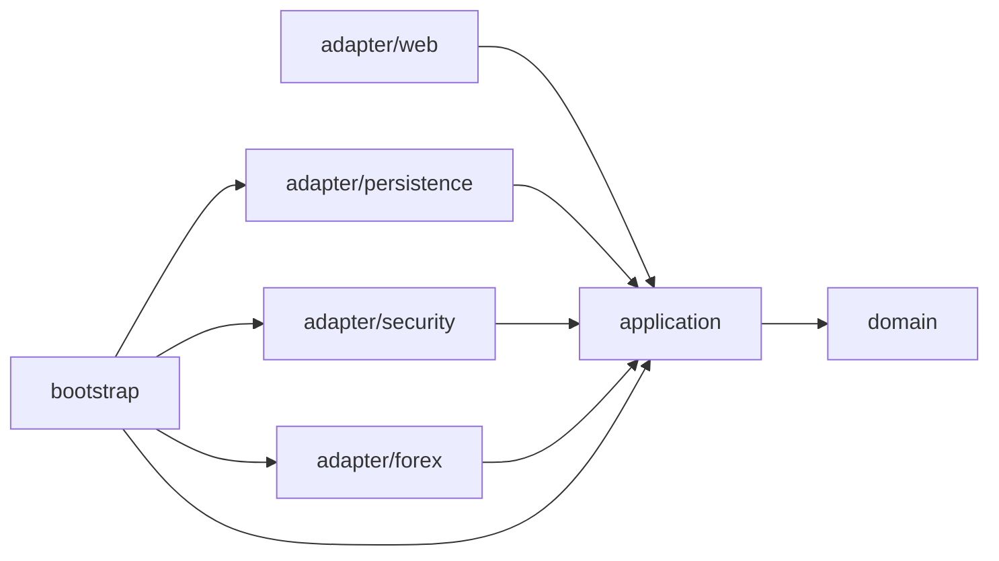
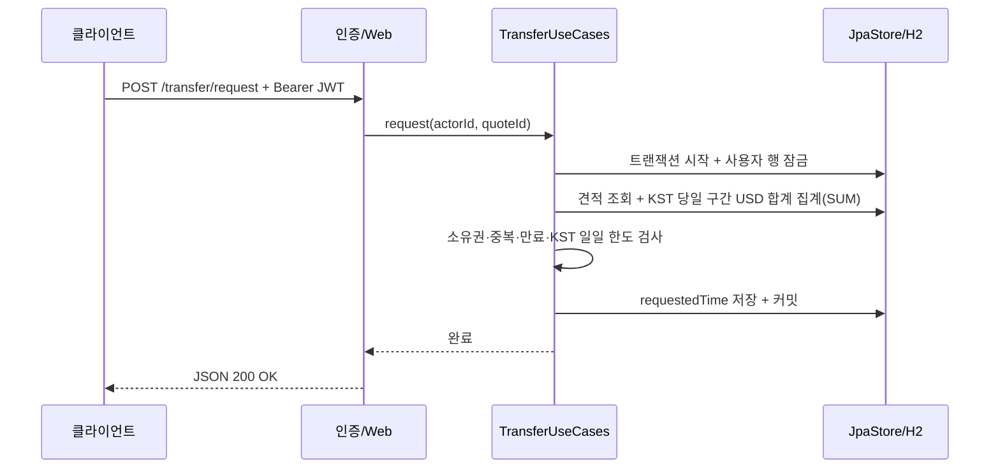

# 아키텍처

## 의존성 방향

기본 패키지 `com.nelson.remittance`에서 내부 정책은 Spring·JPA·HTTP 구현에 의존하지 않는다. 외부 어댑터는 application 포트를 구현하거나 사용 사례를 호출하고 bootstrap은 객체를 조립한다.

| 계층 | 책임 | 대표 클래스 |
| --- | --- | --- |
| domain | 금액·수수료 계산, 견적 상태와 만료, 개인/법인 한도 | QuotePolicy, Quote, User, BusinessException |
| application | 사용 사례 순서, 시간 경계와 트랜잭션 포트 | UserUseCases, TransferUseCases, Ports |
| adapter/web | 입력 검증, 인증 사용자 변환, JSON 응답과 오류 | UserController, TransferController, ApiModels, ApiExceptionHandler, JsonErrorController |
| adapter/persistence | JPA 모델 변환, 저장과 DB 잠금, 트랜잭션 실행 | JpaStore, UserEntity, QuoteEntity, TransactionalWork |
| adapter/security | BCrypt 연결, AES-GCM, JWT 발급·검증 | AesIdentityCipher, JwtTokens, JwtAuthenticationFilter, SecurityConfiguration |
| adapter/forex | 설정 환율 공급 | ConfiguredRates |
| bootstrap | 의존성 주입과 Clock 구성 | ApplicationConfiguration |

웹 DTO와 JPA entity를 domain으로 넘기지 않는다. Ports는 Accounts, Quotes, Rates, Passwords, IdentityCipher, Tokens, Work 등 실제 기술 경계다. Work 구현은 TransactionTemplate을 사용해 Spring 트랜잭션 의존성을 application 밖에 둔다.

## 송금 접수 흐름

견적 생성 시 수수료·환율·USD 환산액을 확정한다. 접수는 당시 값을 재사용한다. 동일 사용자 행 잠금으로 서로 다른 견적의 동시 접수도 직렬화한다. 일일 합계는 접수 이력을 읽지 않고 KST 당일 [00:00, 익일 00:00) 구간을 Instant로 바꿔 DB에서 SUM으로 구한다. 이력 조회는 사용자 잠금을 잡지 않으므로 접수와 서로 막지 않는다. 목록은 (접수시각, ID) 키셋 조건으로 size+1건을 읽어 다음 페이지 존재를 판단하고 인덱스 idx_remittances_user_requested(user_id, requested_time)로 사용자와 접수시각 범위를 좁힌다. 인덱스에 id는 없으므로 같은 시각 안의 id 비교와 정렬 보조는 인덱스 이후 처리다. 커서 인코딩은 웹 어댑터가 맡고 application에는 (Instant, long) 위치값만 전달한다. 오늘 건수와 합계는 한 JPQL(count+sum)로 구해 서로 모순되지 않는다. 다만 목록과 집계는 별개 쿼리라 접수와 겹치면 시점 차이가 있을 수 있고, 키셋 방식은 임의 페이지 점프를 지원하지 않는다.

잠금 대기는 `remittance.lock-timeout-ms`(기본 5000ms)로 제한하며 H2에서는 JDBC URL의 LOCK_TIMEOUT으로 적용된다. 초과하면 어댑터가 업무 오류 LOCK_TIMEOUT으로 바꿔 HTTP 503으로 응답하며 클라이언트가 재시도할 수 있다. 커넥션이 끊겨 롤백도 실패하는 경우에도 원래 업무 오류를 전달한다.

## 저장 모델

- users: 순차 INT 식별자, 유일한 userId, BCrypt 비밀번호, 암호화 식별번호, 신원 유형, 생성/수정 시각.
- remittances: 사용자 FK와 인덱스, 순차 INT 식별자, DECIMAL(22,12) 금액·환율·수수료 감사 값, 만료·생성·수정·접수 시각.
- requestedTime이 null이면 미접수 견적이다. 접수 이력에는 requestedTime이 있는 항목만 포함한다.
- 도메인 식별자는 long이지만 영속성의 INT 범위로 변환·검증한다. UTC 저장과 KST API 표시를 분리한다.

## 검증과 한계

ArchitectureTest는 컴파일된 domain/application의 프레임워크·어댑터 의존성을 검사한다. API 통합 테스트는 실제 H2, 인증, 동시 접수 및 Tomcat 오류 디스패치를 검사한다.

이력은 키셋 페이지로 읽어 응답과 메모리가 size로 제한된다. 멱등성 키가 없어 타임아웃 후 재시도는 클라이언트가 이력으로 확인해야 한다. 직렬화는 단일 DB의 사용자 행 잠금에 의존한다. H2 잠금 검증은 다른 운영 DB에서의 동작·장애 복구를 보증하지 않는다.
