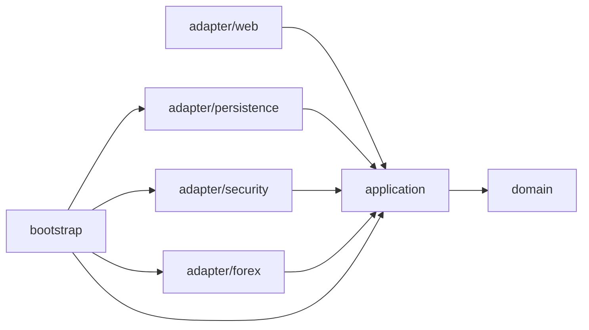
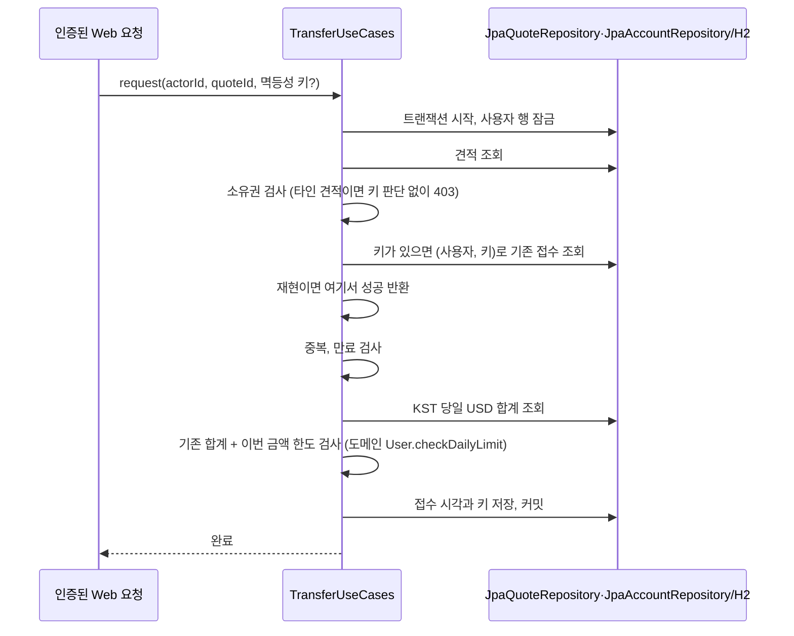
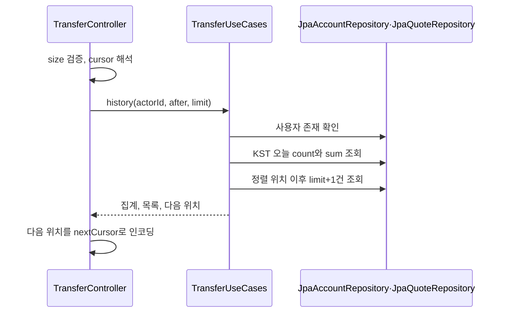
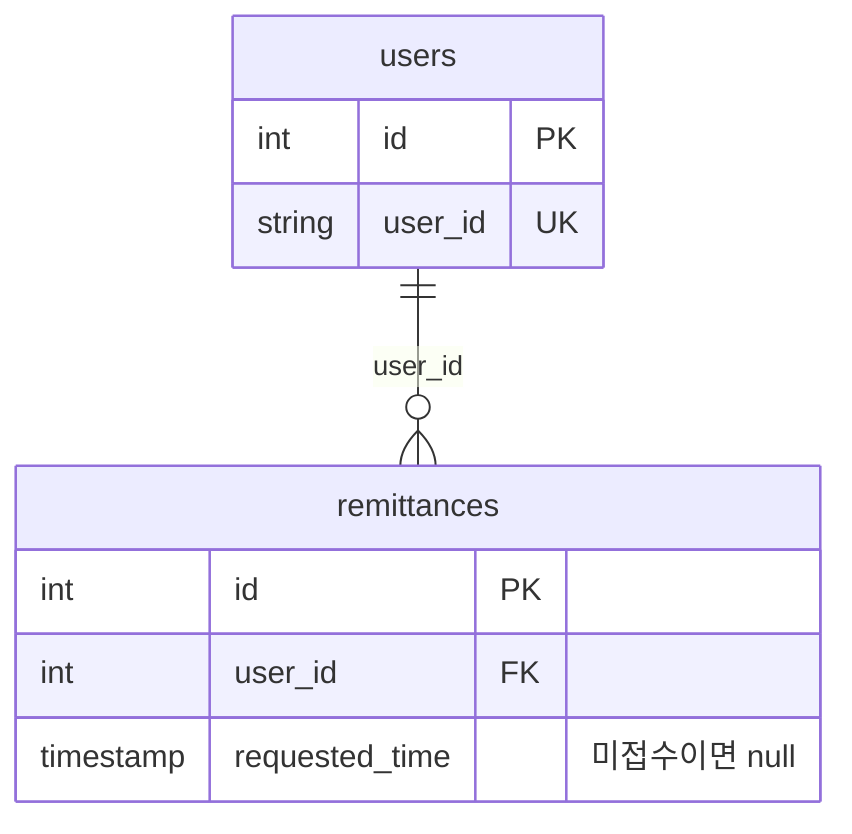
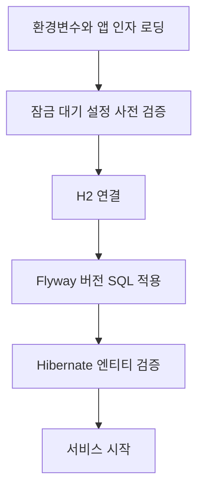

# 아키텍처

`com.nelson.remittance` 아래에서 업무 규칙과 기술 구현을 분리한다. domain은 금액·견적 규칙을 정의하고 application은 규칙을 적용하는 순서를 조정한다. 웹·DB·인증·환율 구현은 adapter에, 설정 기반 조립은 bootstrap에 둔다(유스케이스는 `@Service`, 어댑터 구현은 `@Component`로 스캔 등록).

## 계층과 의존성

도식은 주요 의존성을 나타낸다. 어댑터는 내부 모델을 직접 사용할 수 있지만 domain/application은 Spring·JPA·웹 어댑터를 참조하지 않는다. 웹 DTO와 JPA entity도 내부 정책의 입력으로 전달하지 않는다.

| 계층 | 책임 | 주요 클래스 |
| --- | --- | --- |
| domain | 수수료·수취액 계산, 견적 발급·접수 상태와 만료(10분), 멱등성 재현 판단(24시간 창), 신원 유형별 일일 한도 검사, KST 기준일. 책임별 하위 패키지로 나눈다: `exception`(BusinessException, ErrorCode), `quote`(Quote, QuotePolicy, RateSnapshot), `user`(User), `time`(BusinessDay) | 위 하위 패키지의 클래스 |
| application | 회원·송금 사용 사례, 시간 경계, 외부 기술 포트. 유스케이스는 `user`(UserUseCases), `transfer`(TransferUseCases, RateFreshnessPolicy), 포트는 `port.repository`(AccountRepository, QuoteRepository, QuotePosition, DailyTotal), `port.security`(PasswordHasher, IdentityCipher, TokenProvider), `port.rate`(RateProvider)로 나눈다 | 위 하위 패키지의 클래스 |
| adapter/web | 입력 검증, 인증 사용자 변환, 이력 페이징, JSON 응답과 오류, OpenAPI 명세 선언. 책임별 하위 패키지로 나눈다: `controller`(UserController, TransferController, HistoryPaging), `error`(ApiExceptionHandler, JsonErrorController, ErrorDescriptions), `filter`(RequestIdFilter), `config`(JsonConfiguration, OpenApiConfiguration), `dto`(요청/응답 DTO를 한 파일씩) | 위 하위 패키지의 클래스 |
| adapter/persistence | JPA 모델 변환, 저장·집계·페이지 조회, 사용자 잠금(스키마는 Flyway SQL). 계정(`JpaAccountRepository`)과 견적(`JpaQuoteRepository`) 저장소를 분리하고 DB 예외 판별(`PersistenceErrors`)·ID 범위 변환(`EntityIds`)은 저장소 패키지 안에서만 쓰므로 package-private으로 둔다. 하위 패키지는 `entity`(UserEntity, QuoteEntity), `repository`(JpaAccountRepository, JpaQuoteRepository, PersistenceErrors, EntityIds), `tx`(RollbackSafeTransactionManager)이며 엔티티 필드는 열지 않고 `QuoteEntity.markRequested` 같은 의도 메서드로만 상태를 바꾼다. 엔티티 생성자와 `toDomain()`은 저장소 패키지가 쓰도록 public이므로, `ArchitectureTest`가 `adapter/persistence` 밖의 클래스가 엔티티 패키지를 참조하지 못하게 막는다 | entity/UserEntity, entity/QuoteEntity, repository/*, tx/RollbackSafeTransactionManager |
| adapter/security | BCrypt 비밀번호 해시, AES-GCM, JWT 발급·검증, 인증 필터. 하위 패키지는 `crypto`(BCryptPasswordHasher, AesIdentityCipher)와 `jwt`(JwtTokens, JwtAuthenticationFilter)이고 SecurityConfiguration은 루트에 둔다 | crypto/*, jwt/*, SecurityConfiguration |
| adapter/forex | 설정 환율 제공, 지연·장애를 주입하는 모의 공급처 | ConfiguredRates, SimulatedRates |
| bootstrap | 설정 기반 조립(Clock, 환율 공급처와 허용 지연, 트랜잭션 매니저), 설정값 검증 파서, 시작 실패 진단. 하위 패키지는 `config`(ClockConfiguration, RatesConfiguration, PersistenceConfiguration, ConfigValues)와 `diagnostics`(DatabaseConnectionFailureAnalyzer, LockTimeoutEnvironmentPostProcessor, LockTimeoutFailureAnalyzer, InvalidLockTimeoutException, SocketTimeoutEnvironmentPostProcessor, SocketTimeoutFailureAnalyzer, InvalidSocketTimeoutException)이며, `diagnostics`의 클래스는 `META-INF/spring.factories`에 FQCN으로 등록돼 이동 시 함께 고쳐야 한다 | config/*, diagnostics/* |

API 명세(springdoc-openapi)는 adapter/web의 어노테이션과 `adapter/web/config/OpenApiConfiguration`에서만 생성한다. domain/application은 Swagger를 참조하지 않으며, 명세와 UI 경로(`/v3/api-docs`, `/swagger-ui.html`)는 보안 설정에서 인증 없이 열고 `REMITTANCE_API_DOCS_ENABLED`로 끈다. 오류 처리용 `/error`는 공개 API가 아니므로 명세에서 제외한다.

웹 어댑터는 컨트롤러(`controller`), 오류 변환(`error`), 요청 필터(`filter`), 웹 설정(`config`), 요청/응답 모델(`dto`)을 하위 패키지로 나눈다. 같은 하위 패키지 안에서만 쓰는 클래스(`HistoryPaging`, `ErrorDescriptions`)는 package-private으로 두어 접근 범위를 넓히지 않았다. 예전에는 컨트롤러, 설정, 오류 처리, 필터가 `adapter/web` 한 패키지에 섞여 있었다.

구성 클래스는 책임별로 나뉜다. 어댑터 구현은 어댑터 패키지에서 스스로 등록한다(`BCryptPasswordHasher`, `AesIdentityCipher`, `JwtTokens`는 `@Component`이고 키는 생성자의 `@Value`로 받아 기동 시 검증한다). 웹 직렬화 규칙(문자열·숫자 자동 변환 차단)은 `adapter/web/config/JsonConfiguration`이, `Clock`은 `ClockConfiguration`이, 환율 공급처 선택과 허용 지연은 `RatesConfiguration`이, 트랜잭션 매니저는 `PersistenceConfiguration`이 맡는다. 설정값 파서(`ConfigValues`)는 부호·공백·소수를 허용하지 않는 ASCII 정수와 `true`/`false`만 받고 오류 메시지에는 설정 키와 허용 범위만 담는다. 예전에는 이 모두가 하나의 `ApplicationConfiguration`(약 160줄)에 있었고 BCrypt 구현이 익명 클래스로 bootstrap에 들어 있었다.

`application.port` 패키지는 외부 기술의 경계를 책임별 하위 패키지에 한 파일씩 최상위 인터페이스로 정의한다: 저장소(`port.repository`: `AccountRepository`, `QuoteRepository`와 그 조회용 값 `QuotePosition`, `DailyTotal`), 보안(`port.security`: `PasswordHasher`, `IdentityCipher`, `TokenProvider`), 환율(`port.rate`: `RateProvider`). 예전에는 하나의 `Ports` 클래스에 중첩 인터페이스로 모아 두어 주입할 때마다 `Ports.X`로 써야 했다.

업무 오류는 `domain.exception`의 `BusinessException`(오류 코드는 최상위 enum `ErrorCode`)으로 전달한다. 오류 코드는 운영하면서 늘어날 수 있어 예외 타입과 코드를 별도 패키지·파일로 두었다. 예전에는 `BusinessException` 안에 중첩 enum `Code`가 있었다. HTTP 상태 매핑은 도메인이 아니라 웹 어댑터의 `ApiExceptionHandler`가 맡는다.

사용 사례(`UserUseCases`, `TransferUseCases`)는 `@Service`로 선언해 컴포넌트 스캔과 생성자 주입으로 등록한다. 예전에는 application 계층을 Spring에서 분리하려고 설정 클래스의 `@Bean` 메서드로 직접 조립했지만, `@Transactional`을 허용한 뒤로는 그 근거가 약해져 관례에 맞췄다. 환율 허용 지연처럼 타입으로 주입하기 모호한 설정값은 `RateFreshnessPolicy` 레코드로 감싸 설정 쪽에서 검증해 빈으로 만든다. Spring 없이 생성자로 직접 만들어 단위 테스트하는 것(`RatePolicyTest`)은 여전히 가능하다.

트랜잭션은 사용 사례의 업무 메서드(`quote`, `request`, `history`, `signup`, `login`)에 붙인 `@Transactional`로 건다. application 계층에서 허용하는 Spring 의존은 `org.springframework.stereotype.Service`와 `org.springframework.transaction.annotation.Transactional` 두 타입뿐이며 `ArchitectureTest`가 그 밖의 Spring·JPA 참조(같은 패키지의 다른 타입 포함)를 계속 막는다(domain은 Spring 전체 금지). 프록시가 서브클래스를 만들므로 사용 사례 클래스는 final이 아니다. 예전의 `Work` 포트와 TransactionTemplate 구현(`TransactionalWork`)은 제거했다. 어댑터의 `RollbackSafeTransactionManager`는 롤백 자체가 실패해도 호출자가 원래 예외를 받게 한다.

## 인증과 견적 생성

RequestIdFilter가 보안 필터보다 먼저 실행돼 요청 ID를 응답 헤더와 MDC에 넣는다. 요청 처리가 끝나면 MDC에서 제거해 재사용 스레드에 남지 않게 한다.

송금 인증은 JwtAuthenticationFilter가 처리한다. 필터가 JWT 서명·만료를 확인하고 인증 사용자 ID를 컨트롤러에 전달한다. 송금 본문에서 별도의 사용자 ID를 받지 않는다. 인증 실패는 JSON 401로 응답한다. 접근 정책은 기본 거부다: SecurityConfiguration의 공개 경로 목록(`/user/signup`, `/user/login`, Swagger/OpenAPI, `/h2-console`, `/error`)만 열고, 공개 경로 매처 하나를 JwtAuthenticationFilter와 공유해 검사 제외 대상의 출처를 하나로 둔다. 그 밖의 경로는 인증을 요구하되 `RequestMappingHandlerMapping`에 컨트롤러가 없는 경로는 익명 요청을 통과시켜 기존 404 JSON 계약을 유지한다. 새 컨트롤러는 설정을 바꾸지 않아도 자동으로 인증 대상이 된다. `Authorization` 스킴은 대소문자를 무시한다(RFC 7235).

견적 생성은 사용자 확인 → 대상 통화·USD 환율 스냅샷(환율+기준 시각) 조회 → 신선도 검사(허용 지연 초과 시 RATE_STALE) → QuotePolicy 계산 → 견적 저장 순서로 진행한다. 대상이 USD면 스냅샷을 한 번만 조회한다. 공급 실패는 어댑터가 RATE_UNAVAILABLE로 알리며 둘 다 503이다. 신선도 판단은 도메인 규칙(`RateSnapshot.isFresh`)이고 어떤 공급처를 쓸지는 bootstrap이 설정으로 고른다(`configured`/`simulated`). 환율·수수료·수취액·USD 금액과 만료 시각을 함께 저장한다. 사용자 행에 접수 잠금을 걸지는 않지만, 저장 과정은 `@Transactional` 트랜잭션 안에서 실행한다.

## 송금 접수

접수 규칙은 도메인에 있고 사용 사례는 조정만 한다. `Quote.replays`가 멱등성 키 재현 여부(다른 견적이면 재사용 오류, 같은 견적이면 24시간 창 안에서만 재현)를, `Quote.request`가 소유권·중복·만료를, `User.checkDailyLimit`가 일일 한도를, `BusinessDay.of`가 KST 기준일 구간을 판단한다. 사용 사례는 사용자 잠금을 먼저 잡고 저장소에서 견적·이전 접수·오늘 합계를 읽어 이 규칙들에 넘기고 결과를 저장한다. 규칙 판단은 순수 객체라 DB 없이 경계 단위 테스트(`DomainRulesTest`)가 가능하다.

사용자 잠금은 합계 조회와 한도 검사, 접수 저장을 함께 보호한다. 같은 사용자에 대한 뒤 요청은 앞 트랜잭션이 끝난 뒤 견적과 합계를 읽는다. 다른 견적을 동시에 접수해도 같은 직렬화 지점을 거친다. 멱등성 키 조회도 같은 잠금 안에서 하므로 같은 키의 동시 재시도는 한 번만 반영된다. 키는 접수된 견적 행의 `idempotency_key`에 저장하고 (user_id, idempotency_key) 유일 제약이 한 키를 한 견적에만 묶는다. 구체적인 경쟁 상황은 [[주요 설계]]에서 설명한다.

잠금 대기 한도는 H2에서는 JDBC URL의 `LOCK_TIMEOUT`, PostgreSQL(기본)에서는 연결별 `SET lock_timeout`으로 적용한다. 기본 5000ms를 넘기면 `JpaAccountRepository.lockUser`가 LOCK_TIMEOUT 업무 오류로 변환하고(판별은 `PersistenceErrors.isLockTimeout`) 웹 계층은 `Retry-After: 1` 헤더와 함께 HTTP 503을 반환한다. 설정값은 DB 연결 전에 bootstrap의 LockTimeoutEnvironmentPostProcessor가 1~30000의 ASCII 숫자 표기인지 검사(부호·공백·선행 0 불가)하며 위반하면 기동을 거부한다. 롤백 실패가 원래 업무 오류를 덮는 경우에도 RollbackSafeTransactionManager가 롤백 실패를 삼켜 원래 업무 오류가 전달된다. 이 처리가 DB 복구 상태까지 확인하는 것은 아니다.

## 이력 조회

정렬은 `(requestedTime desc, id desc)`다. 다음 페이지는 `requestedTime < t OR (requestedTime = t AND id < lastId)` 조건으로 읽는다. 페이지 크기보다 한 건 더 조회해 다음 페이지의 존재를 판단한다. 커서의 인코딩은 웹 계층이 담당하고 application에는 `(Instant, long)` 위치값을 전달한다.

커서 인코딩/디코딩과 페이지 크기 검증은 컨트롤러가 아니라 웹 어댑터의 `HistoryPaging`이 맡는다. 커서는 `초.나노.ID`를 URL-safe Base64로 감싼 값이며, 재인코딩 결과가 입력과 같아야 하므로 비정규 표기를 거부하고 초·나노·ID 범위를 제한한다. 예전에는 요청/응답 DTO가 하나의 `ApiModels` 이름 공간 클래스에, 이 페이징 코드가 `TransferController`에 함께 있었다. DTO의 클래스 이름은 OpenAPI 스키마 이름이 되므로 분리하면서 이름을 바꾸지 않았다.

모든 조회에는 인증 사용자의 ID 조건을 적용한다. 커서는 조회 위치이고 접근 권한이 아니다. 인덱스 `idx_remittances_user_requested(user_id, requested_time)`는 사용자·시각 범위를 좁힌다. id를 포함한 복합 인덱스는 아니므로 동일 시각의 ID 비교·정렬까지 인덱스로 해결한다고 가정하지 않는다.

오늘 건수·합계는 한 쿼리에서 조회하며 페이지 크기와 커서의 영향을 받지 않는다. 목록 조회는 별개 쿼리이므로 동시 접수가 있으면 집계와 목록이 서로 다른 시점을 볼 수 있다. 이력 조회는 접수용 사용자 잠금을 사용하지 않는다.

## 트랜잭션과 저장 모델

| 작업 | 트랜잭션 외에 적용하는 보호 수단 |
| --- | --- |
| 회원가입 | userId DB 유일 제약. 동시 가입의 제약 위반은 DUPLICATE_USER로 변환 |
| 견적 생성 | 별도의 사용자 잠금 없음 |
| 접수 | 사용자 행 비관적 쓰기 잠금 |
| 이력 조회 | 별도의 사용자 잠금 없음 |

users는 계정·비밀번호 해시·암호화 식별번호·신원 유형을 저장한다. remittances는 사용자 FK와 견적의 금액·수수료·환율·시각을 저장하며 금액 필드는 DECIMAL(22,12)다. requestedTime이 null이면 미접수 견적이다. 접수에 성공한 요청의 멱등성 키는 같은 행의 idempotency_key(nullable, 사용자별 유일)에 남는다. 이력과 일일 집계는 접수된 항목만 조회한다.

스키마는 `db/migration`의 Flyway SQL이 만들고 Hibernate는 `ddl-auto: validate`로 엔티티와의 일치만 확인한다. 이력이 없는 기존 파일 DB는 버전 0으로 기준선을 잡은 뒤 멱등하게 쓴 V1~V3을 적용한다.

도메인 ID는 long이고 DB ID는 순차 INT다. 영속 어댑터에서 범위를 검사하고 변환한다. 시각 저장은 UTC, 일일 한도 판정과 견적·이력 응답 표시는 KST다.

ArchitectureTest는 컴파일된 내부 계층의 프레임워크·어댑터 의존성을 검사한다. H2/API 테스트는 실제 인증·금액·동시 접수·페이지 경계·JSON 오류 디스패치를 검증한다. PostgreSQL 16에서는 `postgres` 태그 테스트가 단일 앱 프로세스의 동시 접수·락 타임아웃·연결 끊김 복구·롤백 실패 주입을 검증한다. 다중 프로세스·다른 DB 버전에서의 잠금·복구는 별도 검증이 필요하다.

테스트 패키지는 단위 테스트가 대상 클래스의 main 패키지를 그대로 따른다(`domain`, `application/transfer`, `adapter/security`, `adapter/persistence/*`, `bootstrap/*`). 애플리케이션 전체를 띄우는 H2 기반 테스트와 Flyway 마이그레이션 테스트는 `integration`, Docker가 필요한 `postgres` 태그 테스트는 `postgres`, 의존성 방향 검사는 `architecture`에 둔다. 단위 테스트가 같은 패키지의 package-private 클래스를 검증할 수 있도록(`ConfigValuesTest`, `PersistenceErrorsTest`, `HistoryPagingTest`) 접근 범위를 넓히지 않는다.

## 기동과 스키마 변경

도식은 관련 기동 단계의 의존 순서를 나타내며 전체 Spring 시작 절차를 나열한 것은 아니다. LockTimeoutEnvironmentPostProcessor는 설정 로딩 이후 최종 값을 검사하고 잘못된 값이면 DB 연결 전에 시작을 거부한다. LockTimeoutFailureAnalyzer는 해당 실패에 설정 안내를 제공한다. 같은 방식으로 SocketTimeoutEnvironmentPostProcessor가 `remittance.db-socket-timeout-seconds`를 1~3600초 ASCII 정수이면서 잠금 대기 한도(ms)보다 큰지 DB 연결 전에 검사한다(잠금 대기 값이 잘못됐으면 비교를 건너뛰고 잠금 대기 검증기가 거부한다).

Flyway의 V1은 기본 테이블·인덱스, V2는 멱등성 키와 사용자별 유일 제약, V3은 기존 `users.user_id`의 소문자 정규화다(대소문자만 다른 중복이 있으면 실패). 기존 앱의 비어 있지 않은 DB에 Flyway 이력이 없으면 baseline 0 후 V1~V3을 적용한다. IF NOT EXISTS는 기존 객체를 건너뛰는 방식이고 스키마 오류 전체를 보정하지 않는다. Hibernate validate는 컬럼·타입을 검사하며 제약과 인덱스는 마이그레이션 및 스키마 테스트로 확인한다.

DatabaseConnectionFailureAnalyzer는 두 경로를 안내한다. (1) Flyway 초기화의 접속 실패(`FlywaySqlException: Unable to obtain connection from database`): 원인 연쇄의 SQLState(5자 영문 대문자·숫자 형식일 때만)로 인증 거부(`28xxx`)·DB 없음(`3D000`)·연결 불가(`08xxx`) 순으로 분류하고 그 밖은 일반 안내로 처리하며, 조치 문구는 예외 클래스명으로 H2·PostgreSQL을 구분한다. 예외 메시지는 감지 조건(접두사 비교)에만 쓰고 출력하지 않는다. 감지는 Flyway 내부 클래스와 영어 메시지 접두사에 의존하므로 Flyway를 올리면 `DatabaseConnectionFailureTest`로 다시 확인한다. (2) Hibernate의 JDBC metadata/Dialect 실패 표지(Flyway가 꺼져 있을 때 등). 출력에는 비밀번호·사용자명·호스트·URL을 넣지 않는다. 접속 실패가 아닌 Flyway 오류(마이그레이션 SQL 실패 등)와 이 표지가 없는 DB 시작 오류는 분류하지 않는다.

`postgres` 프로파일은 프로파일을 지정하지 않을 때의 기본값(`spring.profiles.default`)이며, 같은 애플리케이션 코드에 PostgreSQL 데이터소스와 전용 Flyway 위치(`db/postgresql/migration`)만 바꾼다. 영속 어댑터와 사용 사례 코드는 그대로이며 잠금 대기 한도만 H2의 URL 옵션 대신 연결 초기화 SQL(`SET lock_timeout`)로 적용한다. 해당 프로파일의 동시 접수·락 타임아웃(접수와 견적 저장 모두 잠금 대기 초과 → 503, PostgreSQL이 내는 SQLState 55P03은 별도 확인)·연결 끊김 복구와 롤백 실패(연결 종료로 주입) 시 원래 업무 오류 보존은 PostgreSQL 16에서 단일 앱 프로세스 기준으로 검증했다. 다중 인스턴스는 검증하지 않았다.

## 오류 응답과 관측 경계

ApiExceptionHandler는 업무 오류·MVC 입력 오류를 JSON 코드로 변환하고, 예상 밖 예외는 ErrorDescriptions의 선별 진단 정보를 ERROR로 기록한다. 단, 원인 연쇄에 DB 연결 장애(SQLState 08xxx·57P01~03, JDBC 연결 예외; `DatabaseUnavailability`)가 있으면 WARN과 `Retry-After: 1`의 503 `DB_UNAVAILABLE`로 응답한다(도메인 `ErrorCode`가 아닌 웹 어댑터의 분류). LOCK_TIMEOUT은 WARN과 Retry-After: 1, 일반 업무 오류는 DEBUG다. UNKNOWN_ERROR 업무 코드는 ERROR로 남긴다.

예외 메시지·요청 본문·쿼리스트링·토큰 대신 요청 ID·메서드·제한된 경로·예외 클래스 연쇄·SQLState/벤더 코드·앱 스택 프레임 일부를 사용한다. JsonErrorController와 보안 필터의 오류는 동일한 응답 형식이어도 이 예외 처리기의 관측 대상과 같지 않다.

local 프로파일은 H2 콘솔과 SQL·DB 오류·연결 풀 진단을 켠다. `SPRING_PROFILES_ACTIVE`를 지정하면 기본 postgres가 대체되므로 local만 지정하면 H2로 실행되고, PostgreSQL에서 진단 로그를 쓰려면 `postgres,local`을 지정한다. 콘솔 활성화에 맞춰 SecurityConfiguration이 SAMEORIGIN 프레임 정책을 적용한다. 기본 프로파일의 개인정보 제한 로그와 로컬 확장 로그의 범위를 분리해서 사용한다.
