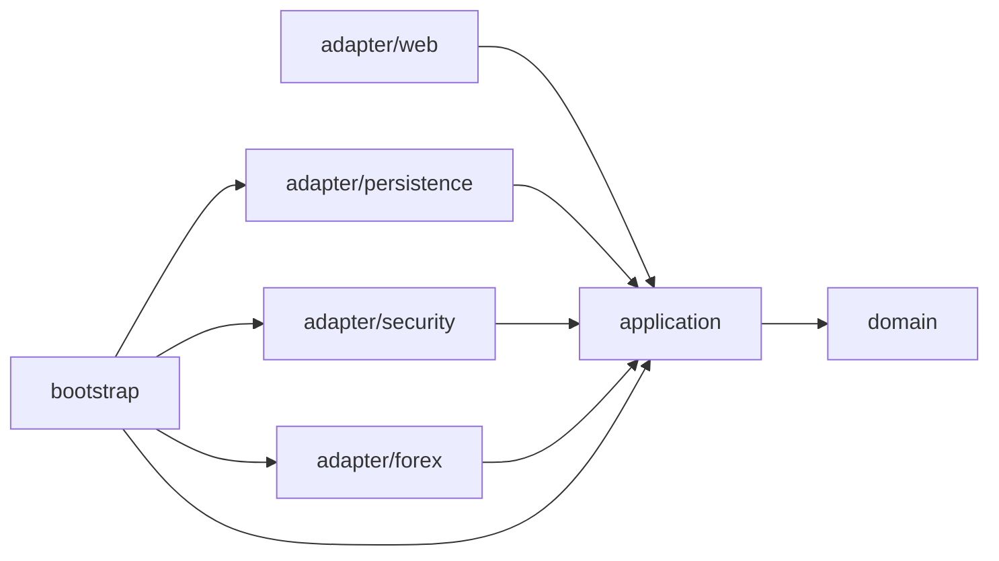
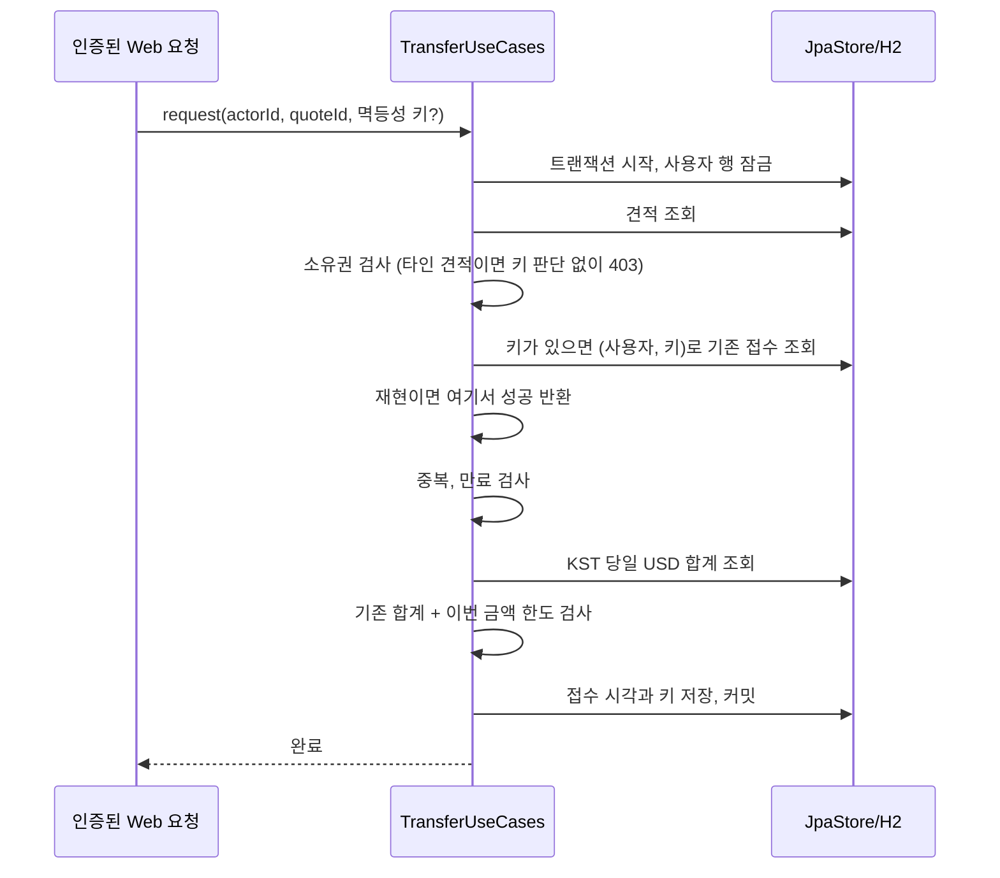
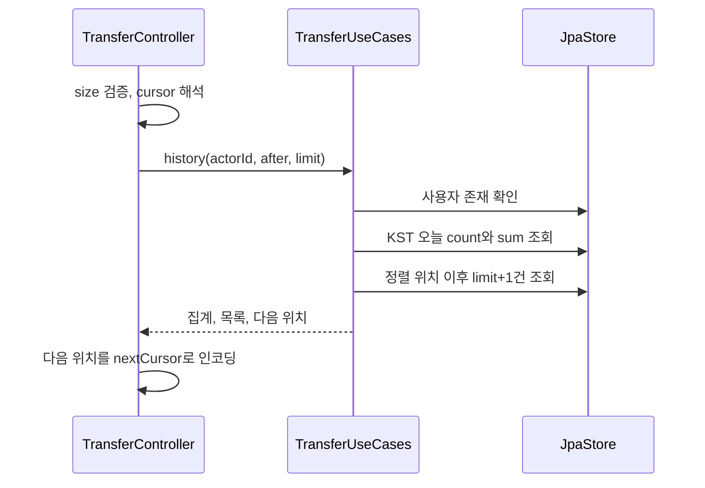
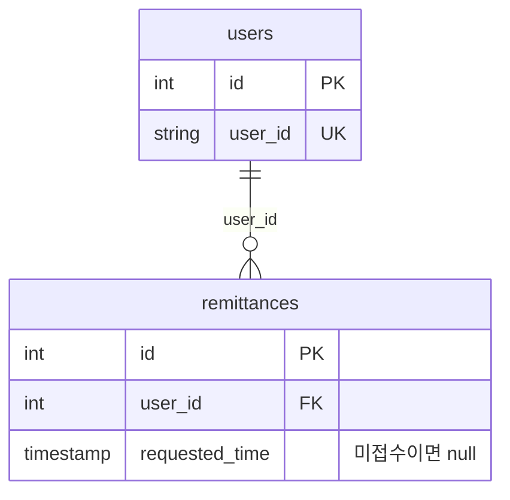

# 아키텍처

`com.nelson.remittance` 아래에서 업무 규칙과 기술 구현을 분리한다. domain은 금액·견적 규칙을 정의하고 application은 규칙을 적용하는 순서를 조정한다. 웹·DB·인증·환율 구현은 adapter에, 객체 조립은 bootstrap에 둔다.

## 계층과 의존성

도식은 주요 의존성을 나타낸다. 어댑터는 내부 모델을 직접 사용할 수 있지만 domain/application은 Spring·JPA·웹 어댑터를 참조하지 않는다. 웹 DTO와 JPA entity도 내부 정책의 입력으로 전달하지 않는다.

| 계층 | 책임 | 주요 클래스 |
| --- | --- | --- |
| domain | 수수료·수취액 계산, 견적 상태와 만료, 신원 유형별 한도 | QuotePolicy, Quote, User, BusinessException |
| application | 회원·송금 사용 사례, 시간 경계, 외부 기술 포트 | UserUseCases, TransferUseCases, Ports |
| adapter/web | 입력 검증, 인증 사용자 변환, 커서 처리, JSON 응답과 오류, OpenAPI 명세 선언 | UserController, TransferController, ApiModels, ApiExceptionHandler, JsonErrorController, OpenApiConfiguration |
| adapter/persistence | JPA 모델 변환, 저장·집계·페이지 조회, 사용자 잠금 | JpaStore, UserEntity, QuoteEntity, TransactionalWork |
| adapter/security | AES-GCM, JWT 발급·검증, 인증 필터 | AesIdentityCipher, JwtTokens, JwtAuthenticationFilter, SecurityConfiguration |
| adapter/forex | 설정 환율 제공 | ConfiguredRates |
| bootstrap | DI, Clock와 BCrypt 구성 | ApplicationConfiguration |

API 명세(springdoc-openapi)는 adapter/web의 어노테이션과 OpenApiConfiguration에서만 생성한다. domain/application은 Swagger를 참조하지 않으며, 명세와 UI 경로(`/v3/api-docs`, `/swagger-ui.html`)는 보안 설정에서 인증 없이 열고 `REMITTANCE_API_DOCS_ENABLED`로 끈다. 오류 처리용 `/error`는 공개 API가 아니므로 명세에서 제외한다.

application의 Ports는 계정·견적 저장, 환율, 비밀번호, 식별번호 암호화, 토큰, 트랜잭션 실행의 경계를 정의한다. TransactionalWork는 Work 포트를 TransactionTemplate으로 구현한다. 사용 사례는 트랜잭션 범위를 정하지만 Spring API에는 의존하지 않는다.

## 인증과 견적 생성

송금 요청은 먼저 JwtAuthenticationFilter를 거친다. 필터가 JWT 서명·만료를 확인하고 인증 사용자 ID를 컨트롤러에 전달한다. 송금 본문에서 별도의 사용자 ID를 받지 않는다. 인증 실패는 JSON 401로 응답한다.

견적 생성은 사용자 확인 → 대상 통화·USD 환율 조회 → QuotePolicy 계산 → 견적 저장 순서로 진행한다. 환율·수수료·수취액·USD 금액과 만료 시각을 함께 저장한다. 사용자 행에 접수 잠금을 걸지는 않지만, 저장 과정은 Work의 트랜잭션 안에서 실행한다.

## 송금 접수

사용자 잠금은 합계 조회와 한도 검사, 접수 저장을 함께 보호한다. 같은 사용자에 대한 뒤 요청은 앞 트랜잭션이 끝난 뒤 견적과 합계를 읽는다. 다른 견적을 동시에 접수해도 같은 직렬화 지점을 거친다. 멱등성 키 조회도 같은 잠금 안에서 하므로 같은 키의 동시 재시도는 한 번만 반영된다. 키는 접수된 견적 행의 `idempotency_key`에 저장하고 (user_id, idempotency_key) 유일 제약이 한 키를 한 견적에만 묶는다. 구체적인 경쟁 상황은 [[주요 설계]]에서 설명한다.

H2 잠금 대기 한도는 JDBC URL의 `LOCK_TIMEOUT`으로 적용한다. 기본 5000ms를 넘기면 JpaStore가 LOCK_TIMEOUT 업무 오류로 변환하고 웹 계층은 HTTP 503을 반환한다. 롤백 실패가 원래 업무 오류를 덮는 경우 TransactionalWork가 해당 업무 오류를 다시 전달한다. 이 처리가 DB 복구 상태까지 확인하는 것은 아니다.

## 이력 조회

정렬은 `(requestedTime desc, id desc)`다. 다음 페이지는 `requestedTime < t OR (requestedTime = t AND id < lastId)` 조건으로 읽는다. 페이지 크기보다 한 건 더 조회해 다음 페이지의 존재를 판단한다. 커서의 인코딩은 웹 계층이 담당하고 application에는 `(Instant, long)` 위치값을 전달한다.

모든 조회에는 인증 사용자의 ID 조건을 적용한다. 커서는 조회 위치이고 접근 권한이 아니다. 인덱스 `idx_remittances_user_requested(user_id, requested_time)`는 사용자·시각 범위를 좁힌다. id를 포함한 복합 인덱스는 아니므로 동일 시각의 ID 비교·정렬까지 인덱스로 해결한다고 가정하지 않는다.

오늘 건수·합계는 한 쿼리에서 조회하며 페이지 크기와 커서의 영향을 받지 않는다. 목록 조회는 별개 쿼리이므로 동시 접수가 있으면 집계와 목록이 서로 다른 시점을 볼 수 있다. 이력 조회는 접수용 사용자 잠금을 사용하지 않는다.

## 트랜잭션과 저장 모델

| 작업 | 트랜잭션 외에 적용하는 보호 수단 |
| --- | --- |
| 회원가입 | userId DB 유일 제약. 동시 가입의 제약 위반은 DUPLICATE_USER로 변환 |
| 견적 생성 | 별도의 사용자 잠금 없음 |
| 접수 | 사용자 행 비관적 쓰기 잠금 |
| 이력 조회 | 별도의 사용자 잠금 없음 |

users는 계정·비밀번호 해시·암호화 식별번호·신원 유형을 저장한다. remittances는 사용자 FK와 견적의 금액·수수료·환율·시각을 저장하며 금액 필드는 DECIMAL(22,12)다. requestedTime이 null이면 미접수 견적이다. 접수에 성공한 요청의 멱등성 키는 같은 행의 idempotency_key(nullable, 사용자별 유일)에 남는다. 이력과 일일 집계는 접수된 항목만 조회한다.

도메인 ID는 long이고 DB ID는 순차 INT다. 영속 어댑터에서 범위를 검사하고 변환한다. 시각 저장은 UTC, 일일 한도 판정과 견적·이력 응답 표시는 KST다.

ArchitectureTest는 컴파일된 내부 계층의 프레임워크·어댑터 의존성을 검사한다. H2/API 테스트는 실제 인증·금액·동시 접수·페이지 경계·JSON 오류 디스패치를 검증한다. 다른 운영 DB나 다중 프로세스에서의 잠금·복구는 별도 검증이 필요하다.
