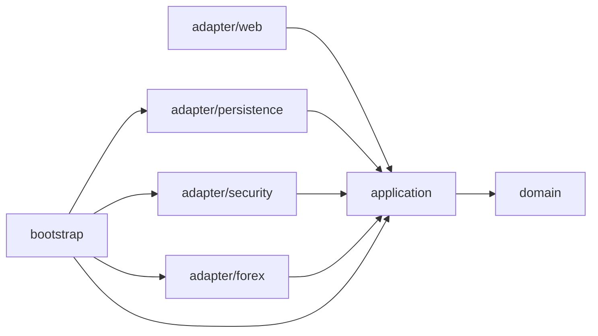
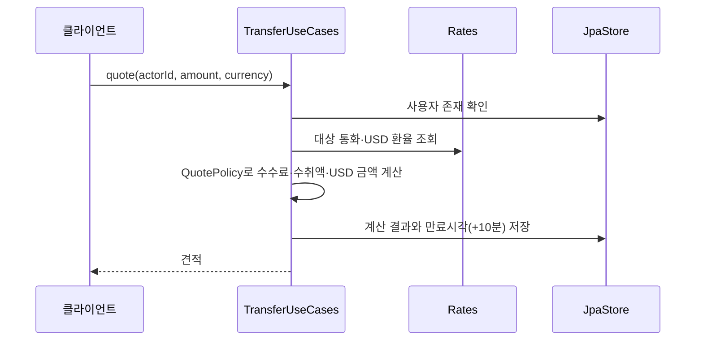
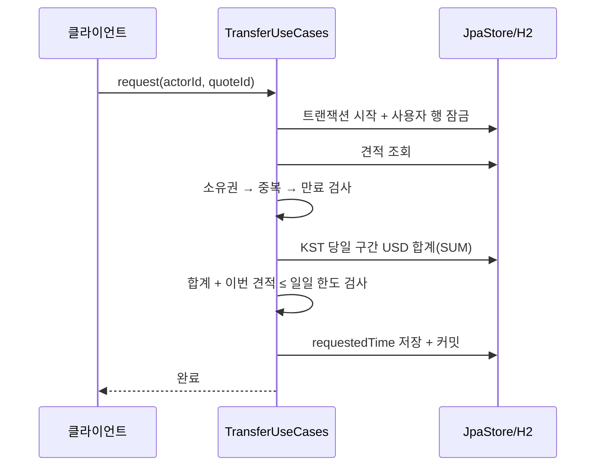
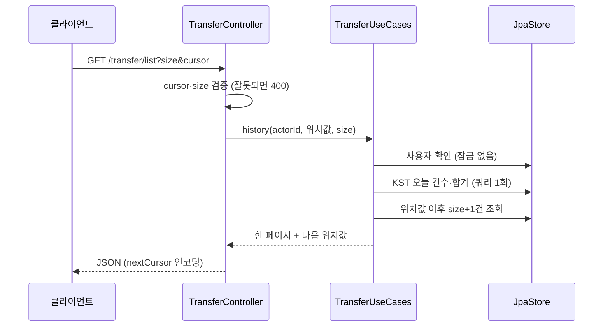

# 아키텍처

## 계층과 의존성 방향

내부 정책(domain, application)은 Spring·JPA·HTTP 구현을 모른다. 외부 어댑터가 application의 포트를 구현하거나 사용 사례를 호출하고, bootstrap이 객체를 조립한다. 의존성은 항상 바깥에서 안쪽으로 향한다.

| 계층 | 책임 | 대표 클래스 |
| --- | --- | --- |
| domain | 금액·수수료 계산, 견적 상태와 만료, 개인/법인 한도 | QuotePolicy, Quote, User, BusinessException |
| application | 사용 사례의 실행 순서, 시간 경계, 트랜잭션 포트 | UserUseCases, TransferUseCases, Ports |
| adapter/web | 입력 검증, 인증 사용자 변환, 커서 인코딩, JSON 응답과 오류 | UserController, TransferController, ApiModels, ApiExceptionHandler, JsonErrorController |
| adapter/persistence | JPA 모델 변환, 저장, DB 잠금, 트랜잭션 실행 | JpaStore, UserEntity, QuoteEntity, TransactionalWork |
| adapter/security | AES-GCM 암호화, JWT 발급·검증, 인증 필터 | AesIdentityCipher, JwtTokens, JwtAuthenticationFilter, SecurityConfiguration |
| adapter/forex | 설정 환율 공급 | ConfiguredRates |
| bootstrap | 의존성 주입, Clock 구성, BCrypt 비밀번호 해시 조립 | ApplicationConfiguration |

웹 DTO와 JPA entity는 domain으로 넘기지 않는다. Ports는 Accounts, Quotes, Rates, Passwords, IdentityCipher, Tokens, Work처럼 실제 기술 경계에만 둔다. Work의 구현(TransactionalWork)이 Spring의 TransactionTemplate을 사용하므로 트랜잭션 의존성이 application 밖에 머문다.

## 요청 흐름

### 인증

송금 API는 `Authorization: Bearer <token>`을 요구한다. JwtAuthenticationFilter가 서명과 만료를 확인하고 인증된 사용자 식별자를 컨트롤러에 전달한다. 요청 본문에는 사용자 식별자를 받지 않는다. 누락·잘못된·만료 토큰은 JSON 401이다.

### 견적 생성

견적은 환율·수수료·USD 환산액을 그 시점의 값으로 확정해 저장한다. 사용자 잠금은 필요 없다.

### 접수

접수는 견적 시점에 확정한 값을 그대로 쓰며 현재 환율로 다시 계산하지 않는다. 사용자 행 잠금이 합계 조회부터 저장까지를 감싸므로 같은 사용자의 접수끼리 직렬화된다.

### 이력 조회

목록은 `(접수시각, ID)` 내림차순 keyset 조건으로 size+1건을 읽어 다음 페이지 유무를 판단한다. 커서의 인코딩과 해석은 웹 어댑터가 맡고 application에는 `(Instant, long)` 위치값만 전달한다. 오늘 건수와 합계는 한 JPQL(count+sum)로 구하므로 서로 모순되지 않고 요청한 페이지와 관계없이 같다.

## 트랜잭션과 동시성 경계

| 작업 | 보호 수단 | 이유 |
| --- | --- | --- |
| 회원가입 | DB 유일 제약(`uk_users_user_id`) | 사전 중복 조회만으로는 동시 가입을 막을 수 없어 제약 위반을 DUPLICATE_USER로 변환 |
| 견적 생성 | 없음 | 서로 간섭하는 상태가 없다 |
| 접수 | 사용자 행 비관적 쓰기 잠금 | 같은 견적의 중복 접수와 서로 다른 견적의 합산 한도 초과를 함께 막음 |
| 이력 조회 | 없음 | 접수를 기다리거나 막지 않는다. 목록 한 번과 집계 한 번의 결과만 사용 |

왜 사용자 행을 잠그는지, 잠그지 않으면 어떤 경쟁이 생기는지는 [[주요 설계]]의 "동시성" 절에 있다.

잠금 대기는 `remittance.lock-timeout-ms`(기본 5000ms)로 제한한다. H2에서는 JDBC URL의 `LOCK_TIMEOUT`으로 적용된다. 초과하면 JpaStore가 업무 오류 LOCK_TIMEOUT으로 바꾸고 HTTP 503으로 응답하므로 클라이언트가 재시도할 수 있다. 타임아웃으로 커넥션이 끊겨 롤백까지 실패해도 TransactionalWork가 원래 업무 오류를 호출자에게 전달한다.

## 이력 조회 구조

- 정렬 키는 `(requestedTime desc, id desc)`이고 다음 페이지 조건은 `requestedTime < t or (requestedTime = t and id < lastId)`다. 정렬 키와 조건이 같아 페이지 사이에 새 접수가 생겨도 중복·누락이 없다.
- 인덱스 `idx_remittances_user_requested(user_id, requested_time)`로 사용자와 접수시각 범위를 좁힌다. 인덱스에 id는 없으므로 같은 시각 안의 id 비교와 정렬 보조는 인덱스 이후에 처리된다.
- 쿼리는 항상 인증된 사용자의 견적으로 제한된다. 커서는 정렬 위치일 뿐 권한 판단에 쓰이지 않는다.

## 저장 모델

- **users**: 순차 INT 식별자, 유일한 userId, BCrypt 비밀번호 해시, AES-GCM 암호화 식별번호, 신원 유형, 생성·수정 시각.
- **remittances**: 사용자 FK와 인덱스, 순차 INT 식별자, DECIMAL(22,12) 금액·환율·수수료 감사 값, 만료·생성·수정·접수 시각.
- `requestedTime`이 null이면 미접수 견적이고 이력과 집계에는 값이 있는 항목만 포함된다.
- 도메인 식별자는 long이지만 영속성의 INT 범위로 변환·검증한다. 저장은 UTC, API 표시는 KST다.

## 검증과 한계

ArchitectureTest는 컴파일된 domain/application의 프레임워크·어댑터 의존성을 검사한다. API 통합 테스트는 실제 H2, 인증, 동시 접수, 페이지 경계, Tomcat 오류 디스패치를 검사한다.

- 멱등성 키가 없어 타임아웃 뒤 재시도는 클라이언트가 이력으로 확인해야 한다.
- 직렬화는 단일 DB의 사용자 행 잠금에 의존한다. H2에서의 검증이 다른 운영 DB의 동작과 장애 복구를 보증하지 않는다.
- 이력의 목록과 오늘 집계는 별개 쿼리라 접수와 겹치면 두 결과의 시점이 다를 수 있다.
