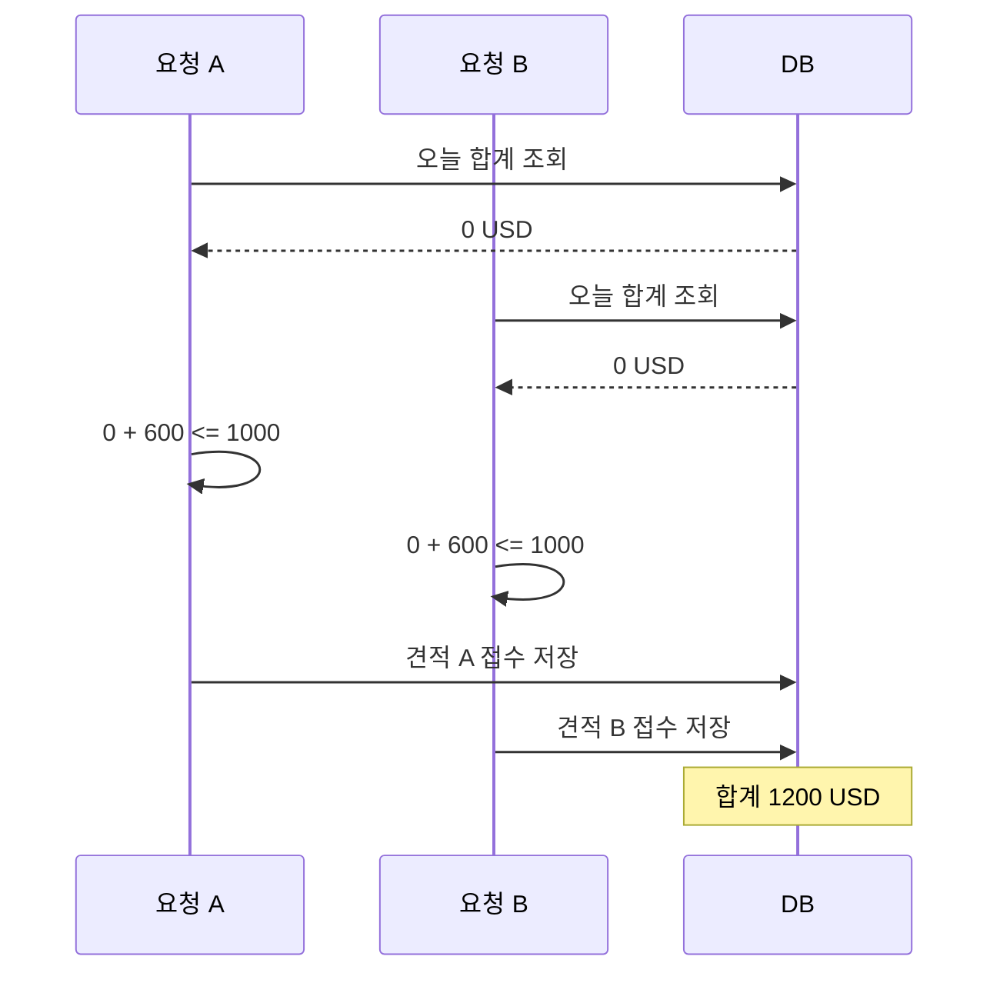
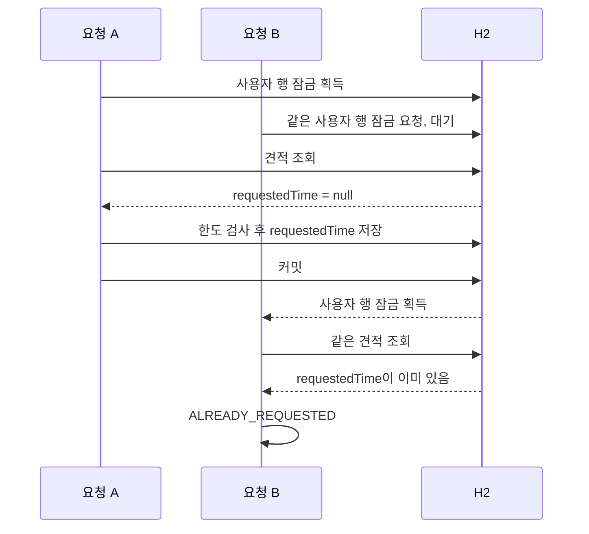
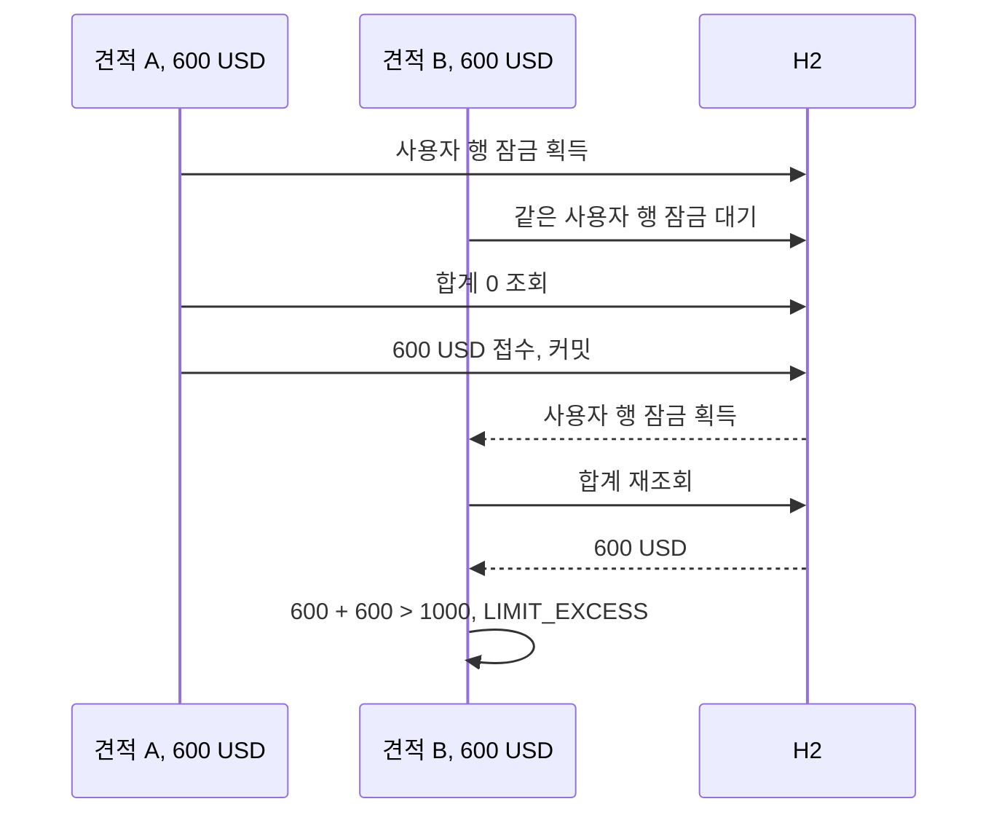
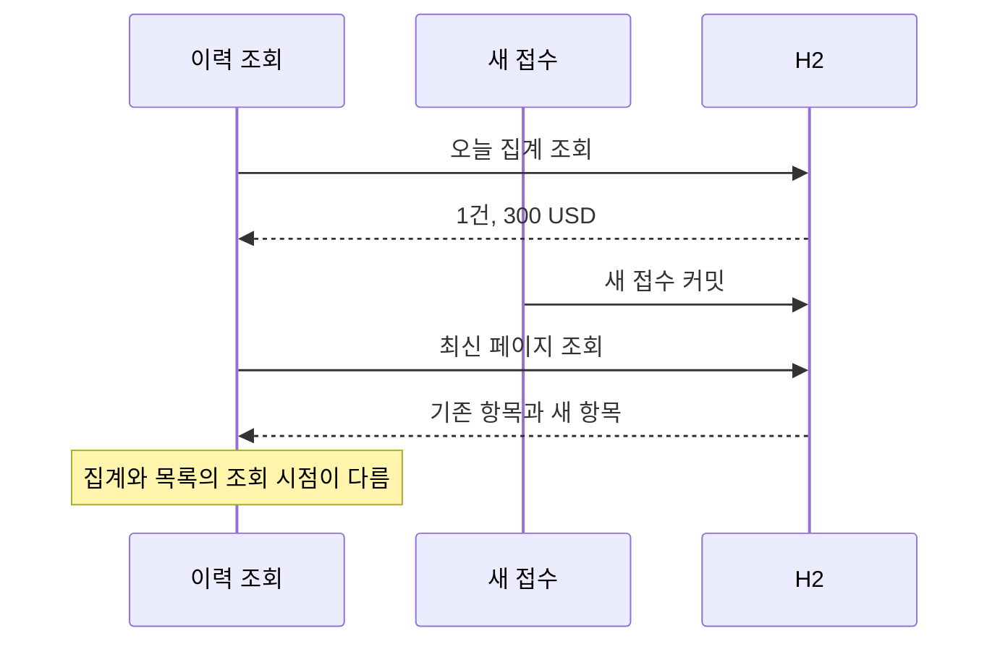

# 동시성과 멱등성

아래 실험·통과 기록은 기존 작업에서 얻은 근거이며 이번 문서 정리의 새 앱 실행 결과가 아니다.

관련 문서: [주요 설계](design.md) · [아키텍처](architecture.md) · [API](api.md). 현재 보장 대상은 DB의 견적 접수·일일 한도다. 금융기관 지급은 구현하지 않았다.

## 동시성: 보호할 상태와 경쟁 범위

접수는 한 행을 변경하지만, 판단에 필요한 상태는 견적과 사용자의 당일 접수 전체에 걸쳐 있다. 한 견적의 requestedTime은 중복 여부를 나타내고, 여러 견적의 usdAmount 합계는 일일 한도를 나타낸다. 따라서 견적 하나의 변경 충돌을 막는 것만으로 접수 규칙 전체를 보호할 수 없다.

| 경쟁 상황 | 함께 읽거나 변경하는 상태 | 필요한 결과 |
| --- | --- | --- |
| 같은 사용자·같은 견적을 동시 접수 | 동일 견적의 requestedTime | 한 요청만 성공, 나머지는 ALREADY_REQUESTED |
| 같은 사용자·서로 다른 견적을 동시 접수 | 서로 다른 견적과 같은 일일 합계 | 두 요청의 합산 결과까지 한도 이내 |
| 서로 다른 사용자가 접수 | 각자의 사용자 행과 일일 합계 | 동일 사용자 잠금으로 서로 직렬화하지 않음 |
| 같은 이메일로 동시 가입 | users의 userId | 한 계정만 저장, 나머지는 DUPLICATE_USER |
| 접수와 이력 조회가 겹침 | 접수 목록과 오늘 집계 | 접수용 잠금을 조회가 점유하지 않음, 조회 시점 차이는 허용 |

아래 시나리오는 모두 같은 인증 사용자 기준이다. 먼저 시작한 요청이 반드시 잠금을 먼저 얻는다고 가정하지 않는다. 설명의 A·B는 잠금 획득 순서를 나타내며 처리의 공정성이나 FIFO 순서를 보장하지 않는다.

### 잠금이 없으면: 검사와 저장 사이의 경쟁

기존 합계가 0, 개인 한도가 1000 USD이고 각각 순송금액 600 USD로 확정된 견적 두 개가 있다고 가정한다. 두 요청이 기존 합계를 동시에 읽으면 각 요청은 자신의 600 USD만 더해 통과한다. 저장이 끝난 뒤 합계는 1200 USD가 된다.

각 요청을 트랜잭션으로 감싸는 것만으로 이 경쟁이 사라지지는 않는다. 현재 사용하는 READ_COMMITTED에서 서로 다른 견적 행을 변경하는 두 요청은 같은 사용자 합계의 검사·저장 순서를 자동으로 맞추지 않는다. 하나의 사용 사례가 중간 상태로 저장되지 않게 하는 원자성과, 여러 사용 사례가 서로의 판단을 방해하지 않게 하는 동시성 제어를 함께 고려해야 한다.

### 실제 잠금 경계

TransferUseCases.request는 `@Transactional` 메서드 하나의 트랜잭션 안에서 아래 순서로 실행한다. 사용 사례는 CGLIB 프록시로 감싸져 메서드 진입 시 트랜잭션이 시작되고 예외로 끝나면 롤백된다.

1. `accountRepository.lockUser(actorId)`(`AccountRepository` 포트)로 사용자 행을 조회하며 `PESSIMISTIC_WRITE` 잠금을 요청한다.
2. 잠금을 얻은 후 견적을 조회한다. 먼저 조회해 둔 requestedTime으로 중복 여부를 판단하지 않는다.
3. Clock의 현재 시각을 읽는다. 키가 있고 현재 사용자 소유 견적이면 같은 사용자·키의 이전 접수를 조회한다. 같은 견적이고 접수 후 24시간 미만이면 변경 없이 즉시 성공 반환한다. 이 분기는 이후 중복·만료·일일 한도를 다시 검사하지 않는다. 타인 견적은 키 조회 없이 다음 소유권 검사로 보낸다.
4. 성공 재현이 아니면 `Quote.request`에서 소유권 → 중복 → 만료 순서로 검사한다.
5. 현재 시각의 KST 날짜로 당일 시작·익일 시작 Instant를 계산하고, 같은 사용자의 접수된 견적만 대상으로 DB SUM을 조회한다.
6. `기존 합계 + 이번 견적의 usdAmount > 한도`이면 LIMIT_EXCESS로 중단한다. 같으면 허용한다.
7. 접수 시각·갱신 시각·키를 저장하고 flush한다. 트랜잭션이 커밋되면 잠금을 해제한다.

flush는 변경 SQL을 DB에 보내는 단계이며 커밋과 다르다. flush 직후에 잠금을 풀고 뒤 요청이 읽게 하는 방식이 아니다. 정상적인 트랜잭션 종료에서 커밋 또는 롤백이 완료될 때 DB 잠금이 해제된다. 연결·DB 장애 시 정리는 DB 동작에 의존한다.

### 같은 견적을 두 번 접수하는 경우

뒤 요청은 중복 검사에서 종료되므로 새 접수 시각을 덮어쓰거나 일일 한도에 같은 거래를 두 번 더하지 않는다. 선행 요청이 접수 저장 전에 실패하고 정상 롤백됐다면 뒤 요청은 아직 미접수인 견적을 다시 판단한다. 선행 요청의 성공 여부와 뒤 요청의 성공 여부가 항상 같은 것은 아니다.

### 서로 다른 견적이 같은 한도를 사용하는 경우

견적 A와 B는 다른 행이지만 같은 사용자 행의 잠금을 공유한다. 뒤 요청이 다시 읽은 합계에는 앞 접수가 반영되므로 둘 다 기존 합계 0을 기준으로 성공하지 않는다. 두 견적의 합이 한도 이내라면 순서대로 둘 다 성공할 수 있다.

### 대기 중 만료 또는 KST 날짜 변경

현재 시각은 잠금을 얻고 견적을 조회한 뒤에 읽는다. HTTP 요청이 도착할 때 유효했어도 잠금 대기 중 만료됐다면 QUOTE_EXPRIED로 거부한다. 만료 시각과 정확히 같아도 만료다.

자정을 넘겨 잠금을 얻으면 그때 읽은 Clock의 KST 날짜로 한도를 집계하고 같은 시각을 requestedTime에 기록한다. 한 요청 안에서 집계 날짜와 접수 시각을 각각 다시 읽어 자정 양쪽으로 분리하지 않는다. 이 동작을 설명하는 것이며, 잠금 대기 중 자정·만료가 발생하는 조합 자체를 별도 회귀 테스트로 검증한 것은 아니다.

## 왜 사용자 행을 잠그는가

사용자 행은 일일 한도의 주체이며 가입 시 이미 존재한다. 당일 거래가 0건인 상태에서도 잠글 수 있고, 같은 사용자에 속한 모든 견적을 하나의 실행 순서로 묶을 수 있다. 날짜별 잠금 행을 별도로 생성하지 않아도 된다. 그만큼 서로 다른 날짜의 접수도 같은 사용자 행을 경유한다.

| 방식 | 이 서비스에서의 검토 포인트 |
| --- | --- |
| JVM synchronized·메모리 잠금 | 한 프로세스 안의 경쟁만 조정한다. 여러 인스턴스의 공통 잠금은 되지 않음 |
| 견적 행 잠금 또는 견적의 버전 검사 | 같은 견적의 중복은 다룰 수 있지만 서로 다른 견적의 일일 합계 경쟁은 남음 |
| 사용자 행 비관적 잠금 | 같은 사용자의 모든 접수를 묶어 한도와 중복을 함께 보호. 현재 구현 |
| 사용자·날짜별 집계 행의 버전/조건부 갱신 | 합계와 버전을 공통 충돌 지점으로 만들 수 있으나 신규 행 생성·갱신·재시도 정책이 필요 |
| SERIALIZABLE 격리 수준 | DB별 충돌 판정과 트랜잭션 재시도 정책을 확인해야 함. 현재 구현에 적용하지 않음 |
| 행 단위 CHECK·유일 제약 | 이메일 유일성에는 적합하지만 여러 접수 행의 합산 한도는 일반적인 행 제약만으로 표현하기 어려움 |

대안 표는 현재 설계와 비교한 설명이다. 각 방식을 구현하거나 성능 비교한 결과는 없다. 특히 낙관적 잠금 자체가 한도를 보호할 수 없는 것은 아니다. 어떤 공통 상태의 버전을 검사하고 충돌 시 무엇을 재시도하는지가 중요하다.

같은 사용자 요청은 잠금 보유 시간에 따라 처리량이 제한된다. 서로 다른 사용자에게 같은 행 잠금을 요청하지 않지만 커넥션 풀·CPU·DB IO·인덱스 등 공유 자원에서 기다릴 수 있다. 다른 사용자의 접수가 항상 즉시 처리된다고 보장하지 않는다.

현재 접수 경로는 사용자 행을 먼저 잠근 뒤 견적을 변경한다. 향후 견적·사용자·다른 자원을 여러 순서로 잠그는 경로가 생기면 교착 가능성과 잠금 순서를 재검토해야 한다. 현재 테스트는 교착 부하를 검증하지 않는다.

## 트랜잭션·격리 수준·집계의 관계

사용자 잠금은 접수 순서를 맞추고 트랜잭션은 그 잠금과 업무 변경의 수명을 묶는다. 한도 판정에는 잠금 획득 후의 집계가 앞 트랜잭션의 커밋된 접수를 읽는다는 조건도 필요하다.

현재 코드에서 접수 격리 수준을 별도로 지정하지 않았으며 H2와 PostgreSQL 16의 기본 READ_COMMITTED에서 확인했다. 잠금을 얻기 전에 만들어 둔 오래된 합계를 사용하지 않는다. 다른 DB로 옮기거나 REPEATABLE_READ 같은 격리 수준을 적용할 때는, 잠금 후 집계가 어떤 스냅샷을 읽는지 확인해야 한다. 격리 수준 이름만 같다는 이유로 동일한 행 잠금·조회 동작을 가정하지 않는다.

일일 합계는 `[KST 당일 00:00, 익일 00:00)`을 UTC Instant로 변환해 SUM으로 계산한다. 접수된 견적의 USD 2자리 반올림 값을 합산한다. 데이터가 없으면 0.00으로 정규화한다. SQL의 범위 조건과 Clock 기반 날짜 계산은 함께 맞아야 한다.

전체 이력을 읽는 방식보다 DB 집계는 전송량과 객체 생성을 줄인다. 잠금 구간 안에서 실행하므로 집계가 느려지면 뒤 접수의 대기도 길어진다. 데이터 양·인덱스·실행 계획에 따른 쿼리 시간과 잠금 보유 시간을 측정해야 하며, SUM을 쓴다는 이유로 일정 시간 처리나 성능 향상 수치를 주장하지 않는다.

한도와 중복은 모든 접수 변경 경로가 사용자 잠금을 거친다는 애플리케이션 규칙에 의존한다. DB가 합산 한도를 직접 강제하지 않는다. 향후 취소·수정·배치·관리자 처리 또는 별도 서비스에서 접수 상태를 바꾸면, 같은 사용자 잠금과 금액·날짜 정책에 참여시킬지 설계해야 한다.

## 회원가입의 동시성은 DB 유일 제약으로 처리

가입 전에 userId 존재 여부를 조회하지만 이 조회만으로 동시 가입을 막지 않는다. 두 요청이 모두 계정이 없다고 판단한 후 같은 이메일을 저장할 수 있기 때문이다. users의 userId 유일 제약이 최종 충돌 지점이다.

한 요청이 저장되고 다른 요청이 유일 제약 위반을 받으면 `JpaAccountRepository`가 DUPLICATE_USER로 변환한다(판별은 `PersistenceErrors.isUniqueViolation`). DB 진단에 이메일이 포함될 수 있어 원시 SQL 오류 로그를 차단한다. 사용자 접수 잠금과 이메일 유일 제약은 서로 다른 경쟁을 해결한다.

이메일은 사용 사례(UserUseCases)가 소문자(`Locale.ROOT`)로 정규화한 값으로 조회·저장하므로 대소문자만 다른 가입도 같은 유일 제약에 걸린다. 별도 `lower(user_id)` 함수형 인덱스는 두지 않았다(저장값 자체가 소문자라 기존 유일 제약으로 충분하며 H2·PostgreSQL 이식성을 유지한다). 기존 데이터는 V3이 소문자로 맞춘다. 로그인은 계정이 없어도 기동 시 임의 값으로 만든 더미 BCrypt 해시와 `matches`를 수행해, 응답 시간으로 계정 존재 여부를 추측하기 어렵게 한다(시간 동일성을 측정으로 증명하지는 않았고, 테스트는 비교 호출 여부만 확인한다).

## 이력 조회의 일관성

이력 조회는 접수용 사용자 쓰기 잠금을 잡지 않는다. 접수를 기다리는 조회나 조회 때문에 대기하는 접수를 줄이려는 선택이다. 이는 모든 DB 조회가 어떤 상황에서도 기다리지 않는다는 뜻은 아니다.

이력 조회는 `@Transactional(readOnly = true)`다. 다만 사용자·집계·목록 세 쿼리는 같은 트랜잭션에서 실행될 뿐, PostgreSQL 기본 격리(READ COMMITTED)에서는 쿼리마다 스냅샷이 달라 일관 스냅샷을 보장하지 않는다(REPEATABLE READ로 올리지 않았다). 한도 검사에 쓰는 접수 시점 합계와 이력의 오늘 합계는 같은 쿼리(`requestedDailyTotal`) 하나를 공유한다.

오늘 건수·USD 합계는 같은 집계 쿼리에서 읽는다. 페이지 크기·커서는 당일 전체 집계의 범위를 바꾸지 않는다. 페이지 목록은 다른 쿼리에서 읽으므로 아래와 같은 결과가 가능하다.

이력 응답 전체가 같은 DB 스냅샷이라는 계약은 없다. 여러 페이지를 읽는 동안 오늘 집계도 변할 수 있다. 접수 한도 판정은 이력 API 결과를 쓰지 않고, 접수 트랜잭션 안에서 사용자 잠금을 얻은 뒤 합계를 별도로 조회한다.

일관된 시점의 목록·집계가 필요해지면 격리 수준·스냅샷·조회 모델의 변경과 그에 따른 비용을 검토해야 한다. 현재 구현에 그런 보장을 추가한 것은 아니다.

## 잠금 실패·롤백·재시도

잠금 대기는 H2에서는 JDBC URL의 LOCK_TIMEOUT, PostgreSQL(기본)에서는 연결별 `SET lock_timeout`으로 제한한다. 기본값은 5000ms이며 REMITTANCE_LOCK_TIMEOUT_MS로 설정한다. 현재 H2 조합에서 JPA 잠금 timeout 힌트는 대기 한도 적용에 사용하지 않는다. 잠금 대기 초과는 `JpaAccountRepository`에서 업무 오류로 변환해 HTTP 503 LOCK_TIMEOUT을 반환한다.

현재 구현은 서버에서 자동 재시도하지 않는다. 잠금 대기 한도는 HTTP 전체 처리 시간의 상한도 아니다. 인증·커넥션 획득·조회·응답 처리 시간까지 포함해 5초 이내를 보장하는 설정으로 해석하지 않는다.

| 결정 | 이유 | 대가 |
| --- | --- | --- |
| LOCK_TIMEOUT 503과 DB_UNAVAILABLE 503에만 `Retry-After: 1`(고정 1초)을 붙인다 | 잠금은 보유 트랜잭션이 끝나면 풀려서 짧은 재시도가 의미 있고, 클라이언트가 즉시 재시도 폭주를 하지 않게 안내한다 | 실제 경합 시간을 반영한 값이 아니다. 재시도 한도·백오프는 클라이언트 몫이며 서버가 재시도를 보장하지 않는다 |
| `REMITTANCE_LOCK_TIMEOUT_MS`는 선행 0 없는 1~5자리 숫자(`[1-9][0-9]{0,4}`)이고 1~30000일 때만 받고 아니면 기동을 거부한다(DB 연결 전, EnvironmentPostProcessor) | 값이 H2 URL에 그대로 들어가므로 빈 값·문자가 섞이면 DB 접속 실패처럼 보이는 엉뚱한 오류가 난다. 상한은 대기 요청이 Tomcat 스레드와 DB 연결(풀 10개)을 오래 붙잡는 것을 막는다 | 30초를 넘기는 대기가 필요한 환경은 코드 수정이 필요하다. 상한 30000은 이 프로젝트의 판단이며 H2의 한계가 아니다 |
| 실패 안내는 FailureAnalyzer로 출력하고 입력값은 출력 안전하게 정리해(ASCII 20자) 보여 준다 | 원인과 조치를 `APPLICATION FAILED TO START`로 바로 알 수 있다. 값은 비밀이 아니지만 개행 등 로그 주입을 막는다 | 잘못된 값의 앞 20자만 보인다 |

| 상황 | 현재 처리 | 클라이언트가 주의할 점 |
| --- | --- | --- |
| 잠금 획득 실패 | 503 LOCK_TIMEOUT(`Retry-After: 1`), 해당 실행의 접수 저장에 도달하지 않음. 견적 저장이 외래키 공유 잠금에서 대기 초과해도 같은 503(PostgreSQL 16에서 관찰: 수정 전 500 UNKNOWN_ERROR) | 대기를 두고 재시도할 수 있지만 다시 만료·한도 검사 대상 |
| 잠금 후 업무 검사 실패 | ALREADY_REQUESTED·QUOTE_EXPRIED·LIMIT_EXCESS 등 | 무조건 재시도해 해결되는 오류가 아님 |
| 업무 예외 후 롤백도 실패 | RollbackSafeTransactionManager가 롤백 실패를 로그만 남기고 삼켜 원래 예외(BusinessException 포함)를 전달 | 오류 원인 유지와 DB 복구 확인은 별개 |
| 커밋 후 응답 유실 | 클라이언트는 성공 여부를 알 수 없음 | 같은 Idempotency-Key로 재요청하면 24시간 미만이면 200이 재현된다. 키가 없었다면 이력으로 확인 |

`@Transactional`을 쓰고 기본 `JpaTransactionManager` 기준으로 롤백 자체가 예외를 던지면 그 예외가 원래 업무 예외를 덮는다. 전환 중에 H2 락 타임아웃 테스트가 503이 아니라 500으로 깨지는 것이 관찰됐고(개발 중 관찰, 현재 코드로는 재현되지 않는다), 롤백이 실패하게 만든 결정적 재현 테스트(Mockito 대역 EntityManagerFactory)에서는 호출자가 원래 `BusinessException`이 아니라 `JpaSystemException`을 받는다. PostgreSQL 16에서는 트랜잭션 도중 DB가 연결을 끊게 해 같은 현상을 직접 재현했다(아래 PostgreSQL 프로파일의 롤백 실패 행). 다른 DB에서 일반적으로 나타나는지까지는 단정하지 않는다. 그래서 JpaTransactionManager를 상속한 `RollbackSafeTransactionManager`가 `doRollback`의 RuntimeException을 삼키고 예외 클래스명·SQLState만 WARN으로 남긴다. 이전 `TransactionalWork`는 `BusinessException`만 보존하고 그 외 예외에서는 롤백 예외를 던졌지만, 현재 방식은 모든 원래 예외를 보존한다. 롤백 실패를 삼키는 것이므로 커넥션 상태가 불확실한 채 풀에 반환될 수 있다. PostgreSQL 16에서 끊긴 연결로는 반환 후 점유 연결이 0이고 이후 풀이 복구됨을 확인했지만, 끊김 이외의 롤백 실패 원인은 확인하지 않았다. 이 처리가 롤백 재시도나 커밋 결과 조회까지 수행하지는 않는다.

회원가입·로그인은 메서드 전체 트랜잭션을 열지 않는다. BCrypt 동안 DB 연결을 점유하지 않도록 조회 연결을 반납하고, 가입 저장만 `JpaAccountRepository.saveUser`의 짧은 트랜잭션으로 처리한다. 계정 문자열 조회는 스트림을 읽는 동안만 읽기 전용 트랜잭션을 연다. 사전 중복 조회 이후의 경쟁은 DB 유일 제약이 최종 방어한다. 자세한 변경 당시 측정은 [개선 기록](../harness/tasks/review-fixes-1.md)에 남긴다.

### 멱등성 키

재현 기간은 접수 시각부터 24시간 미만이다. 정확히 24시간부터 같은 견적은 ALREADY_REQUESTED이며, 기간이 지나도 키의 귀속은 유지돼 다른 견적에 재사용할 수 없다. 재현도 JWT 인증이 필요해 장시간 뒤에는 같은 사용자로 재로그인해야 한다.

키 없이 같은 견적을 재요청하면 ALREADY_REQUESTED를 받는데, 이것만으로는 "내 첫 요청이 성공했다"와 "다른 요청이 먼저 처리됐다"를 구분할 수 없다. 그래서 접수에 선택적 `Idempotency-Key`를 둔다.

| 결정 | 이유 | 대가 |
| --- | --- | --- |
| 키를 접수된 견적 행에 저장하고 (사용자, 키) 유일 제약을 둔다 | 한 견적은 한 번만 접수되므로 키 저장소를 따로 두지 않아도 된다. 만료 정리 작업도 없다 | 실패 응답은 저장하지 않는다. 재현되는 것은 성공뿐이다 |
| 키 조회를 기존 사용자 행 잠금 안에서 한다 | 같은 키의 동시 요청이 직렬화되어 뒤 요청이 앞 요청의 커밋을 보고 재현으로 끝난다 | 접수 직렬화의 처리량 한계를 그대로 따른다 |
| 같은 키·같은 견적이면 재현 시 만료·한도를 다시 평가하지 않는다 | 이미 성공한 건의 재현이다. 다시 평가하면 성공한 요청이 실패로 바뀐다 | 재현은 24시간 창(접수 시각 기준)으로 한정한다 |
| 같은 키·다른 견적은 422로 거부한다 | 클라이언트 버그 신호다. 조용히 둘 중 하나를 받으면 의도하지 않은 송금이 생길 수 있다 | 키는 그 견적에 영구히 묶인다(창이 지나도 다른 견적에 재사용할 수 없다) |
| 실패한 시도는 키를 소비하지 않는다 | 한도 초과나 잠금 타임아웃 뒤의 재시도는 새로 평가되어야 한다 | 실패 응답을 그대로 재현해 주지 않는다 |

유일 제약은 잠금 밖에서 쓰기가 일어나는 예외 상황의 최종 방어이며, 위반은 IDEMPOTENCY_KEY_REUSED로 변환한다. 키는 요청 본문이 아니라 헤더로 받고 `[A-Za-z0-9._~-]{1,64}`로 제한한다. 키 없는 호출은 이전과 같다.

검증하지 않은 것: 유일 제약 위반을 IDEMPOTENCY_KEY_REUSED로 바꾸는 최종 방어는 잠금 때문에 정상 경로에서 도달하지 않아 직접 테스트하지 않았다. 변환은 SQLState 23505(H2·PostgreSQL)에 기대므로 다른 DB로 옮기면 다시 확인해야 한다. 기존 파일 DB에 이 컬럼과 제약을 추가하는 경로는 [스키마 마이그레이션](design.md#스키마-마이그레이션) 절에서 실제 DB 파일로 확인했다.

보장하지 않는 것: 요청 본문 전체의 동일성은 비교하지 않는다(견적 ID만 비교한다). 키 없이 이미 접수된 견적에 새 키를 붙여 보내도 재현이 아니라 ALREADY_REQUESTED다. 실제 지급 연동에는 외부 요청과 DB 기록 사이의 중복·실패 처리가 별도로 필요하다.

## 동시성 테스트가 확인하는 범위

| 테스트 | 재현 방식과 확인 내용 |
| --- | --- |
| concurrentSameQuoteIsAcceptedExactlyOnce | 같은 견적을 두 스레드에서 접수. OK 한 번·ALREADY_REQUESTED 한 번, 오늘 접수 한 건 확인 |
| concurrentDifferentQuotesCannotJointlyExceedDailyLimit | 합산하면 한도를 넘는 서로 다른 견적을 두 스레드에서 접수. OK 한 번·LIMIT_EXCESS 한 번, 결과 합계 한도 이내 확인 |
| concurrentSignupPreservesUniqueUserAndDoesNotLogEmail | 같은 이메일 동시 가입의 단일 저장·중복 오류와 이메일 로그 미노출 확인 |
| concurrentSameKeyAndQuoteSucceedsTwiceButEffectsOnce | 같은 키·같은 견적 동시 요청 둘 다 OK, 접수 한 건과 합계 한 번 반영 확인 |
| concurrentSameKeyDifferentQuotesAcceptsOnlyOne | 같은 키·다른 견적 동시 요청에서 하나만 접수, 다른 하나는 IDEMPOTENCY_KEY_REUSED |
| lockWaitTimeoutIsBusinessErrorAndRecoversAfterRelease | 별도 트랜잭션이 사용자 행을 잠근 상태에서 HTTP 요청. 503과 시간 제한, 잠금 해제 후 동일 견적의 정상 접수 확인 |
| historyIsNotBlockedByUserRowLock | 사용자 행 잠금 보유 중 이력 호출. 기존 목록·집계 반환과 제한된 테스트 시간 내 완료 확인 |
| dailyTotalWindowIsHalfOpenAtKstMidnight | KST 자정 전후 거래를 분리하고 당일 합계가 한도 판단에 사용되는지 확인 |
| newRequestBetweenPagesDoesNotRepeatReceivedItems | 페이지 사이 새 접수 후, 다음 페이지에서 이미 받은 항목이 반복되지 않는지 확인 |

동시 접수 테스트는 실행 시작을 맞춘 두 작업의 결과를 확인한다. 모든 스레드 스케줄을 탐색하거나 요청별 SQL 순서를 계측한 증거는 아니다. 잠금 대기 테스트는 별도 트랜잭션이 실제 행 잠금을 획득한 뒤 접수·이력 호출을 실행한다.

이 테스트들은 H2에서의 회귀 근거이며, 같은 시나리오 일부를 PostgreSQL 16에서도 재현했다(아래 PostgreSQL 프로파일 절). 이 절의 H2 테스트만으로 고부하·장시간 경쟁·교착·프로세스 종료·DB 재시작·네트워크 분리·다중 인스턴스를 검증한 것은 아니다. PostgreSQL과 k6의 후속 근거는 아래 PostgreSQL 절과 [검증 범위](../portfolio/validation.md)에 구분했다. 정확한 한도·만료·날짜 테스트와 잠금 대기 테스트가 각각 존재해도, 모든 경계와 대기의 조합을 검증한 것으로 확대하지 않는다.

운영 DB나 실제 지급으로 확장할 때는 잠금 획득·해제, 격리 수준의 읽기 스냅샷, 타임아웃 예외 변환, 커밋 결과 확인, 재시도 정책과 멱등성 범위를 해당 환경에서 다시 검증해야 한다. 후속 PostgreSQL 테스트는 같은 JVM의 독립 앱 컨텍스트 2개에서 확인했지만, 별도 프로세스·호스트 운영 검증을 완료한 것은 아니다.

## PostgreSQL 프로파일

핵심 주장(사용자 행 잠금으로 동시 접수를 직렬화해 일일 한도를 지킨다)을 처음에는 embedded H2에서만 검증했다. 운영 DB 후보인 PostgreSQL에서 같은 주장을 확인하기 위해 먼저 그 DB로 앱이 뜨고 스키마가 맞게 했고(1단계), 이어서 동시성·락 타임아웃·연결 끊김 복구를 검증했다(2단계).

| 결정 | 이유 | 대가 |
| --- | --- | --- |
| 기본 실행을 PostgreSQL로 바꾸고(`spring.profiles.default: postgres`) H2는 프로파일을 지정할 때(`h2`·`local`·`test`)만 쓴다. 로컬 DB는 `docker-compose.yml`로 구성한다 | 검증한 운영 DB 후보로 개발·실행해 H2와 PostgreSQL의 차이를 줄인다. `./data` 파일 DB·H2 테스트·기존 H2 설정은 그대로 보존한다 | 기본 실행에 Docker와 DB 비밀번호가 필요하다. 프로파일을 지정하면 기본값이 대체되므로 `local`만 지정하면 H2로 실행된다. 두 DB의 스키마 SQL을 따로 유지해야 한다 |
| PostgreSQL 전용 마이그레이션을 `db/postgresql/migration`(H2 폴더의 형제)에 둔다 | H2 문법(`ENUM`, `ADD CONSTRAINT IF NOT EXISTS`)이 PostgreSQL에서 안 된다. 하위 폴더는 Flyway가 함께 읽어 방언이 섞인다 | V1/V2가 두 벌이라 새 변경은 양쪽에 같은 번호로 추가해야 한다 |
| `ENUM`을 `VARCHAR + CHECK`로 옮기고 새 DB 전용(`IF NOT EXISTS` 없음)으로 쓴다 | 같은 값 제한을 유지하고, 이력 없이 객체가 이미 있는 DB를 조용히 인수하지 않고 충돌로 실패시킨다 | 기존 PostgreSQL DB를 가져오려면 별도 절차가 필요하다 |
| 잠금 대기 한도를 연결 초기화 SQL `SET lock_timeout`으로 적용한다 | H2의 URL `LOCK_TIMEOUT`과 같은 역할이다. 값은 기동 시 1~30000 정수로 검증되어 SQL에 안전하다 | 풀에서 만든 모든 연결에 설정되지만 사용자가 직접 연결을 열면 적용되지 않는다 |
| PostgreSQL 테스트는 태그 `postgres`와 `postgresTest` 태스크로 분리한다 | Docker 없는 환경에서도 기본 `check`가 통과한다 | 기본 검증만으로는 PostgreSQL 경로가 확인되지 않는다. Docker가 없으면 건너뛰지 않고 실패한다 |

기존 작업에서 확인한 것: Testcontainers의 PostgreSQL 16에서 V1·V2가 적용되고 `ddl-auto: validate`를 통과했으며, 풀 연결의 `lock_timeout`이 설정값이고, 가입·로그인·견적·접수·이력 조회·키 재현(200)·키 없는 재접수(409)가 H2와 같은 계약으로 동작했다. 같은 흐름을 실제 컨테이너에 jar로 띄워 수동으로도 확인했다.

2단계에서 PostgreSQL 16(Testcontainers)에 대해 직접 확인한 것(`postgresTest`, 단일 앱 프로세스, 6스레드, 반복 실행에서 매번 통과):

| 시나리오 | 결과 |
| --- | --- |
| 같은 견적을 동시에 접수 | 성공 1건, 나머지 `ALREADY_REQUESTED`, DB 접수 행 1건 |
| 한도를 넘는 서로 다른 견적 6개를 동시에 접수(건당 398.2 USD, 한도 1000) | 정확히 2건 성공, 4건 `LIMIT_EXCESS`, 오늘 합계 796.4 |
| 같은 `Idempotency-Key`·같은 견적 동시 요청 | 모두 200, 효과는 1회(접수 행·접수 시각 하나) |
| 같은 키·다른 견적 6개 동시 요청 | 1건 성공, 나머지 422 `IDEMPOTENCY_KEY_REUSED` |
| 다른 연결이 사용자 행을 `FOR UPDATE`로 잡은 채 접수 | 설정 한도(2000ms) 후 503 `LOCK_TIMEOUT`과 `Retry-After: 1`(측정 약 2.03초). 해제 후 같은 키 요청이 200, 타임아웃된 시도는 접수 시각·키를 남기지 않음 |
| 별도 JDBC 연결이 같은 행을 `lock_timeout` 500ms로 `FOR UPDATE` | PostgreSQL이 실제로 SQLState `55P03`을 냄. 코드(`PersistenceErrors.isLockTimeout`)가 기대하는 값임을 직접 확인한 것이며, 앱 경로에서 어느 매핑 분기(JPA 예외 또는 SQLState)로 변환됐는지까지는 구분해 확인하지 않았다 |
| 위와 같은 잠금 중 이력 조회 | 1초 안에 200(읽기는 쓰기 잠금에 막히지 않음. PostgreSQL 기본 격리 수준(READ COMMITTED)에 의존) |
| 트랜잭션 도중 DB가 그 연결의 백엔드를 종료(`pg_terminate_backend`)해 JDBC 롤백이 실패(WARN에 `DataAccessResourceFailureException`, SQLState `57P01`) | 호출자는 원래 `BusinessException`(LOCK_TIMEOUT)을 받음. 같은 트랜잭션의 가입 쓰기는 남지 않음, 트랜잭션 리소스 정리, 점유 연결 0, 이후 풀 복구. 대조로 보존 장치 없는 기본 `JpaTransactionManager`는 같은 상황에서 원래 예외를 덮음(3회 반복 모두 통과) |
| DB가 앱의 모든 연결을 끊음(`pg_terminate_backend`) | 끊긴 직후 첫 요청은 `Retry-After: 1`이 붙은 503 `DB_UNAVAILABLE`(원인 SQLState `57P01`)이고 재시도에 200으로 복구. 실패한 시도는 부분 상태를 남기지 않고 같은 키 재시도는 효과 1회. 이 매핑 도입 전에는 같은 시나리오의 첫 요청이 500(`UNKNOWN_ERROR`)이었다 |

연결 끊김 뒤의 첫 실패는 풀이 직전 500ms 안에 쓴 연결의 생존 확인을 건너뛰어(Hikari aliveBypassWindow) 끊긴 연결을 처음 사용할 때 알게 되는 동작이다. 이 실패를 없애지는 않고 500 대신 재시도 가능한 503 `DB_UNAVAILABLE`로 알린다(`ApiExceptionHandler`가 원인 연쇄의 SQLState 08xxx(08P01 프로토콜 위반 제외)·57P01~03과 JDBC 연결 예외로 판별. 잠금 대기·제약 위반은 제외). 비용: 판별이 SQLState 기반이라 다른 DB·드라이버에서는 확인이 필요하고, 커밋 도중 연결이 끊겨 결과가 불확실한 경우도 같은 503이 되므로 클라이언트는 `Idempotency-Key`로 재시도해야 한다. 첫 실패 자체를 없애려면 생존 확인 창이나 서버 측 재시도를 별도로 설계해야 한다.

후속 검증은 다음처럼 범위를 넓혔다. 각 작업 기록의 당시 미검증 항목은 이력으로 남기며 현재 범위는 이 설명을 따른다.

| 후속 실험 | 확인한 내용 | 한계 |
| --- | --- | --- |
| 독립 앱 컨텍스트 2개 | 별도 HTTP 서버·풀에서 같은 견적·한도·키 동시 접수, DB 행·합계와 JWT 호환 확인 | 같은 JVM, 같은 키 설정. 별도 프로세스·호스트·동시 Flyway 기동 아님 |
| 재시작·폭주·풀 고갈 | 정상 재시작 후 앱 재기동 없이 복구, 풀 3·32스레드의 중복·한도, 별도 풀 고갈 503 | 폭주 자체에서는 503 미관찰. 운영 용량 한계 탐색 아님 |
| SIGKILL·pause | DB 강제 종료·무응답 뒤 복구, 부분 상태 없음, 같은 키 재시도 | pause는 네트워크 단절 자체가 아님 |
| Toxiproxy | 블랙홀·리셋·disable·지연에서 503 또는 정상 처리와 복구 | 로컬 TCP 프록시, 실제 인터넷 전체 장애 유형 아님 |
| COMMIT 전·후 결함 주입 | 미도달 0행과 커밋 후 응답 유실 1행을 직접 DB 조회, 같은 키 재시도 뒤 접수·합계 1회 | COMMIT 한 지점, 단일 앱·PostgreSQL 16 |

pause 실험은 풀 연결 획득 제한만으로 기존 연결의 읽기 대기를 제한할 수 없음을 드러냈다. `socketTimeout`을 기본 60초로 도입하고 잠금 대기 한도보다 크게 시작 시 검증한다. 테스트 4초에서 무응답 요청이 약 4초 후 503으로 끝났다. 이 설정은 개별 읽기의 제한이어서 여러 읽기 지연을 합친 HTTP 전체 처리 시간은 더 길 수 있다. [소켓 타임아웃 결정](../decisions/db-socket-timeout.md)에 선택과 비용을 기록했다.

커밋 응답 유실에서는 503을 받아도 DB는 커밋했을 수 있다. 테스트용 프록시가 COMMIT 전송 전 또는 서버 응답 폐기 시점에 연결을 끊으며, 커밋 여부의 근거는 응답 추측이 아닌 별도 DB 조회다. 클라이언트는 처음부터 사용한 같은 키·견적으로 재시도해야 한다. 기존 멱등성 설계로 24시간 미만의 성공 응답을 재현하며 부분 쓰기나 이중 한도 반영 없이 수렴함을 확인했다.

로컬 k6 램프업·스파이크·2시간 소크는 응답 계약과 지연 추이를 관찰했다. DB 행·합계 직접 단언은 통합 테스트가 맡고, think time이 있는 단일 앱의 부하 수치를 최대 처리량으로 해석하지 않는다. [검증 범위](../portfolio/validation.md)에 명령·수치·한계를, [대표 사례](../portfolio/case-studies.md)에 수정 전후를 정리했다.

여전히 보장하지 않는 것: 교착, 별도 프로세스·호스트 장애, 다른 PostgreSQL 버전·관리형 서비스, 운영 규모·수 일 부하. 롤백 실패는 연결 종료로 만든 원인만 검증했고 다른 원인은 확인하지 않았다.
