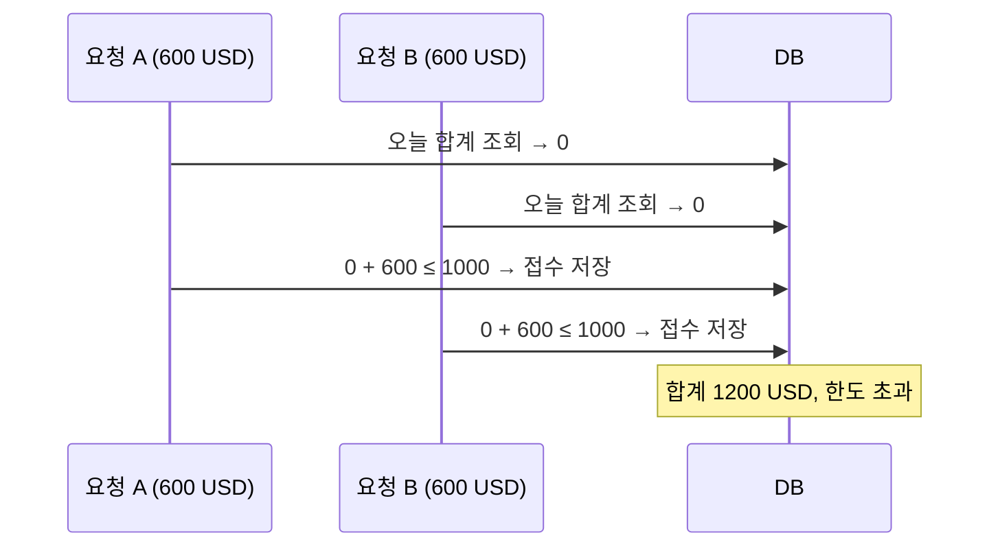
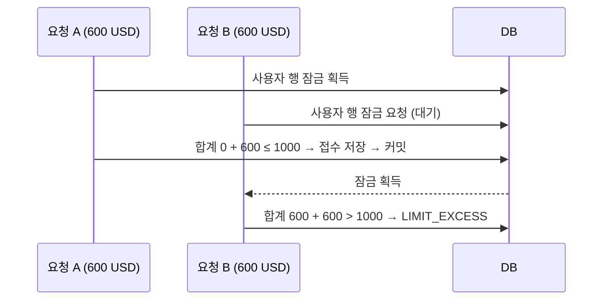

# 주요 설계

송금은 한 번 잘못 기록되면 되돌리기 어려운 금융 도메인이다. 잘못된 금액, 두 번 처리된 접수, 한도를 넘은 거래는 사후에 고치기보다 **처음부터 만들어지지 않게** 설계했다. 이 문서는 먼저 지켜야 할 정합성 규칙(불변식)과 동시 요청에서 이를 지키는 방법을 설명하고, 그 뒤에 세부 결정을 "결정 → 이유 → 대가" 순서로 적는다.

## 설계 우선순위

1. **틀린 금액을 만들지 않는다.** 계산은 십진수로, 반올림 규칙은 한 곳에 고정한다.
2. **같은 요청이 두 번 반영되지 않는다.** 한 견적은 최대 한 번만 접수된다.
3. **동시 요청이 규칙을 깨지 못한다.** 동시에 들어와도 일일 한도와 유일성은 지켜진다.
4. **일부만 반영되지 않는다.** 한 사용 사례는 전부 반영되거나 전혀 반영되지 않는다.
5. **실패를 정직하게 알린다.** 실패의 종류를 구분해 알리고, 모르는 원인은 노출하지 않는다.

## 정합성 불변식

각 불변식이 어떤 상황에서 깨질 수 있고, 무엇이 막고, 어떤 테스트가 확인하는지를 한눈에 정리한다.

| 불변식 | 깨질 수 있는 상황 | 방어 수단 | 확인하는 테스트 |
| --- | --- | --- | --- |
| 한 견적은 최대 한 번만 접수된다 | 같은 견적을 동시에 또는 재요청 | 사용자 행 잠금 + 잠금 안에서 `requestedTime` 재확인 | `concurrentSameQuoteIsAcceptedExactlyOnce` |
| KST 하루 순송금 USD 합계는 한도를 넘지 않는다 (개인 1000, 법인 5000, 같으면 허용) | 서로 다른 견적이 동시에 접수되며 같은 합계를 읽음 | 같은 잠금 안에서 합계 조회 → 검사 → 저장 | `concurrentDifferentQuotesCannotJointlyExceedDailyLimit`, `personalAndBusinessLimitsAreInclusiveAndCentBeyondIsRejected` |
| userId는 유일하다 | 같은 이메일로 동시 가입 | DB 유일 제약 + 제약 위반을 `DUPLICATE_USER`로 변환 | `concurrentSignupPreservesUniqueUserAndDoesNotLogEmail` |
| 접수 금액은 견적 때 확정한 값이다 | 견적 후 환율 변동, 접수 때 재계산 | 환율·수수료·USD 금액을 견적에 저장하고 접수는 상태만 변경 | `completeFlowPersistsProtectedIdentityAndImmutableFinancialAudit` |
| 금액 계산은 정확하다 | 부동소수 오차, 반올림 불일치, 저장 범위 초과 | BigDecimal, HALF_UP, 통화별 자릿수, DECIMAL(22,12) 범위 검사 | `QuotePolicyTest` |
| 본인 견적만 접수한다 | 타인의 견적 ID 사용 | 인증 사용자 기준 소유권 검사 | `foreignOwnerAndUnknownQuoteCannotRequestThenDuplicateIsRejected` |
| 만료·자정 경계가 정확하다 | 만료 순간, KST 자정 전후 | 주입된 Clock, 만료 시각 이상은 만료, 하루를 `[00:00, 익일 00:00)` 반개구간으로 계산 | `quoteExpiresAtExactTenMinutesAndNeverCountsAsRequested`, `kstDayResetsDailyTotalsWhileHistoryIncludesPriorRequests`, `dailyTotalWindowIsHalfOpenAtKstMidnight` |
| 한 사용 사례는 전부 또는 전무다 | 실행 중 예외, 잠금 타임아웃 | 사용 사례 단위 트랜잭션, 예외 시 롤백 | `lockWaitTimeoutIsBusinessErrorAndRecoversAfterRelease` (타임아웃 뒤 상태가 남지 않음을 간접 확인) |

## 동시성: 무엇이 경쟁하고 어떻게 막는가

### 핵심 위험: 검사 후 실행(check-then-act)

일일 한도는 "기존 합계를 읽고, 이번 금액을 더해도 한도 이내인지 검사하고, 접수를 저장한다"는 세 단계다. 두 요청이 이 세 단계를 겹쳐 실행하면 둘 다 같은 기존 합계를 보고 각자 한도 이내라고 판단한다. 예를 들어 한도 1000 USD에서 각각 600 USD인 서로 다른 두 견적이 동시에 접수되는 경우다.

**잠금이 없을 때**: 둘 다 통과해 합계 1200 USD가 접수된다.

**사용자 행 잠금을 쓸 때**: 같은 사용자의 접수는 한 번에 하나만 실행되어 뒤 요청은 앞 요청이 커밋한 결과를 보고 판단한다.

같은 원리로 같은 견적의 중복 접수도 막는다. 뒤 요청은 잠금을 얻은 뒤 앞 요청이 커밋한 `requestedTime`을 보고 `ALREADY_REQUESTED`를 받는다.

### 설계 규칙

- **직렬화 지점은 견적이 아니라 사용자다.** 한도는 사용자의 모든 견적에 걸친 합계라서 견적 하나만 잠그면 서로 다른 견적 사이의 경쟁을 막지 못한다.
- **한도 판단은 항상 잠금 안에서만 한다.** 합계 조회부터 저장까지가 잠금 하나로 감싸여 있고, 잠금을 얻은 뒤의 조회는 앞 트랜잭션이 커밋한 최신 데이터를 본다.
- **잠금 구간을 짧게 유지한다.** 합계는 이력 전체를 읽지 않고 KST 당일 구간만 DB의 SUM으로 구한다.
- **대가는 처리량이다.** 같은 사용자의 접수끼리는 직렬화되어 처리량이 떨어진다. 다른 사용자의 접수는 서로 기다리지 않는다.
- **견적 생성과 이력 조회는 잠그지 않는다.** 서로 간섭하는 상태를 바꾸지 않거나 읽기 전용이다.

### 다른 방식으로 막을 수 있는가 (분석)

과거에 비교해 결정한 기록은 "메모리 잠금은 다중 인스턴스에 한계가 있어 DB 잠금을 선택했다"는 하나다. 아래는 지금 시점에서 정리한 분석이다.

| 방식 | 한계 |
| --- | --- |
| JVM 메모리 잠금 | 인스턴스가 둘 이상이면 서로의 잠금을 알지 못한다. 공유 DB의 행 잠금이 인스턴스 밖의 직렬화 지점이다 |
| 견적 행만 잠금/버전 검사 | 같은 견적의 중복 접수는 막지만 서로 다른 견적의 합산 한도 경쟁은 막지 못한다 |
| DB 제약으로 한도 강제 | "합계 ≤ 한도"는 일반적인 행 단위 제약으로 표현할 수 없다 |
| 직렬화 격리 수준 | 모든 트랜잭션의 동작과 재시도에 영향을 주고 DB 구현에 크게 의존한다 |

## 읽기 일관성

- **한도 판단은 읽기 일관성에 의존하지 않는다.** 잠금 안에서만 하기 때문이다.
- **이력 조회는 표시용 읽기다.** 잠금을 잡지 않으므로 접수를 막지 않는다. 오늘 건수·합계는 한 쿼리로 구해 서로 모순되지 않고 요청한 페이지와 관계없이 같다. 다만 목록과 집계는 별개 쿼리라 접수와 겹치면 두 결과의 시점이 다를 수 있다. 이 차이는 화면 표시에만 영향을 주고 돈의 이동이나 한도 판단에는 영향을 주지 않는다.
- **트랜잭션 격리 수준은 코드에서 따로 지정하지 않았다.** H2의 기본값(READ_COMMITTED)을 쓴다. 잠금을 얻은 뒤의 조회가 커밋된 최신 값을 보는 동작에 의존하므로 다른 DB로 옮기면 이 가정을 다시 확인해야 한다.

## 장애와 재시도

- **잠금 대기 한도**: 대기는 `remittance.lock-timeout-ms`(기본 5000ms)로 제한하고, 초과하면 503 LOCK_TIMEOUT으로 응답한다. 500 UNKNOWN_ERROR로 보이면 클라이언트가 재시도해도 되는지 알 수 없기 때문이다. H2에서 `jakarta.persistence.lock.timeout` 힌트는 무시되어 한도를 JDBC URL의 `LOCK_TIMEOUT`으로 적용한다. 다른 DB로 옮기면 그 DB의 잠금 대기 설정을 다시 해야 한다.
- **롤백 실패**: 타임아웃으로 커넥션이 끊겨 롤백까지 실패하면 원래 업무 오류가 가려진다. TransactionalWork가 이때 원래 업무 오류를 호출자에게 전달한다.
- **타임아웃은 상태를 남기지 않는다.** 트랜잭션이 롤백되므로 접수가 절반만 반영되지 않고, 잠금이 풀린 뒤 같은 요청이 정상 접수된다.
- **멱등성 키가 없다.** 응답을 받지 못한 재시도는 이미 성공했다면 `ALREADY_REQUESTED`를 받는다. 접수 여부는 이력으로 확인해야 한다.

## 이 설계가 보증하지 않는 것

- **한도와 중복 방지는 애플리케이션 수준의 불변식이다.** 모든 접수 경로가 사용자 행 잠금을 거친다는 약속에 기대며, DB가 강제하지 않는다. 잠금 없이 접수를 변경하는 경로를 추가하면 깨질 수 있다. 낙관적 락용 버전 컬럼도 없다.
- **직렬화는 단일 DB의 행 잠금에 의존한다.** 인스턴스가 여러 개여도 공유 DB가 잠금을 제공하면 유지되지만, 운영 DB에서의 잠금·장애 복구는 검증하지 않았다. embedded 파일 H2는 단일 프로세스용이다.
- **동시성 테스트는 H2에서 2개 스레드로 실행한다.** 부하나 교착 상황은 다루지 않는다.

## 세부 결정

### 금액과 환율

- **결정**: 모든 금액을 BigDecimal로 계산하고 HALF_UP으로 반올림한다. Java Currency 기준으로 KRW·JPY는 0자리, USD는 2자리다. 환율은 대상 통화 1단위당 KRW이며 12자리로 반올림한다.
- **이유**: double 오차를 피하고, 어디서 어떻게 반올림하는지를 한 곳(QuotePolicy)에 고정해 같은 입력이 항상 같은 금액을 만들게 한다.

| 통화·원화 금액 | 고정 수수료 | 비율 |
| --- | --- | --- |
| USD 100만원 이하 | 1000원 | 0.002 |
| USD 100만원 초과 | 3000원 | 0.001 |
| JPY | 3000원 | 0.05 |

계산 순서는 이렇다.

1. 입력 원화를 먼저 정수화한 뒤 수수료 구간을 고른다.
2. 비율 수수료를 원화로 반올림하고 고정 수수료를 더한다.
3. 수취금액 = (원화 금액 − 수수료) ÷ 수취통화 환율. 일일 한도용 USD 역시 순송금 원화를 USD 환율로 나눈다.

수수료 차감 후 0은 허용하고 음수는 거부한다. 입력이나 계산 결과가 DECIMAL(22,12) 범위를 넘으면 저장 전에 INVALID_REQUEST로 거부한다. 과도한 지수·정밀도는 `setScale`로 큰 메모리를 할당하기 전에 먼저 차단한다.

- **대가**: 원 요구사항의 JPY 소수 예시는 명시된 통화 자릿수 규칙보다 우선하지 않는다.

### 견적을 감사 기록으로 저장

- **결정**: 견적 시점의 환율·수수료·순송금 USD를 저장하고 접수 때 다시 계산하지 않는다. Quote는 불변 모델이며 접수 상태 변경은 새 값을 만든다.
- **이유**: 나중의 환율 변화로 접수 금액이나 일일 한도가 바뀌지 않고, 이력에서 계산 근거를 설명할 수 있다.
- **대가**: 환율이 유리하게 바뀌어도 이미 만든 견적은 만료 전까지 옛 환율로 접수된다.

### 일일 합계는 DB 집계

- **결정**: 접수 시 합계를 KST 당일 `[00:00, 익일 00:00)` 구간으로 바꿔 DB의 SUM으로 구한다. 합산하는 값은 견적마다 USD 2자리로 반올림해 저장한 금액이며, 이 합과 이번 견적 금액이 한도와 같으면 허용하고 넘으면 거부한다.
- **이유**: 이력 전체를 읽어 더하던 이전 방식은 거래 수에 비례해 느려지고, 그동안 잠금을 쥐고 있었다. 집계 쿼리는 이를 DB가 한 번에 처리해 그 시간을 줄이려는 선택이다.
- **대가**: 구간 경계를 직접 계산하므로 틀리면 자정 전후 거래가 잘못 분류된다. 그래서 반개구간의 자정 경계를 테스트로 고정한다.

### 이력은 keyset 페이지로

- **결정**: `GET /transfer/list`는 `(접수시각, ID)` 내림차순 keyset 커서로 한 페이지씩 읽는다. `size`(기본 50, 최대 100)와 `cursor`는 선택이다.
- **이유**: 전체 반환은 거래가 쌓일수록 응답과 메모리가 무한히 커진다. OFFSET 방식은 페이지 사이에 새 접수가 끼어들면 항목이 밀려 중복·누락되고 깊은 페이지가 느려진다. keyset은 둘 다 피하고 `(user_id, requested_time)` 인덱스를 활용한다.
- **대가**: 임의 페이지로 점프할 수 없고 이전·다음 이동만 된다. 파라미터 없는 기존 요청은 전체가 아니라 첫 50건을 받는다.

### 시간과 경계

- **결정**: Clock을 주입해 테스트에서 시간을 고정한다. JWT는 30분, 견적은 10분이며 정확한 만료 순간부터 거부한다. 저장은 UTC Instant, 하루 판정과 API 표시는 Asia/Seoul이다.
- **이유**: 서버 기본 시간대에 일일 한도 정책을 맡기면 배포 환경에 따라 하루의 경계가 달라진다.

### 인증과 개인정보

- **비밀번호**: BCrypt로 해시한다. UTF-8 72바이트 초과를 거부해 묵시적 잘림을 막는다.
- **식별번호**: 랜덤 nonce를 쓰는 AES-GCM으로 암호화해 무결성도 검증한다. 저장 길이를 위해 UTF-8 64바이트 제한을 둔다. 실행 키가 없거나 잘못되면 시작을 거부한다.
- **소유권**: JWT의 서명·만료를 확인한 인증 사용자를 기준으로 견적 소유권을 판단한다.
- **누출 방지**: 회원/로그인 DTO의 toString을 가리고 API 오류에 원시 예외를 노출하지 않는다. H2 유일 제약 오류에 이메일이 포함될 수 있어 SqlExceptionHelper 원시 로그를 차단했다.
- **대가**: 그 때문에 DB 진단 상세가 줄어든다. 운영에서는 개인정보를 제거한 관측 체계가 필요하다.

### 포트와 테스트

업무 규칙은 프레임워크 없는 domain에, 실행 순서는 application에 둔다. DB·암호화·환율·시간 경계를 대체 가능하게 하되 DTO마다 기계적인 인터페이스를 만들지는 않는다.

테스트는 반올림·수수료 경계·만료·KST 자정·개인/법인 한도·소유권·중복·동시 접수·페이지 경계를 도메인·보안 테스트와 H2/API 통합 테스트로 검증한다. ArchitectureTest는 내부 계층 의존성을 검사하고, Spotless와 Checkstyle은 Gradle check에 연결된다.

## 남은 한계

- 환율은 ConfiguredRates의 예시 값이며 실제 시세 연동은 없다. 외부 공급처는 Rates 포트 구현으로 교체한다.
- 접수 API에 멱등성 키가 없다.
- embedded H2 검증은 운영 DB의 잠금·복구·장애 검증을 대신하지 않는다.
- 실제 금융기관 송금과 데이터 마이그레이션은 제공하지 않는다.
