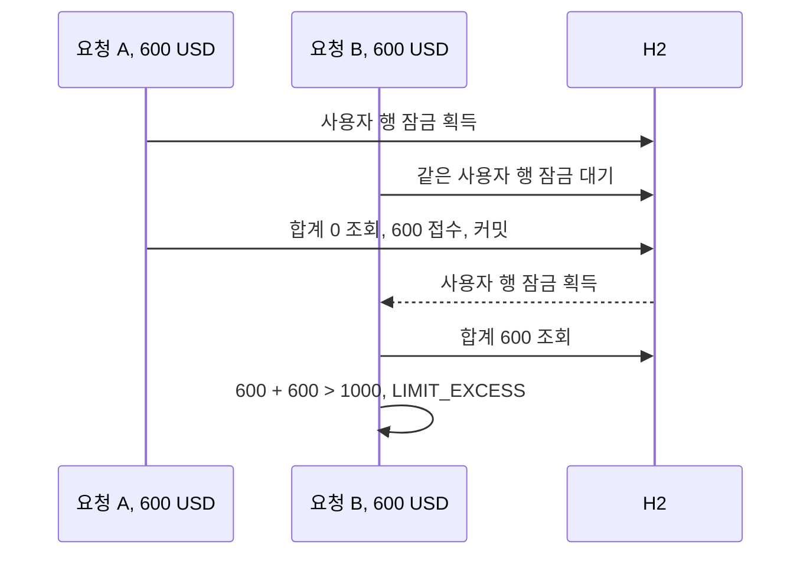

# 주요 설계

이 서비스에서 보호하는 데이터는 견적 금액과 접수 기록이다. 실제 지급까지 구현하지 않았으므로, 여기서 설명하는 정합성과 동시성도 그 범위에 해당한다. 핵심은 같은 견적의 중복 접수와 같은 사용자의 일일 한도 초과를 막으면서 견적 때 확정한 계산 값을 유지하는 것이다.

## 지켜야 할 규칙

| 규칙 | 적용 위치 | 검증 근거 |
| --- | --- | --- |
| 한 견적은 한 번만 접수 | 사용자 잠금 안에서 requestedTime 확인 | 동일 견적 동시 접수 테스트 |
| KST 일일 순송금 USD 합계는 개인 1000·법인 5000 이하 | 사용자 잠금 안에서 집계·검사·저장 | 서로 다른 견적 동시 접수, 정확한 한도와 0.01 USD 초과 테스트 |
| userId는 유일 | users의 DB 유일 제약 | 동시 회원가입 테스트 |
| 접수는 견적의 환율·수수료·USD 금액 사용 | 견적 생성 시 계산 값을 저장, 접수 시 시각만 변경 | 계산 감사 값과 접수 저장 테스트 |
| 본인 소유의 미만료 견적만 접수 | 인증 사용자와 견적 소유자 비교, Clock 기반 만료 검사 | 타인 견적·정확한 만료 시각 테스트 |
| 접수 시각에 따라 KST 하루를 분류 | 당일 시작 이상·익일 시작 미만의 DB 조회 | 자정 및 반개구간 집계 테스트 |

QuotePolicyTest는 금액·수수료·반올림·저장 범위를, RemittanceApiTest는 저장·인증·접수·동시성·페이지 조회를 확인한다. 테스트가 다룬 경계와 운영 환경 전체에 대한 보증을 구분한다.

## 같은 사용자의 접수를 직렬화하는 이유

한도 검사는 기존 합계를 읽고, 이번 금액을 더해 한도 이내인지 확인한 뒤, 접수 기록을 저장한다. 잠금 없이 두 요청이 겹치면 같은 합계를 읽고 모두 통과할 수 있다. 개인 한도 1000 USD에서 기존 합계가 0이고 600 USD 견적 두 개를 동시에 접수하면, 각각은 한도 이내지만 두 접수의 합은 1200 USD가 된다.

사용자 행을 잠그면 뒤 요청은 앞 접수가 커밋된 뒤 합계를 읽는다.

같은 견적을 동시에 접수해도 뒤 요청은 잠금을 얻은 후 앞 요청이 기록한 requestedTime을 확인하고 ALREADY_REQUESTED를 받는다. 잠금은 한도 집계부터 저장까지 같은 트랜잭션에서 유지한다. 견적 생성과 이력 조회에는 이 사용자 잠금을 사용하지 않는다.

견적 하나만 잠그는 방식은 서로 다른 견적의 합산 한도를 보호하지 못한다. JVM 메모리 잠금은 여러 인스턴스 사이의 공통 잠금이 되지 않는다. DB의 사용자 행을 선택한 이유는 한도의 범위와 직렬화 단위를 맞추기 위해서다. 같은 사용자 접수의 동시 처리량을 제한하는 비용이 있다. 서로 다른 사용자에게 같은 애플리케이션 행 잠금을 걸지는 않지만 DB 자원 경합까지 없애지는 못한다.

합산 한도는 일반적인 행 단위 DB 제약으로 강제하지 않는다. 모든 접수 경로가 이 잠금 절차를 거쳐야 한다. 요청 처리 외에 잠금 없이 접수 기록을 갱신하는 경로를 추가하면 이 규칙이 깨질 수 있다. 낙관적 잠금용 버전 컬럼도 없다.

## 집계와 읽기 일관성

접수 한도는 KST 하루를 UTC Instant 구간으로 변환해 DB SUM으로 계산한다. 구간은 `[당일 00:00, 익일 00:00)`이며, 견적마다 USD 2자리로 반올림해 저장한 순송금액을 합산한다. 기존 합계와 이번 금액이 한도와 같으면 허용한다.

전체 이력을 메모리로 읽는 대신 당일 합계만 DB에서 계산해 전송량과 객체 생성을 줄인다. 이 선택이 모든 데이터 규모에서 일정한 조회 시간을 보장하지는 않는다. 실제 잠금 유지 시간과 쿼리 성능은 데이터 양·인덱스·DB 실행 계획에 따라 측정해야 한다.

사용자 잠금은 동시 접수의 실행 순서를 맞춘다. 한도 판정에는 잠금뿐 아니라, 그 이후 집계가 앞 트랜잭션의 커밋을 읽는다는 가정도 필요하다. 코드에서 격리 수준을 별도로 지정하지 않았고 현재 H2의 READ_COMMITTED 동작을 기준으로 검증했다. 다른 DB나 격리 수준으로 옮기면 이 가정을 다시 확인해야 한다.

이력의 오늘 건수와 합계는 한 쿼리에서 구한다. 페이지 크기·커서는 집계 범위를 바꾸지 않는다. 다만 집계와 페이지 목록은 별개 쿼리이므로 동시 접수와 겹치면 조회 시점이 다를 수 있다. 여러 페이지를 읽는 동안 집계가 바뀔 수도 있다. 이 조회 결과를 접수 한도 판정에 재사용하지 않는다.

## 잠금 실패와 재시도

H2의 잠금 대기 한도는 기본 5000ms이며 REMITTANCE_LOCK_TIMEOUT_MS로 바꿀 수 있다. 현재 구현은 JPA 잠금 timeout 힌트 대신 JDBC URL의 LOCK_TIMEOUT 옵션을 사용한다. 대기 한도 초과는 503 LOCK_TIMEOUT으로 반환한다.

타임아웃 과정에서 연결이 깨져 롤백까지 실패하면 원래 업무 오류가 가려질 수 있다. TransactionalWork는 이 경우 해당 업무 오류를 다시 전달한다. 이는 오류 원인을 유지하는 처리이며, 롤백 실패 뒤 DB 상태가 복구됐음을 확인하는 절차는 아니다. 테스트는 잠금 타임아웃 후 해당 견적이 미접수로 남고 잠금 해제 뒤 다시 접수되는 상황을 확인한다.

멱등성 키와 이전 성공 응답의 재생은 구현하지 않았다. 클라이언트가 응답을 받지 못했어도 서버에서는 이미 커밋했을 수 있다. 같은 견적을 재요청하면 성공하거나 ALREADY_REQUESTED를 받을 수 있으므로, 이력을 조회해 접수 여부를 확인해야 한다.

## 금액 계산과 견적 보존

BigDecimal로 십진수 금액을 계산하고 HALF_UP으로 반올림한다. Java Currency 기준으로 KRW·JPY는 0자리, USD는 2자리다. 환율은 대상 통화 1단위당 KRW이며 12자리로 반올림한다.

| 통화·원화 금액 | 고정 수수료 | 비율 |
| --- | --- | --- |
| USD 100만원 이하 | 1000원 | 0.002 |
| USD 100만원 초과 | 3000원 | 0.001 |
| JPY | 3000원 | 0.05 |

입력 원화를 먼저 정수화해 수수료 구간을 선택한다. 비율 수수료를 원화로 반올림하고 고정 수수료를 더한다. 순송금 원화는 입력 금액에서 이 수수료를 뺀 값이다. 수취액은 순송금 원화를 수취통화 환율로 나누고, 한도용 USD는 같은 순송금 원화를 USD 환율로 나눈다.

예시로 400000 KRW를 환율 1300으로 USD 송금하면 수수료는 `1000 + 400000 × 0.002 = 1800` KRW이고 수취액은 `398200 ÷ 1300 → 306.31` USD다. JPY 소수 표기 예시와 통화 자릿수 규칙이 충돌했던 원 요구사항은 통화 자릿수 규칙을 우선해 해석했다.

수수료 차감 후 0은 허용하고 음수는 거부한다. DECIMAL(22,12)에 저장할 수 있는 범위를 넘으면 INVALID_REQUEST로 거부한다. 과도한 지수·정밀도도 반올림 연산 전에 차단한다.

견적에는 환율·수수료·수취액·USD 금액을 저장한다. 접수는 requestedTime과 updatedAt만 변경하므로 견적 이후 환율 설정이 바뀌어도 계산 근거를 유지한다. 만료 전까지는 견적의 기존 환율을 사용하고, 새 환율을 적용하려면 새 견적을 만들어야 한다. Quote는 불변 객체지만 DB 감사 기록의 위변조를 별도로 탐지하는 기능은 없다.

## 이력 페이지네이션

이력은 `(접수시각, ID)` 내림차순으로 정렬하고 마지막 항목보다 뒤에 있는 항목을 읽는 keyset 방식을 사용한다. 같은 시각의 거래는 ID로 순서를 구분한다. 웹 계층이 이 위치를 nextCursor로 인코딩한다.

OFFSET처럼 앞쪽에 새 항목이 추가됐다는 이유로 기존 항목의 페이지 위치가 밀리지 않는다. 다만 페이지 전체가 하나의 고정 스냅샷은 아니다. 이미 읽은 위치보다 앞에 추가된 새 거래는 뒤 페이지에 나타나지 않으므로 최신 거래는 첫 페이지부터 다시 조회해야 한다. 정렬 값의 변경·삭제 같은 상황까지 일반적으로 누락 없이 탐색한다고 보장하지 않는다.

size는 기본 50, 최대 100이다. 파라미터를 생략한 요청도 전체 이력이 아닌 첫 페이지를 받는다. 클라이언트는 nextCursor를 따라 다음 페이지로 이동하며, 임의 페이지 번호나 이전 페이지 이동용 API는 제공하지 않는다. 오늘 집계는 해당 페이지의 합계가 아니라 KST 당일 접수 전체의 합계다.

## 시간과 개인정보

저장은 UTC Instant, 일일 한도 판정과 견적·이력 표시는 Asia/Seoul을 사용한다. Clock을 주입해 테스트에서 시간을 고정한다. 견적은 10분, JWT는 30분이며 정확한 만료 순간부터 거부한다. 서버 기본 시간대를 업무 날짜의 기준으로 삼지 않는다.

비밀번호는 BCrypt로 해시하고 UTF-8 72바이트 초과를 거부해 잘림을 막는다. 식별번호는 랜덤 nonce를 사용하는 AES-GCM으로 암호화하고 무결성을 확인한다. 저장 길이에 맞춰 UTF-8 64바이트로 제한한다. 필수 키가 없거나 형식이 잘못되면 시작을 거부한다.

JWT 서명·만료로 확인한 사용자를 기준으로 견적 소유권을 판단한다. 회원·로그인 DTO의 toString은 가리고 응답에 원시 예외를 내보내지 않는다. DB 유일 제약 오류에 이메일이 포함될 수 있어 SqlExceptionHelper 원시 로그도 차단했다. 그만큼 DB 진단 정보가 줄어들므로 개인정보를 제거한 오류 관측은 후속 과제로 남아 있다.

## 검증 범위와 남은 과제

도메인·보안 단위 테스트와 H2/API 통합 테스트는 반올림·수수료·저장 범위·만료·KST 자정·한도·소유권·중복·동시 접수·페이지 경계를 확인한다. 동시 접수 테스트는 H2에서 두 스레드의 경쟁을 다루며 부하·교착·다중 프로세스 장애를 검증하지는 않는다.

DB 행 잠금은 같은 DB를 쓰는 접수 경로의 직렬화 지점이다. 현재 embedded 파일 H2는 단일 프로세스 구성이고 운영 DB에서의 잠금·복구를 검증하지 않았다. 다중 인스턴스 환경의 검증 근거로 확장해서 해석하지 않는다.

실시간 환율, 금융기관 지급, 멱등성 키, 기존 데이터 마이그레이션은 제공하지 않는다. 프레임워크 없는 내부 정책과 Ports는 외부 기술을 교체할 경계를 마련하지만, 새 어댑터의 동작은 별도 통합 검증이 필요하다. ArchitectureTest·Spotless·Checkstyle은 계층과 스타일을 검사하며 업무 정확성 검증을 대신하지 않는다.
