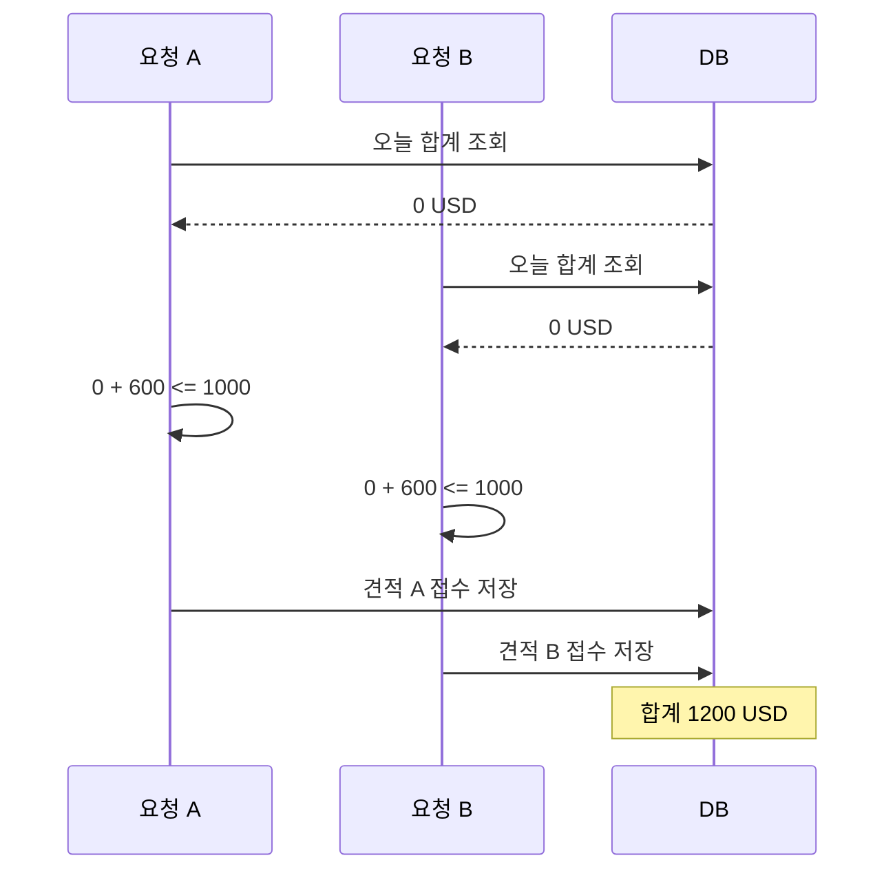
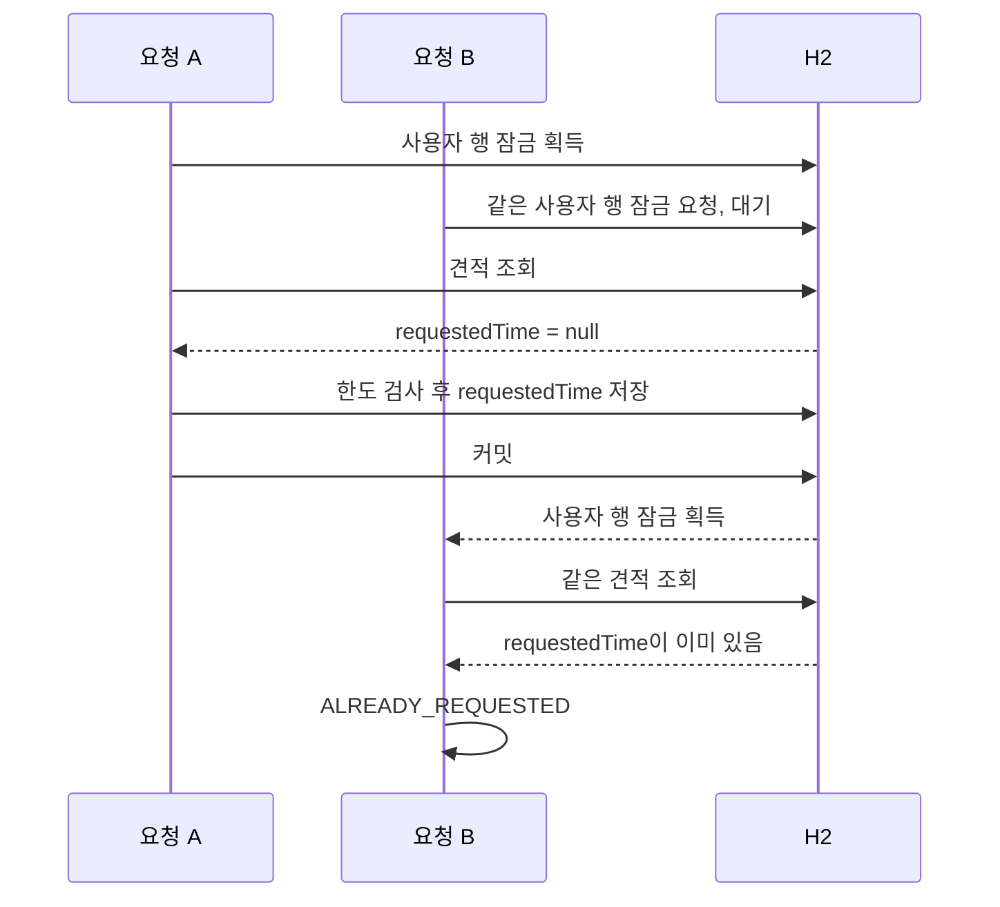
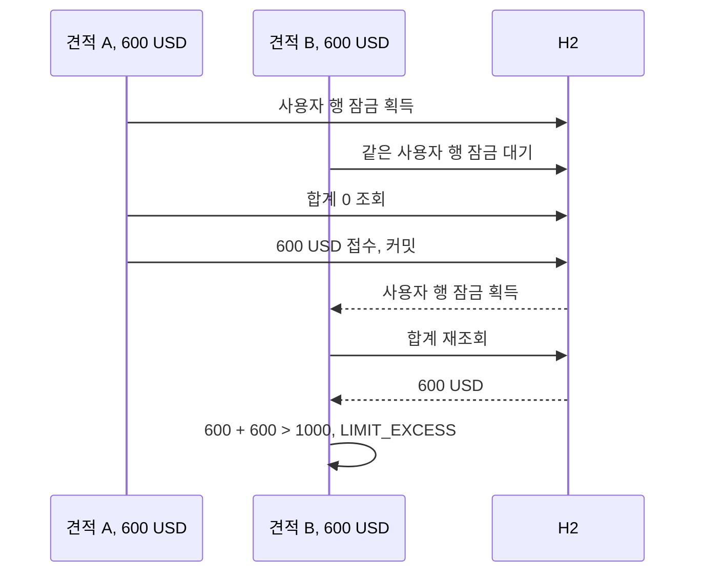
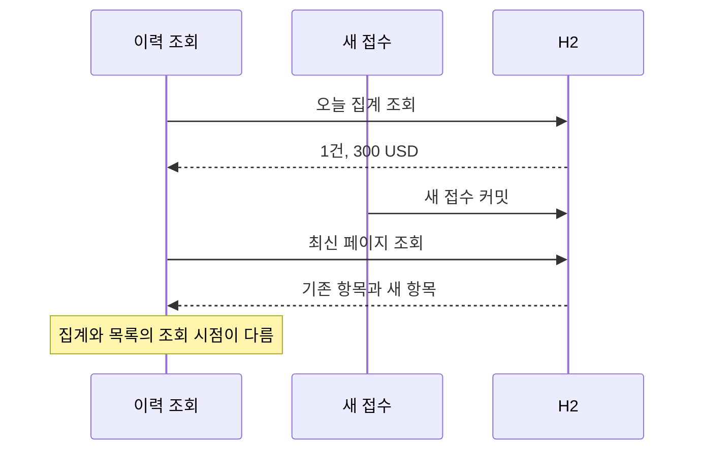

# 주요 설계

이 서비스에서 보호하는 데이터는 견적 금액과 접수 기록이다. 실제 지급까지 구현하지 않았으므로, 여기서 설명하는 정합성과 동시성도 그 범위에 해당한다. 핵심은 같은 견적의 중복 접수와 같은 사용자의 일일 한도 초과를 막으면서 견적 때 확정한 계산 값을 유지하는 것이다.

## 지켜야 할 규칙

| 규칙 | 적용 위치 | 검증 근거 |
| --- | --- | --- |
| 한 견적은 한 번만 접수 | 사용자 잠금 안에서 requestedTime 확인 | 동일 견적 동시 접수 테스트 |
| KST 일일 순송금 USD 합계는 개인 1000·법인 5000 이하 | 사용자 잠금 안에서 집계·검사·저장 | 서로 다른 견적 동시 접수, 정확한 한도와 0.01 USD 초과 테스트 |
| 같은 멱등성 키의 재시도는 한 번만 반영 | 사용자 잠금 안에서 (사용자, 키) 조회 + 유일 제약 | 재현·동시 같은 키·다른 견적 거부 테스트 |
| userId는 유일 | users의 DB 유일 제약 | 동시 회원가입 테스트 |
| 접수는 견적의 환율·수수료·USD 금액 사용 | 견적 생성 시 계산 값을 저장, 접수 시 시각만 변경 | 계산 감사 값과 접수 저장 테스트 |
| 본인 소유의 미만료 견적만 접수 | 인증 사용자와 견적 소유자 비교, Clock 기반 만료 검사 | 타인 견적·정확한 만료 시각 테스트 |
| 접수 시각에 따라 KST 하루를 분류 | 당일 시작 이상·익일 시작 미만의 DB 조회 | 자정 및 반개구간 집계 테스트 |

QuotePolicyTest는 금액·수수료·반올림·저장 범위를, RemittanceApiTest는 저장·인증·접수·동시성·페이지 조회를 확인한다. 테스트가 다룬 경계와 운영 환경 전체에 대한 보증을 구분한다.

## 동시성: 보호할 상태와 경쟁 범위

접수는 한 행을 변경하지만, 판단에 필요한 상태는 견적과 사용자의 당일 접수 전체에 걸쳐 있다. 한 견적의 requestedTime은 중복 여부를 나타내고, 여러 견적의 usdAmount 합계는 일일 한도를 나타낸다. 따라서 견적 하나의 변경 충돌을 막는 것만으로 접수 규칙 전체를 보호할 수 없다.

| 경쟁 상황 | 함께 읽거나 변경하는 상태 | 필요한 결과 |
| --- | --- | --- |
| 같은 사용자·같은 견적을 동시 접수 | 동일 견적의 requestedTime | 한 요청만 성공, 나머지는 ALREADY_REQUESTED |
| 같은 사용자·서로 다른 견적을 동시 접수 | 서로 다른 견적과 같은 일일 합계 | 두 요청의 합산 결과까지 한도 이내 |
| 서로 다른 사용자가 접수 | 각자의 사용자 행과 일일 합계 | 동일 사용자 잠금으로 서로 직렬화하지 않음 |
| 같은 이메일로 동시 가입 | users의 userId | 한 계정만 저장, 나머지는 DUPLICATE_USER |
| 접수와 이력 조회가 겹침 | 접수 목록과 오늘 집계 | 접수용 잠금을 조회가 점유하지 않음, 조회 시점 차이는 허용 |

아래 시나리오는 모두 같은 인증 사용자 기준이다. 먼저 시작한 요청이 반드시 잠금을 먼저 얻는다고 가정하지 않는다. 설명의 A·B는 잠금 획득 순서를 나타내며 처리의 공정성이나 FIFO 순서를 보장하지 않는다.

### 잠금이 없으면: 검사와 저장 사이의 경쟁

기존 합계가 0, 개인 한도가 1000 USD이고 각각 순송금액 600 USD로 확정된 견적 두 개가 있다고 가정한다. 두 요청이 기존 합계를 동시에 읽으면 각 요청은 자신의 600 USD만 더해 통과한다. 저장이 끝난 뒤 합계는 1200 USD가 된다.

각 요청을 트랜잭션으로 감싸는 것만으로 이 경쟁이 사라지지는 않는다. 현재 사용하는 READ_COMMITTED에서 서로 다른 견적 행을 변경하는 두 요청은 같은 사용자 합계의 검사·저장 순서를 자동으로 맞추지 않는다. 하나의 사용 사례가 중간 상태로 저장되지 않게 하는 원자성과, 여러 사용 사례가 서로의 판단을 방해하지 않게 하는 동시성 제어를 함께 고려해야 한다.

### 실제 잠금 경계

TransferUseCases.request는 `@Transactional` 메서드 하나의 트랜잭션 안에서 아래 순서로 실행한다. 사용 사례는 CGLIB 프록시로 감싸져 메서드 진입 시 트랜잭션이 시작되고 예외로 끝나면 롤백된다.

1. `Accounts.lockUser(actorId)`로 사용자 행을 조회하며 `PESSIMISTIC_WRITE` 잠금을 요청한다.
2. 잠금을 얻은 후 견적을 조회한다. 먼저 조회해 둔 requestedTime으로 중복 여부를 판단하지 않는다.
3. Clock의 현재 시각을 읽고 소유권 → 중복 → 만료 순서로 검사한다.
4. 현재 시각의 KST 날짜로 당일 시작·익일 시작 Instant를 계산한다.
5. 같은 사용자의 접수된 견적만 대상으로 DB SUM을 조회한다.
6. `기존 합계 + 이번 견적의 usdAmount > 한도`이면 LIMIT_EXCESS로 중단한다. 같으면 허용한다.
7. requestedTime과 updatedAt을 저장하고 flush한다. 트랜잭션이 커밋되면 잠금을 해제한다.

flush는 변경 SQL을 DB에 보내는 단계이며 커밋과 다르다. flush 직후에 잠금을 풀고 뒤 요청이 읽게 하는 방식이 아니다. 정상적인 트랜잭션 종료에서 커밋 또는 롤백이 완료될 때 DB 잠금이 해제된다. 연결·DB 장애 시 정리는 DB 동작에 의존한다.

### 같은 견적을 두 번 접수하는 경우

뒤 요청은 중복 검사에서 종료되므로 새 접수 시각을 덮어쓰거나 일일 한도에 같은 거래를 두 번 더하지 않는다. 선행 요청이 접수 저장 전에 실패하고 정상 롤백됐다면 뒤 요청은 아직 미접수인 견적을 다시 판단한다. 선행 요청의 성공 여부와 뒤 요청의 성공 여부가 항상 같은 것은 아니다.

### 서로 다른 견적이 같은 한도를 사용하는 경우

견적 A와 B는 다른 행이지만 같은 사용자 행의 잠금을 공유한다. 뒤 요청이 다시 읽은 합계에는 앞 접수가 반영되므로 둘 다 기존 합계 0을 기준으로 성공하지 않는다. 두 견적의 합이 한도 이내라면 순서대로 둘 다 성공할 수 있다.

### 대기 중 만료 또는 KST 날짜 변경

현재 시각은 잠금을 얻고 견적을 조회한 뒤에 읽는다. HTTP 요청이 도착할 때 유효했어도 잠금 대기 중 만료됐다면 QUOTE_EXPRIED로 거부한다. 만료 시각과 정확히 같아도 만료다.

자정을 넘겨 잠금을 얻으면 그때 읽은 Clock의 KST 날짜로 한도를 집계하고 같은 시각을 requestedTime에 기록한다. 한 요청 안에서 집계 날짜와 접수 시각을 각각 다시 읽어 자정 양쪽으로 분리하지 않는다. 이 동작을 설명하는 것이며, 잠금 대기 중 자정·만료가 발생하는 조합 자체를 별도 회귀 테스트로 검증한 것은 아니다.

## 왜 사용자 행을 잠그는가

사용자 행은 일일 한도의 주체이며 가입 시 이미 존재한다. 당일 거래가 0건인 상태에서도 잠글 수 있고, 같은 사용자에 속한 모든 견적을 하나의 실행 순서로 묶을 수 있다. 날짜별 잠금 행을 별도로 생성하지 않아도 된다. 그만큼 서로 다른 날짜의 접수도 같은 사용자 행을 경유한다.

| 방식 | 이 서비스에서의 검토 포인트 |
| --- | --- |
| JVM synchronized·메모리 잠금 | 한 프로세스 안의 경쟁만 조정한다. 여러 인스턴스의 공통 잠금은 되지 않음 |
| 견적 행 잠금 또는 견적의 버전 검사 | 같은 견적의 중복은 다룰 수 있지만 서로 다른 견적의 일일 합계 경쟁은 남음 |
| 사용자 행 비관적 잠금 | 같은 사용자의 모든 접수를 묶어 한도와 중복을 함께 보호. 현재 구현 |
| 사용자·날짜별 집계 행의 버전/조건부 갱신 | 합계와 버전을 공통 충돌 지점으로 만들 수 있으나 신규 행 생성·갱신·재시도 정책이 필요 |
| SERIALIZABLE 격리 수준 | DB별 충돌 판정과 트랜잭션 재시도 정책을 확인해야 함. 현재 구현에 적용하지 않음 |
| 행 단위 CHECK·유일 제약 | 이메일 유일성에는 적합하지만 여러 접수 행의 합산 한도는 일반적인 행 제약만으로 표현하기 어려움 |

대안 표는 현재 설계와 비교한 설명이다. 각 방식을 구현하거나 성능 비교한 결과는 없다. 특히 낙관적 잠금 자체가 한도를 보호할 수 없는 것은 아니다. 어떤 공통 상태의 버전을 검사하고 충돌 시 무엇을 재시도하는지가 중요하다.

같은 사용자 요청은 잠금 보유 시간에 따라 처리량이 제한된다. 서로 다른 사용자에게 같은 행 잠금을 요청하지 않지만 커넥션 풀·CPU·DB IO·인덱스 등 공유 자원에서 기다릴 수 있다. 다른 사용자의 접수가 항상 즉시 처리된다고 보장하지 않는다.

현재 접수 경로는 사용자 행을 먼저 잠근 뒤 견적을 변경한다. 향후 견적·사용자·다른 자원을 여러 순서로 잠그는 경로가 생기면 교착 가능성과 잠금 순서를 재검토해야 한다. 현재 테스트는 교착 부하를 검증하지 않는다.

## 트랜잭션·격리 수준·집계의 관계

사용자 잠금은 접수 순서를 맞추고 트랜잭션은 그 잠금과 업무 변경의 수명을 묶는다. 한도 판정에는 잠금 획득 후의 집계가 앞 트랜잭션의 커밋된 접수를 읽는다는 조건도 필요하다.

현재 코드에서 격리 수준을 별도로 지정하지 않았고 H2의 READ_COMMITTED 동작을 기준으로 검증했다. 잠금을 얻기 전에 만들어 둔 오래된 합계를 사용하지 않는다. 다른 DB로 옮기거나 REPEATABLE_READ 같은 격리 수준을 적용할 때는, 잠금 후 집계가 어떤 스냅샷을 읽는지 확인해야 한다. 격리 수준 이름만 같다는 이유로 동일한 행 잠금·조회 동작을 가정하지 않는다.

일일 합계는 `[KST 당일 00:00, 익일 00:00)`을 UTC Instant로 변환해 SUM으로 계산한다. 접수된 견적의 USD 2자리 반올림 값을 합산한다. 데이터가 없으면 0.00으로 정규화한다. SQL의 범위 조건과 Clock 기반 날짜 계산은 함께 맞아야 한다.

전체 이력을 읽는 방식보다 DB 집계는 전송량과 객체 생성을 줄인다. 잠금 구간 안에서 실행하므로 집계가 느려지면 뒤 접수의 대기도 길어진다. 데이터 양·인덱스·실행 계획에 따른 쿼리 시간과 잠금 보유 시간을 측정해야 하며, SUM을 쓴다는 이유로 일정 시간 처리나 성능 향상 수치를 주장하지 않는다.

한도와 중복은 모든 접수 변경 경로가 사용자 잠금을 거친다는 애플리케이션 규칙에 의존한다. DB가 합산 한도를 직접 강제하지 않는다. 향후 취소·수정·배치·관리자 처리 또는 별도 서비스에서 접수 상태를 바꾸면, 같은 사용자 잠금과 금액·날짜 정책에 참여시킬지 설계해야 한다.

## 회원가입의 동시성은 DB 유일 제약으로 처리

가입 전에 userId 존재 여부를 조회하지만 이 조회만으로 동시 가입을 막지 않는다. 두 요청이 모두 계정이 없다고 판단한 후 같은 이메일을 저장할 수 있기 때문이다. users의 userId 유일 제약이 최종 충돌 지점이다.

한 요청이 저장되고 다른 요청이 유일 제약 위반을 받으면 `JpaAccountRepository`가 DUPLICATE_USER로 변환한다(판별은 `PersistenceErrors.isUniqueViolation`). DB 진단에 이메일이 포함될 수 있어 원시 SQL 오류 로그를 차단한다. 사용자 접수 잠금과 이메일 유일 제약은 서로 다른 경쟁을 해결한다.

## 이력 조회의 일관성

이력 조회는 접수용 사용자 쓰기 잠금을 잡지 않는다. 접수를 기다리는 조회나 조회 때문에 대기하는 접수를 줄이려는 선택이다. 이는 모든 DB 조회가 어떤 상황에서도 기다리지 않는다는 뜻은 아니다.

오늘 건수·USD 합계는 같은 집계 쿼리에서 읽는다. 페이지 크기·커서는 당일 전체 집계의 범위를 바꾸지 않는다. 페이지 목록은 다른 쿼리에서 읽으므로 아래와 같은 결과가 가능하다.

이력 응답 전체가 같은 DB 스냅샷이라는 계약은 없다. 여러 페이지를 읽는 동안 오늘 집계도 변할 수 있다. 접수 한도 판정은 이력 API 결과를 쓰지 않고, 접수 트랜잭션 안에서 사용자 잠금을 얻은 뒤 합계를 별도로 조회한다.

일관된 시점의 목록·집계가 필요해지면 격리 수준·스냅샷·조회 모델의 변경과 그에 따른 비용을 검토해야 한다. 현재 구현에 그런 보장을 추가한 것은 아니다.

## 잠금 실패·롤백·재시도

잠금 대기는 H2 JDBC URL의 LOCK_TIMEOUT으로 제한한다. 기본값은 5000ms이며 REMITTANCE_LOCK_TIMEOUT_MS로 설정한다. 현재 H2 조합에서 JPA 잠금 timeout 힌트는 대기 한도 적용에 사용하지 않는다. 잠금 대기 초과는 `JpaAccountRepository`에서 업무 오류로 변환해 HTTP 503 LOCK_TIMEOUT을 반환한다.

현재 구현은 서버에서 자동 재시도하지 않는다. 잠금 대기 한도는 HTTP 전체 처리 시간의 상한도 아니다. 인증·커넥션 획득·조회·응답 처리 시간까지 포함해 5초 이내를 보장하는 설정으로 해석하지 않는다.

| 결정 | 이유 | 대가 |
| --- | --- | --- |
| LOCK_TIMEOUT 503에만 `Retry-After: 1`(고정 1초)을 붙인다 | 잠금은 보유 트랜잭션이 끝나면 풀려서 짧은 재시도가 의미 있고, 클라이언트가 즉시 재시도 폭주를 하지 않게 안내한다 | 실제 경합 시간을 반영한 값이 아니다. 재시도 한도·백오프는 클라이언트 몫이며 서버가 재시도를 보장하지 않는다 |
| `REMITTANCE_LOCK_TIMEOUT_MS`는 선행 0 없는 1~5자리 숫자(`[1-9][0-9]{0,4}`)이고 1~30000일 때만 받고 아니면 기동을 거부한다(DB 연결 전, EnvironmentPostProcessor) | 값이 H2 URL에 그대로 들어가므로 빈 값·문자가 섞이면 DB 접속 실패처럼 보이는 엉뚱한 오류가 난다. 상한은 대기 요청이 Tomcat 스레드와 DB 연결(풀 10개)을 오래 붙잡는 것을 막는다 | 30초를 넘기는 대기가 필요한 환경은 코드 수정이 필요하다. 상한 30000은 이 프로젝트의 판단이며 H2의 한계가 아니다 |
| 실패 안내는 FailureAnalyzer로 출력하고 입력값은 출력 안전하게 정리해(ASCII 20자) 보여 준다 | 원인과 조치를 `APPLICATION FAILED TO START`로 바로 알 수 있다. 값은 비밀이 아니지만 개행 등 로그 주입을 막는다 | 잘못된 값의 앞 20자만 보인다 |

| 상황 | 현재 처리 | 클라이언트가 주의할 점 |
| --- | --- | --- |
| 잠금 획득 실패 | 503 LOCK_TIMEOUT(`Retry-After: 1`), 해당 실행의 접수 저장에 도달하지 않음 | 대기를 두고 재시도할 수 있지만 다시 만료·한도 검사 대상 |
| 잠금 후 업무 검사 실패 | ALREADY_REQUESTED·QUOTE_EXPRIED·LIMIT_EXCESS 등 | 무조건 재시도해 해결되는 오류가 아님 |
| 업무 예외 후 롤백도 실패 | RollbackSafeTransactionManager가 롤백 실패를 로그만 남기고 삼켜 원래 예외(BusinessException 포함)를 전달 | 오류 원인 유지와 DB 복구 확인은 별개 |
| 커밋 후 응답 유실 | 클라이언트는 성공 여부를 알 수 없음 | 같은 Idempotency-Key로 재요청하면 24시간 미만이면 200이 재현된다. 키가 없었다면 이력으로 확인 |

`@Transactional`을 쓰고 기본 `JpaTransactionManager` 기준으로 롤백 자체가 예외를 던지면 그 예외가 원래 업무 예외를 덮는다. 전환 중에 H2 락 타임아웃 테스트가 503이 아니라 500으로 깨지는 것이 관찰됐고(개발 중 관찰, 현재 코드로는 재현되지 않는다), 롤백이 실패하게 만든 결정적 재현 테스트(Mockito 대역 EntityManagerFactory)에서는 호출자가 원래 `BusinessException`이 아니라 `JpaSystemException`을 받는다. 실제 H2·PostgreSQL에서 이 현상이 일반적으로 나타나는지까지는 단정하지 않는다. 그래서 JpaTransactionManager를 상속한 `RollbackSafeTransactionManager`가 `doRollback`의 RuntimeException을 삼키고 예외 클래스명·SQLState만 WARN으로 남긴다. 이전 `TransactionalWork`는 `BusinessException`만 보존하고 그 외 예외에서는 롤백 예외를 던졌지만, 새 방식은 모든 원래 예외를 보존한다. 롤백 실패를 삼키는 것이므로 커넥션 상태가 불확실한 채 풀에 반환될 수 있다(풀이 반환 시 정리하는지는 이 프로젝트에서 확인하지 않았다). 이 처리가 롤백 재시도나 커밋 결과 조회까지 수행하지는 않는다.

트랜잭션 전환에서 달라진 점: 이전에는 `signup`·`login`의 입력 형식 검증(비밀번호·식별번호 길이, UTF-8 바이트 제한)이 트랜잭션 바깥이었지만 지금은 메서드 전체가 `@Transactional`이라 잘못된 입력도 빈 트랜잭션을 열었다 닫는다. 오류 코드와 응답은 같고, Hibernate가 트랜잭션 시작 시 풀 연결을 잡을 수 있어 형식 오류 요청도 연결을 잠깐 점유한다. 한도가 정해진 풀(기본 10개)에서 잘못된 요청이 몰릴 때의 영향은 측정하지 않았다. 또 직접 등록한 트랜잭션 매니저는 Boot 기본 구성을 대체하므로 `spring.transaction.*` 속성이 적용되도록 `TransactionManagerCustomizers`를 연결했다.

### 멱등성 키

재현 기간은 접수 시각부터 24시간 미만이다. 정확히 24시간부터 같은 견적은 ALREADY_REQUESTED이며, 기간이 지나도 키의 귀속은 유지돼 다른 견적에 재사용할 수 없다. 재현도 JWT 인증이 필요해 장시간 뒤에는 같은 사용자로 재로그인해야 한다.

키 없이 같은 견적을 재요청하면 ALREADY_REQUESTED를 받는데, 이것만으로는 "내 첫 요청이 성공했다"와 "다른 요청이 먼저 처리됐다"를 구분할 수 없다. 그래서 접수에 선택적 `Idempotency-Key`를 둔다.

| 결정 | 이유 | 대가 |
| --- | --- | --- |
| 키를 접수된 견적 행에 저장하고 (사용자, 키) 유일 제약을 둔다 | 한 견적은 한 번만 접수되므로 키 저장소를 따로 두지 않아도 된다. 만료 정리 작업도 없다 | 실패 응답은 저장하지 않는다. 재현되는 것은 성공뿐이다 |
| 키 조회를 기존 사용자 행 잠금 안에서 한다 | 같은 키의 동시 요청이 직렬화되어 뒤 요청이 앞 요청의 커밋을 보고 재현으로 끝난다 | 접수 직렬화의 처리량 한계를 그대로 따른다 |
| 같은 키·같은 견적이면 재현 시 만료·한도를 다시 평가하지 않는다 | 이미 성공한 건의 재현이다. 다시 평가하면 성공한 요청이 실패로 바뀐다 | 재현은 24시간 창(접수 시각 기준)으로 한정한다 |
| 같은 키·다른 견적은 422로 거부한다 | 클라이언트 버그 신호다. 조용히 둘 중 하나를 받으면 의도하지 않은 송금이 생길 수 있다 | 키는 그 견적에 영구히 묶인다(창이 지나도 다른 견적에 재사용할 수 없다) |
| 실패한 시도는 키를 소비하지 않는다 | 한도 초과나 잠금 타임아웃 뒤의 재시도는 새로 평가되어야 한다 | 실패 응답을 그대로 재현해 주지 않는다 |

유일 제약은 잠금 밖에서 쓰기가 일어나는 예외 상황의 최종 방어이며, 위반은 IDEMPOTENCY_KEY_REUSED로 변환한다. 키는 요청 본문이 아니라 헤더로 받고 `[A-Za-z0-9._~-]{1,64}`로 제한한다. 키 없는 호출은 이전과 같다.

검증하지 않은 것: 유일 제약 위반을 IDEMPOTENCY_KEY_REUSED로 바꾸는 최종 방어는 잠금 때문에 정상 경로에서 도달하지 않아 직접 테스트하지 않았다. 변환은 SQLState 23505(H2·PostgreSQL)에 기대므로 다른 DB로 옮기면 다시 확인해야 한다. 기존 파일 DB에 이 컬럼과 제약을 추가하는 경로는 아래 "스키마 마이그레이션" 절에서 실제 DB 파일로 확인했다.

보장하지 않는 것: 요청 본문 전체의 동일성은 비교하지 않는다(견적 ID만 비교한다). 키 없이 이미 접수된 견적에 새 키를 붙여 보내도 재현이 아니라 ALREADY_REQUESTED다. 실제 지급 연동에는 외부 요청과 DB 기록 사이의 중복·실패 처리가 별도로 필요하다.

## 동시성 테스트가 확인하는 범위

| 테스트 | 재현 방식과 확인 내용 |
| --- | --- |
| concurrentSameQuoteIsAcceptedExactlyOnce | 같은 견적을 두 스레드에서 접수. OK 한 번·ALREADY_REQUESTED 한 번, 오늘 접수 한 건 확인 |
| concurrentDifferentQuotesCannotJointlyExceedDailyLimit | 합산하면 한도를 넘는 서로 다른 견적을 두 스레드에서 접수. OK 한 번·LIMIT_EXCESS 한 번, 결과 합계 한도 이내 확인 |
| concurrentSignupPreservesUniqueUserAndDoesNotLogEmail | 같은 이메일 동시 가입의 단일 저장·중복 오류와 이메일 로그 미노출 확인 |
| concurrentSameKeyAndQuoteSucceedsTwiceButEffectsOnce | 같은 키·같은 견적 동시 요청 둘 다 OK, 접수 한 건과 합계 한 번 반영 확인 |
| concurrentSameKeyDifferentQuotesAcceptsOnlyOne | 같은 키·다른 견적 동시 요청에서 하나만 접수, 다른 하나는 IDEMPOTENCY_KEY_REUSED |
| lockWaitTimeoutIsBusinessErrorAndRecoversAfterRelease | 별도 트랜잭션이 사용자 행을 잠근 상태에서 HTTP 요청. 503과 시간 제한, 잠금 해제 후 동일 견적의 정상 접수 확인 |
| historyIsNotBlockedByUserRowLock | 사용자 행 잠금 보유 중 이력 호출. 기존 목록·집계 반환과 제한된 테스트 시간 내 완료 확인 |
| dailyTotalWindowIsHalfOpenAtKstMidnight | KST 자정 전후 거래를 분리하고 당일 합계가 한도 판단에 사용되는지 확인 |
| newRequestBetweenPagesDoesNotRepeatReceivedItems | 페이지 사이 새 접수 후, 다음 페이지에서 이미 받은 항목이 반복되지 않는지 확인 |

동시 접수 테스트는 실행 시작을 맞춘 두 작업의 결과를 확인한다. 모든 스레드 스케줄을 탐색하거나 요청별 SQL 순서를 계측한 증거는 아니다. 잠금 대기 테스트는 별도 트랜잭션이 실제 행 잠금을 획득한 뒤 접수·이력 호출을 실행한다.

이 테스트들은 H2에서의 회귀 근거이며, 같은 시나리오 일부를 PostgreSQL 16에서도 재현했다(아래 "PostgreSQL 프로파일" 절). 고부하·장시간 경쟁·교착·프로세스 종료·DB 재시작·네트워크 분리·다중 인스턴스를 검증하지 않는다. 정확한 한도·만료·날짜 테스트와 잠금 대기 테스트가 각각 존재해도, 모든 경계와 대기의 조합을 검증한 것으로 확대하지 않는다.

운영 DB나 실제 지급으로 확장할 때는 잠금 획득·해제, 격리 수준의 읽기 스냅샷, 타임아웃 예외 변환, 커밋 결과 확인, 재시도 정책과 멱등성 범위를 해당 환경에서 다시 검증해야 한다. H2와 PostgreSQL 검증 모두 단일 앱 프로세스이므로 DB 행 잠금을 쓴다는 사실만으로 다중 인스턴스 운영 검증을 완료했다고 볼 수 없다.

## 금액 계산과 견적 보존

BigDecimal로 십진수 금액을 계산하고 HALF_UP으로 반올림한다. Java Currency 기준으로 KRW·JPY는 0자리, USD는 2자리다. 환율은 대상 통화 1단위당 KRW이며 12자리로 반올림한다.

| 통화·원화 금액 | 고정 수수료 | 비율 |
| --- | --- | --- |
| USD 100만원 이하 | 1000원 | 0.002 |
| USD 100만원 초과 | 3000원 | 0.001 |
| JPY | 3000원 | 0.05 |

입력 원화를 먼저 정수화해 수수료 구간을 선택한다. 비율 수수료를 원화로 반올림하고 고정 수수료를 더한다. 순송금 원화는 입력 금액에서 이 수수료를 뺀 값이다. 수취액은 순송금 원화를 수취통화 환율로 나누고, 한도용 USD는 같은 순송금 원화를 USD 환율로 나눈다.

예시로 400000 KRW를 환율 1300으로 USD 송금하면 수수료는 `1000 + 400000 × 0.002 = 1800` KRW이고 수취액은 `398200 ÷ 1300 → 306.31` USD다. JPY 소수 표기 예시와 통화 자릿수 규칙이 충돌했던 원 요구사항은 통화 자릿수 규칙을 우선해 해석했다.

수수료 차감 후 0은 허용하고 음수는 거부한다. DECIMAL(22,12)에 저장할 수 있는 범위를 넘으면 INVALID_REQUEST로 거부한다. 과도한 지수·정밀도도 반올림 연산 전에 차단한다.

견적에는 환율·수수료·수취액·USD 금액을 저장한다. 접수는 requestedTime과 updatedAt만 변경하므로 견적 이후 환율 설정이 바뀌어도 계산 근거를 유지한다. 만료 전까지는 견적의 기존 환율을 사용하고, 새 환율을 적용하려면 새 견적을 만들어야 한다. Quote는 불변 객체지만 DB 감사 기록의 위변조를 별도로 탐지하는 기능은 없다.

## 이력 페이지네이션

이력은 `(접수시각, ID)` 내림차순으로 정렬하고 마지막 항목보다 뒤에 있는 항목을 읽는 keyset 방식을 사용한다. 같은 시각의 거래는 ID로 순서를 구분한다. 웹 계층이 이 위치를 nextCursor로 인코딩한다.

OFFSET처럼 앞쪽에 새 항목이 추가됐다는 이유로 기존 항목의 페이지 위치가 밀리지 않는다. 다만 페이지 전체가 하나의 고정 스냅샷은 아니다. 이미 읽은 위치보다 앞에 추가된 새 거래는 뒤 페이지에 나타나지 않으므로 최신 거래는 첫 페이지부터 다시 조회해야 한다. 정렬 값의 변경·삭제 같은 상황까지 일반적으로 누락 없이 탐색한다고 보장하지 않는다.

size는 기본 50, 최대 100이다. 파라미터를 생략한 요청도 전체 이력이 아닌 첫 페이지를 받는다. 클라이언트는 nextCursor를 따라 다음 페이지로 이동하며, 임의 페이지 번호나 이전 페이지 이동용 API는 제공하지 않는다. 오늘 집계는 해당 페이지의 합계가 아니라 KST 당일 접수 전체의 합계다.

## 시간과 개인정보

저장은 UTC Instant, 일일 한도 판정과 견적·이력 표시는 Asia/Seoul을 사용한다. Clock을 주입해 테스트에서 시간을 고정한다. 견적은 10분, JWT는 30분이며 정확한 만료 순간부터 거부한다. 서버 기본 시간대를 업무 날짜의 기준으로 삼지 않는다.

비밀번호는 BCrypt로 해시하고 UTF-8 72바이트 초과를 거부해 잘림을 막는다. 식별번호는 랜덤 nonce를 사용하는 AES-GCM으로 암호화하고 무결성을 확인한다. 저장 길이에 맞춰 UTF-8 64바이트로 제한한다. 필수 키가 없거나 형식이 잘못되면 시작을 거부한다.

JWT 서명·만료로 확인한 사용자를 기준으로 견적 소유권을 판단한다. 회원·로그인 DTO의 toString은 가리고 응답에 원시 예외를 내보내지 않는다. DB 유일 제약 오류에 이메일이 포함될 수 있어 SqlExceptionHelper 원시 로그는 기본 설정에서 차단한다.

## 오류 관측과 로컬 진단

기본 프로파일은 요청과 실패 위치를 추적하되 예외 메시지에 섞인 개인정보를 남기지 않는 것을 목표로 한다. RequestIdFilter는 보안 필터보다 먼저 요청 ID를 응답 X-Request-Id와 MDC에 넣는다. 클라이언트 값은 `[A-Za-z0-9._-]{1,64}`만 채택하고 다른 값은 UUID로 대체한다. 요청 종료 시 MDC를 제거한다. 이 값은 인증·멱등성 근거가 아니다.

예상 밖 오류의 진단 정보는 ErrorDescriptions에서 선별한다. 예외 메시지와 예외 객체 전체 대신 클래스 연쇄·SQLState·벤더 코드·앱 스택 프레임 일부를 남긴다. 메서드·경로는 길이·문자를 제한하고 쿼리스트링·본문·토큰을 기록하지 않는다. 메시지에만 있는 단서는 사라지므로 전체 스택 로그보다 진단 정보가 적다.

ApiExceptionHandler가 다루는 LOCK_TIMEOUT은 WARN, 일반 업무·입력 오류는 DEBUG, UNKNOWN_ERROR와 예상 밖 오류는 ERROR다. 기본 INFO 수준에서는 일부 4xx 로그가 보이지 않는다. 이 허용 목록은 해당 코드가 직접 남기는 로그의 정책이다. 보안 필터·서블릿 sendError·/error 디스패치의 모든 오류를 수집하지 않으며 오류 디스패치의 MDC와 라이브러리 로그도 별도 범위다.

DB 접속 실패는 Flyway 초기화에서 먼저 드러난다(Flyway 도입 후). DatabaseConnectionFailureAnalyzer는 이 경우 원인 연쇄의 SQLState만으로 인증 거부(`28xxx`)·연결 불가(`08xxx`)·DB 없음(`3D000`)·그 밖의 접속 실패를 분류해 한국어 조치를 안내한다. 예외 메시지에는 사용자명·호스트가 섞일 수 있어 읽지 않고 SQLState 코드만 출력한다. Hibernate의 `Dialect` 표지 경로는 Flyway 없이 Hibernate가 먼저 실패할 때를 위해 남겼다.

직접 확인한 것: 단위 테스트(실제 H2 인증 실패와 `SpringApplication` 콘솔 블록 출력, PostgreSQL 16의 틀린 비밀번호 28P01·닫힌 포트 08001·없는 DB 3D000, 안내에 비밀번호·사용자명·호스트·포트·JDBC URL 없음, 우선순위·형식 오류·비접속 Flyway 예외 합성 테스트)와 실제 jar 기동(H2 기본 프로파일 틀린 비밀번호, PostgreSQL 세 경우)에서 안내 블록이 나오고 비밀번호·JDBC URL이 로그에 없었다. 보장하지 않는 것: 안내 블록 밖의 라이브러리 로그와 스택에는 사용자명·호스트:포트가 나올 수 있다(WARN 줄에서 확인). 분류는 SQLState에 의존하므로 드라이버가 다른 코드를 내면 "그 밖의 접속 실패" 안내로 떨어진다. 조치 문구는 예외 클래스명(`org.h2.`/`org.postgresql.`)으로 DB 종류를 구분하고, 알 수 없으면 두 종류의 항목을 모두 보여 준다. 안내 블록 아래에는 스택이 나오지 않으며(직접 확인) 원래 메시지는 블록 바로 위 WARN 한 줄에 있다. 감지가 Flyway 내부 클래스와 영어 메시지 접두사에 의존해 Flyway 업그레이드 시 조용히 안내가 사라질 수 있으므로 테스트가 이를 잡게 두었다. 28xxx를 한 가지로만 안내하지 않고 PostgreSQL에서는 접근 규칙(`pg_hba.conf`)도 확인하도록 했다. 접속 이후 단계(풀 고갈, 쿼리 중 연결 끊김)는 이 분석기의 대상이 아니다.

local 프로파일은 H2 콘솔과 Hibernate SQL DEBUG, SqlExceptionHelper WARN, Hikari DEBUG로 개발 진단을 넓힌다. 바인딩 TRACE는 기본적으로 꺼져 있지만 오류 메시지·연결 풀 정보에는 이메일·URL·사용자명이 포함될 수 있다. 이 환경을 기본 프로파일과 같은 로그 보장으로 해석하지 않는다.

콘솔은 JWT 대신 DB 로그인으로 접근하며 활성화될 때 프레임 정책이 SAMEORIGIN으로 바뀐다. 기본 DB 비밀번호가 빈 값이고 로그인 화면에서 JDBC URL도 지정할 수 있으므로 로컬 개발 범위에서 사용한다. 외부 로그 수집·알림·보존·접근 제어는 이 구현에 포함하지 않았다.

## 스키마 마이그레이션

Flyway SQL은 스키마 변경을 명시적으로 남기는 원본이다. V1은 멱등성 도입 이전의 users·remittances와 인덱스를, V2는 idempotency_key와 사용자별 유일 제약을 만든다. Hibernate는 ddl-auto: validate로 컬럼·타입을 대조하고 스키마를 변경하지 않는다.

새 DB는 V1부터 적용한다. 이전 앱이 만든 비어 있지 않은 DB에 Flyway 이력이 없으면 baseline-version 0으로 기준선을 잡은 뒤 V1·V2를 실행한다. 두 SQL의 IF NOT EXISTS는 기존 객체를 건너뛰기 위한 것이다. baseline은 기존 DB가 정상이라는 검증 결과가 아니며, IF NOT EXISTS도 잘못된 컬럼·제약을 수정하지 않는다.

적용 이력은 flyway_schema_history에 저장한다. 적용된 SQL을 수정하면 체크섬 검증에 영향을 주므로 이후 변경은 새 번호로 추가한다. validate만으로 유일 제약·인덱스·FK 이름까지 검사한다고 가정하지 않는다. MigrationTest와 API 스키마 테스트로 필요한 구조를 확인한다.

MigrationTest는 빈 DB 생성, V1 데이터 유지와 V2 업그레이드, 이력만 없는 최신 스키마와 구 스키마의 기준선 적용을 확인한다. 이전 작업의 실제 파일 DB 기동·로그인·접수 확인은 [Flyway 작업 기록](https://github.com/ssipflow/Moin-GlobalRemittance/blob/f0834e1/docs/harness/tasks/flyway-migrations.md)의 수동 검증 근거이며 이번 문서 작업에서 재실행하지 않았다. 구 DB의 Hibernate 생성 FK 이름과 새 DB의 명시 이름은 다를 수 있다.

이력만 없는 최신 스키마 테스트는 Flyway 생성 DB에서 이력만 지운 재현이며, Hibernate의 실제 DDL과 동일한지를 별도로 증명하지 않는다. 지원하지 않는 외부 스키마를 기준선 설정만으로 받아들이지 않는다. H2 ENUM·시간 타입·DDL은 다른 운영 DB에서 재검토해야 한다. 버전 지원 경고와 실패한 마이그레이션의 부분 적용 복구도 별도 확인 대상이다. 다른 시스템 데이터의 변환·이전 도구는 제공하지 않는다.

## PostgreSQL 프로파일

핵심 주장(사용자 행 잠금으로 동시 접수를 직렬화해 일일 한도를 지킨다)을 처음에는 embedded H2에서만 검증했다. 운영 DB 후보인 PostgreSQL에서 같은 주장을 확인하기 위해 먼저 그 DB로 앱이 뜨고 스키마가 맞게 했고(1단계), 이어서 동시성·락 타임아웃·연결 끊김 복구를 검증했다(2단계).

| 결정 | 이유 | 대가 |
| --- | --- | --- |
| 기본 실행은 H2 그대로 두고 `postgres` 프로파일에서만 PostgreSQL을 쓴다 | 기존 실행·`./data` 파일 DB·기존 테스트가 영향받지 않는다 | 두 DB의 스키마 SQL을 따로 유지해야 한다 |
| PostgreSQL 전용 마이그레이션을 `db/postgresql/migration`(H2 폴더의 형제)에 둔다 | H2 문법(`ENUM`, `ADD CONSTRAINT IF NOT EXISTS`)이 PostgreSQL에서 안 된다. 하위 폴더는 Flyway가 함께 읽어 방언이 섞인다 | V1/V2가 두 벌이라 새 변경은 양쪽에 같은 번호로 추가해야 한다 |
| `ENUM`을 `VARCHAR + CHECK`로 옮기고 새 DB 전용(`IF NOT EXISTS` 없음)으로 쓴다 | 같은 값 제한을 유지하고, 이력 없이 객체가 이미 있는 DB를 조용히 인수하지 않고 충돌로 실패시킨다 | 기존 PostgreSQL DB를 가져오려면 별도 절차가 필요하다 |
| 잠금 대기 한도를 연결 초기화 SQL `SET lock_timeout`으로 적용한다 | H2의 URL `LOCK_TIMEOUT`과 같은 역할이다. 값은 기동 시 1~30000 정수로 검증되어 SQL에 안전하다 | 풀에서 만든 모든 연결에 설정되지만 사용자가 직접 연결을 열면 적용되지 않는다 |
| PostgreSQL 테스트는 태그 `postgres`와 `postgresTest` 태스크로 분리한다 | Docker 없는 환경에서도 기본 `check`가 통과한다 | 기본 검증만으로는 PostgreSQL 경로가 확인되지 않는다. Docker가 없으면 건너뛰지 않고 실패한다 |

직접 확인한 것: Testcontainers의 PostgreSQL 16에서 V1·V2가 적용되고 `ddl-auto: validate`를 통과했으며, 풀 연결의 `lock_timeout`이 설정값이고, 가입·로그인·견적·접수·이력 조회·키 재현(200)·키 없는 재접수(409)가 H2와 같은 계약으로 동작했다. 같은 흐름을 실제 컨테이너에 jar로 띄워 수동으로도 확인했다.

2단계에서 PostgreSQL 16(Testcontainers)에 대해 직접 확인한 것(`postgresTest`, 단일 앱 프로세스, 6스레드, 반복 실행에서 매번 통과):

| 시나리오 | 결과 |
| --- | --- |
| 같은 견적을 동시에 접수 | 성공 1건, 나머지 `ALREADY_REQUESTED`, DB 접수 행 1건 |
| 한도를 넘는 서로 다른 견적 6개를 동시에 접수(건당 398.2 USD, 한도 1000) | 정확히 2건 성공, 4건 `LIMIT_EXCESS`, 오늘 합계 796.4 |
| 같은 `Idempotency-Key`·같은 견적 동시 요청 | 모두 200, 효과는 1회(접수 행·접수 시각 하나) |
| 같은 키·다른 견적 6개 동시 요청 | 1건 성공, 나머지 422 `IDEMPOTENCY_KEY_REUSED` |
| 다른 연결이 사용자 행을 `FOR UPDATE`로 잡은 채 접수 | 설정 한도(2000ms) 후 503 `LOCK_TIMEOUT`과 `Retry-After: 1`(측정 약 2.03초). 해제 후 같은 키 요청이 200, 타임아웃된 시도는 접수 시각·키를 남기지 않음 |
| 별도 JDBC 연결이 같은 행을 `lock_timeout` 500ms로 `FOR UPDATE` | PostgreSQL이 실제로 SQLState `55P03`을 냄. 코드(`PersistenceErrors.isLockTimeout`)가 기대하는 값임을 직접 확인한 것이며, 앱 경로에서 어느 매핑 분기(JPA 예외 또는 SQLState)로 변환됐는지까지는 구분해 확인하지 않았다 |
| 위와 같은 잠금 중 이력 조회 | 1초 안에 200(읽기는 쓰기 잠금에 막히지 않음. PostgreSQL 기본 격리 수준(READ COMMITTED)에 의존) |
| DB가 앱의 모든 연결을 끊음(`pg_terminate_backend`) | 끊긴 직후 첫 요청은 500(`UNKNOWN_ERROR`)이었고 두 번째 시도에 200으로 복구(3회 모두 `[500, 200]`). 실패한 시도는 부분 상태를 남기지 않아 접수는 정확히 1건 |

연결 끊김 뒤의 첫 500은 풀이 끊긴 연결을 처음 사용할 때 알게 되는 현재의 실제 동작이다. 클라이언트는 같은 `Idempotency-Key`로 재시도하면 안전하다. 이 500을 숨기려면 풀의 검증·수명 설정이나 재시도를 별도로 설계해야 하며 이번 범위가 아니다.

보장하지 않는 것: 다중 앱 인스턴스, 고부하·장시간 경쟁·교착, DB 재시작·네트워크 분리, 롤백 자체가 실패하는 상황(`RollbackSafeTransactionManager`의 원래 예외 보존)은 H2 락 타임아웃 테스트와 Mockito 기반 결정적 재현으로만 확인했고 PostgreSQL에서는 검증하지 않았다. 연결 끊김 시나리오는 모든 연결을 한 번에 끊은 한 경우뿐이다. PostgreSQL 16 한 버전만 사용했고 다른 버전·관리형 서비스·커넥션 풀 크기 변화는 확인하지 않았다.

## 환율 신선도 정책

실제 시세 공급처를 붙이지 않기로 했지만, 포트가 값만 돌려주면 공급처가 붙는 순간 "얼마나 오래된 환율까지 허용하는가"와 "조회가 실패하면 어떻게 하는가"가 구현자 마음대로 정해진다. 그래서 공급처 없이 정책과 포트 계약을 먼저 고정했다.

| 결정 | 이유 | 대가 |
| --- | --- | --- |
| 환율을 `RateSnapshot(환율, 기준 시각)`으로 돌려준다 | 값만으로는 오래된 환율을 구분할 수 없다. 대상 통화와 USD 환율이 같은 시점인지도 볼 수 있다 | 포트가 바뀌어 모든 공급처가 기준 시각을 알려야 한다 |
| 기준 시각과 현재의 차이(절댓값)가 허용 지연(기본 60초) 이하일 때만 신선하다. 경계는 신선 | 미래 기준 시각은 시계 어긋남 신호라 과거와 같은 범위로 제한한다 | 60초는 이 프로젝트의 기본안이며 시장 기준이 아니다. 1~3600초로 설정한다 |
| 오래됐거나 조회가 실패하면 견적을 만들지 않고 503(`RATE_STALE`/`RATE_UNAVAILABLE`)으로 거부한다. 직전 값을 몰래 쓰지 않는다 | 금융 서비스에서 낡은 환율로 확정한 견적은 손실이 될 수 있어, 불편한 거부가 조용한 오류보다 낫다 | 공급처가 불안정하면 견적 가용성이 떨어진다. 직전 값 허용 정책은 의도적으로 두지 않았다 |
| 신선도 판단은 도메인(`RateSnapshot.isFresh`)·사용 사례가, 공급 실패 신호는 어댑터가 맡는다 | 정책이 공급처 구현에 흩어지지 않는다 | 어댑터가 실패를 `RATE_UNAVAILABLE`로 번역해야 한다. 그 밖의 예외는 삼키지 않고 500으로 보인다 |
| 접수(`request`)는 환율을 조회하지 않는다 | 발급된 견적은 10분간 환율이 고정이라는 계약이 이미 있고, 환율 장애가 접수를 막으면 이미 확정한 거래를 못 끝낸다 | 견적 발급 이후 시장이 크게 움직여도 발급 환율이 유지된다(기존 계약) |
| 모의 공급처(`simulated`)로 지연·장애를 주입한다. 기본은 설정 환율(`configured`) | 실제 공급처 없이 정책을 시연·검증한다. 기본 동작은 외부에서 보기에 바뀌지 않는다 | 운영에서 켜면 견적이 거부될 수 있어 기동 시 WARN을 남기고 문서에 운영 사용 금지를 적었다 |

직접 확인한 것: 단위 테스트(경계 60초 통과·1ms 초과 거부, 미래 기준 시각, 대상/USD 각각의 지연, USD 단일 조회, 장애 전달, 미지원 통화 불변, 실패 시 저장 없음, 미존재 사용자는 환율 조회 전 401)와 API 테스트(모의 장애 503·`Retry-After` 없음·견적 행 0·로그에 코드만, 지연 120초 대 허용 60초 503, 30초 200, 허용 1초와 지연 2초 경계, 잘못된 설정의 기동 거부, 장애 중에도 발급된 견적 접수 200과 새 견적 503)를 통과했다. 실제 jar 기동에서도 기본 200, 지연 120초 503 `RATE_STALE`, 지연 30초 200, 장애 503 `RATE_UNAVAILABLE`, 허용 지연 0·잘못된 source의 기동 거부를 확인했다.

보장하지 않는 것: 실제 공급처가 없으므로 타임아웃·재시도·서킷 브레이커·다중 공급처·공급처 간 불일치는 다루지 않는다. 실제 공급처를 붙이면 지금 구조에서는 환율 조회가 DB 트랜잭션 안에서 일어나 연결을 붙잡으므로 호출 위치를 재검토해야 한다. 견적에는 환율 기준 시각을 저장하지 않아(스키마 변경 필요) 사후에 어떤 시점의 환율이었는지 감사할 수 없다. 모의 장애 모드는 통화 검증보다 먼저 실패하므로 미지원 통화도 `RATE_UNAVAILABLE`이 된다. 잘못된 환율 설정은 DB 초기화 뒤에 거부되어 거부 전에 DB 파일이 만들어질 수 있다. 시계 동기화(서버와 공급처)는 이 프로젝트가 보장하지 않는다.

## 업무 규칙의 위치

일일 한도 비교, 멱등성 재현 24시간 창, 견적 유효시간 10분, KST 기준일은 처음에 `TransferUseCases`에 있었다. 그러면 가장 중요한 규칙을 읽으려고 트랜잭션·락 조정 코드를 헤쳐야 하고, 규칙을 검증하려면 DB가 필요하다. 그래서 규칙은 도메인 객체(`Quote`, `User`, `BusinessDay`)로 옮기고 사용 사례는 "무엇을 어떤 순서로 읽고 저장할지"만 맡게 했다. 동작은 바꾸지 않았다(검사 순서·오류 코드·경계·락 순서 불변).

| 규칙 | 위치 | 사용 사례의 역할 |
| --- | --- | --- |
| 견적 유효시간 10분, 신규 견적 생성 | `Quote.issue` | 환율 신선도 확인 후 호출하고 저장 |
| 소유권 → 중복 → 만료(같은 순간은 만료) | `Quote.request` | 호출하고 결과를 저장 |
| 멱등성 키 재현(다른 견적이면 재사용 오류, 같은 견적이면 24시간 창 안에서만 재현, 창 경계는 재현 아님) | `Quote.replays` | 사용자 잠금 안에서 이전 접수를 조회해 넘김 |
| 일일 한도(한도와 같으면 허용, 초과만 거부) | `User.checkDailyLimit` | 같은 잠금 안에서 오늘 합계를 조회해 넘김 |
| KST 기준일 [00:00, 익일 00:00), 표시 시간대 | `BusinessDay` | 한도·이력 집계 구간으로 사용 |

여전히 사용 사례에 남은 것: 잠금 순서(첫 DB 작업이 `lockUser`), 저장소 조회와 저장, 트랜잭션 경계, 환율 신선도 확인과 시각 공급(`Clock`)이다. 도메인이 DB를 모르므로 "오늘 합계"는 사용 사례가 읽어서 넘긴다.

직접 확인한 것: 경계 단위 테스트(KST 자정·월말·연말, 한도와 같은 금액/0.01 초과, 만료 정확히 +10분, 재현 창 1ns 전/정확히 24시간, 다른 견적 키 재사용, 검사 순서)와 기존 API·동시성 테스트(수정 없이 통과), 실제 jar 기동(접수 3건 후 4번째 `LIMIT_EXCESS`, 같은 키 재요청 200으로 건수 불변, 같은 키·다른 견적 422).

보장하지 않는 것: 이 이동은 동작 불변 리팩터링이며 도메인을 풍부하게 모델링한 것은 아니다. 금액은 여전히 `BigDecimal`과 통화 문자열이고(`Money` 값 객체 없음), 견적과 접수된 송금은 `requestedTime`의 null 여부로 구분하는 하나의 모델이다. 일일 합계처럼 여러 견적에 걸친 불변식은 사용자 행 잠금과 사용 사례의 조회 순서로 지켜지며, 이를 소유하는 애그리게이트가 코드로 드러나지 않는다. 이 세 가지는 합의에 따라 이번 범위에서 하지 않았다.

## 검증 범위와 남은 과제

도메인·보안 단위 테스트와 H2/API 통합 테스트는 반올림·수수료·저장 범위·만료·KST 자정·한도·소유권·중복·동시 접수·페이지 경계를 확인한다. 동시 접수 테스트는 H2에서 두 스레드의 경쟁을 다루며 부하·교착·다중 프로세스 장애를 검증하지는 않는다.

DB 행 잠금은 같은 DB를 쓰는 접수 경로의 직렬화 지점이다. 기본 실행의 embedded 파일 H2는 단일 프로세스 구성이고, PostgreSQL 16 검증도 단일 앱 프로세스 기준이다. 다중 인스턴스 환경의 검증 근거로 확장해서 해석하지 않는다.

실시간 환율, 금융기관 지급, 다른 시스템의 데이터 이전, 외부 로그 수집·알림 연동은 제공하지 않는다. 프레임워크 없는 내부 정책과 `application.port`의 인터페이스는 외부 기술을 교체할 경계를 마련하지만, 새 어댑터의 동작은 별도 통합 검증이 필요하다. ArchitectureTest·Spotless·Checkstyle은 계층과 스타일을 검사하며 업무 정확성 검증을 대신하지 않는다.
