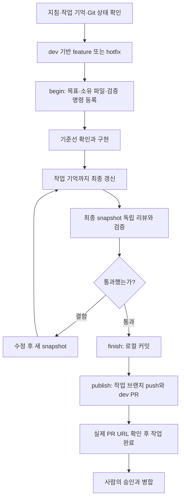

# 하네스 워크플로우

GlobalRemittance의 하네스는 **작업 범위를 등록하고, 같은 변경에 대한 독립 리뷰와 실제 검증을 확보한 뒤 커밋·dev PR까지 연결하는 작업 절차**다. 에이전트가 구현과 판단을 수행하고 Python 스크립트가 상태·검증 근거·종료 조건을 관리한다.

이 문서는 저장소에서 관리하고 옵시디언으로 단방향 내보내는 운영 설명서다. 개별 작업 진행·PR·검증 로그는 저장소의 하네스 기억에서 확인한다.

> [!info] 확인 범위
> 2026-10-20 정리 기준으로 저장소의 `AGENTS.md`, `.codex/instructions/workflow.md`, `scripts/harness.py`, `.codex/hooks.json`과 관련 문서를 대조했다. 저장소에서 확인한 훅은 Codex용이며 Claude Code에서 동일하게 자동 실행되는지는 확인하지 않았다. 훅 활성화·신뢰 여부도 설정 파일의 존재와 별도로 확인해야 한다.

## 1. 무엇을 보장하려는가

- 기존 사용자 변경을 작업에 섞지 않고, 명시적으로 등록한 파일만 수정·커밋한다.
- 변경된 최종 상태에 독립 리뷰와 검증 결과가 함께 대응해야 한다.
- 실패·시간 초과·검증 미실행을 성공으로 처리하지 않는다.
- 다음 세션이 대화 기억 대신 파일과 Git으로 작업을 복원할 수 있게 한다.
- AI의 종료 지점은 작업 브랜치 push와 dev 대상 PR 확인이다. 승인·병합은 사람이 한다.

## 2. 역할과 권한

| 역할 | 수행할 일 | 경계 |
| --- | --- | --- |
| Coordinator | 범위·완료 기준 설정, 구현 위임, 리뷰·검증 조정, 기억 갱신, finish·publish | PR 리뷰·코멘트 게시, 승인·병합은 하지 않음 |
| Implementer | 맡은 파일의 구현과 필요한 회귀 테스트 | 자식은 커밋하지 않음 |
| Reviewer | 정확성·보안·업무 규칙·설계 검토 | 읽기 전용, 결과는 내부 개선용 |
| Verifier | 등록된 명령 실행과 실제 결과 확인 | 검증만 수행, 실패를 우회하지 않음 |
| GitHub AI | GitHub PR 리뷰와 코멘트 | 자동 연결 여부는 별도 확인 |
| 사람 | 최종 판단·승인·병합 | AI가 대신 실행하지 않음 |

작은 문서·하네스 설정 작업은 Coordinator가 직접 작성할 수 있다. 파일별 쓰기 담당자는 한 명으로 유지한다. 모델·reasoning 설정은 부모 세션에서 상속하며, 저장소 설정의 동시 자식 상한은 3이다.

## 3. 전체 흐름



같은 실패가 반복되거나 3회 수정 후에도 해결되지 않으면 중단 사유와 다음 행동을 남긴다. 훅의 종료 후속 실행 상한과 수정 재시도 기준은 서로 구분한다.

## 4. 시작할 때 읽는 순서

1. `AGENTS.md`, `.codex/instructions/workflow.md`: 현재 실행 범위.
2. `docs/engineering/principles.md`: 공통 품질·클린 아키텍처 원칙.
3. `docs/engineering/preferences.md`: 개인 진행·소통 선호.
4. `docs/engineering/branches.md`: 브랜치 정책. 최신 실행 범위와 함께 해석한다.
5. `docs/harness/state.md`, 현재 작업에 필요한 backlog·작업 기록.
6. `.codex/instructions/obsidian.md`: 문서화·동기화 규칙.
7. `git status --short`, `python3 scripts/harness.py status`: 실제 상태 대조.

사용자의 현재 명시적 요청을 우선한다. 기존 문서의 로컬 커밋 종료·test 병합 절차와 충돌하면 최신 `workflow.md`의 **작업 브랜치 → dev PR 종료** 지시를 적용한다. 과거 backlog를 자동으로 실행하지 않는다.

## 5. 작업 등록과 검증 명령

아래는 새 작업의 예시다. 이미 active·committed·blocked 작업이 있으면 새 begin으로 덮어쓰지 않는다.

```bash
git switch dev
git switch -c feature/example-task

python3 scripts/harness.py begin --id example-task \
  --goal '작업 목표와 완료 기준' \
  --files <개별-수정-파일> docs/harness/state.md docs/harness/tasks/example-task.md \
  --check './gradlew clean check bootJar --no-daemon' \
  --check 'git diff --check'

python3 scripts/harness.py status
```

`begin`은 깨끗한 작업 트리, feature/hotfix 이름, 현재 로컬 dev의 포함 여부를 검사한다. 파일은 디렉터리 대신 저장소 상대 경로의 개별 목록으로 등록한다. 기존 사용자 변경이 있으면 보존하고 별도 작업 트리를 사용한다.

검증 명령은 작업에 맞게 정한다. 도메인 변경은 금액·반올림, 한도, 중복·동시성, 만료·날짜 경계, 인증·소유권 중 해당 회귀 검증을 포함한다. PostgreSQL 검증 등 추가 환경이 필요한 명령은 필요한 작업에서 등록한다. 예시 명령이 모든 작업의 고정 필수 목록은 아니다.

## 작업 중 소유 파일 추가

추가 파일이 필요하면 `.harness/task.json`을 직접 편집하지 않고 다음 명령을 사용한다.

```bash
python3 scripts/harness.py own --files docs/application/concurrency.md
```

활성 작업에서만 개별 상대 경로를 추가할 수 있다. 디렉터리·절대 경로·상위 경로·내부 상태 파일은 거부하며 추가 시각과 파일을 `ownership_additions`에 기록한다. `own` 자체는 내용을 바꾸지 않으므로 기존 snapshot 근거를 유지하지만 이후 파일 변경은 재검토 대상이다. 이미 수정한 파일도 추가 가능하므로 사용자 변경을 섞지 않는 판단은 Coordinator 책임이다.

## 6. snapshot과 통과 근거

snapshot은 브랜치·HEAD·index와 Git에서 무시되지 않는 추적/미추적 파일의 내용·모드 등을 묶은 해시다. 소유 파일만의 해시가 아니므로 다른 파일 변경도 기존 근거를 낡게 만들 수 있다.

작업 기억까지 수정한 최종 상태로 reviewer에게 독립 리뷰를 요청한다. 실제 통과 결과를 받은 뒤에만 다음 명령으로 기록한다.

```bash
python3 scripts/harness.py attest-review \
  --snapshot '<status에서 확인한 snapshot>' \
  --evidence '<실제 reviewer 결과 요약과 참조>'

python3 scripts/harness.py verify
```

`attest-review`는 리뷰를 실행하는 명령이 아니다. Coordinator가 확인한 결과를 기록하며 판단의 진실성은 운영 절차에 의존한다.

`verify`는 begin에 등록한 명령을 실제 실행한다. 명령마다 최대 600초이며 종료 코드와 로그를 남긴다. 모든 명령이 성공하고 검증 전후 snapshot도 같아야 통과한다. 파일 변경이 있으면 새 상태에서 리뷰·검증을 다시 수행한다.

## 7. 커밋과 PR 종료

```bash
python3 scripts/harness.py finish --message 'refactor: explain concrete change'

python3 scripts/harness.py publish \
  --repo ssipflow/GlobalRemittance \
  --title 'refactor: explain concrete change' \
  --body-file /tmp/pr-body.md
```

finish는 최신 snapshot의 리뷰·검증, 변경 파일의 소유 범위, `state.md` 갱신, 빈 index, diff 형식을 확인한 뒤 변경 파일만 스테이징·커밋한다. 커밋 훅이나 동시 쓰기가 결과를 바꾸면 자동 롤백 없이 blocked로 남긴다.

publish는 깨끗한 작업 트리와 기록된 커밋·snapshot, origin fetch URL·단일 push URL·명시한 저장소의 일치를 확인한다. 작업 브랜치만 push하고 dev PR의 HEAD가 기록한 커밋과 같은지 확인한다. PR 번호·URL·HEAD를 로컬 상태에 저장한다.

같은 열린 PR은 재사용한다. 사람이 닫거나 병합한 PR을 자동 재생성하지 않는다. 실패하면 성공을 주장하지 말고 원인을 해결한 뒤 상태에 맞게 재시도한다. main/dev/test 직접 push, PR 리뷰·코멘트 게시, approve·merge·auto-merge는 수행하지 않는다.

## 8. 상태 전이와 재개

| 상태 | 의미 | 다음 행동 |
| --- | --- | --- |
| active | 등록된 작업 진행 중 | 구현·기억 갱신·독립 리뷰·verify 후 finish |
| committed | 로컬 커밋 완료, PR 종료 전 | finish를 반복하지 않고 publish |
| completed | 기록한 커밋의 dev PR 확인 완료 | 사람의 승인·병합 대상 |
| blocked | 명시적 중단 또는 종료 후속 실행 상한 도달 | 원인 확인 후 resume |

```bash
python3 scripts/harness.py block --reason '중단 이유와 필요한 다음 행동'
python3 scripts/harness.py resume
```

active에서 재개하면 이전 리뷰·검증 근거를 버린다. committed에서 중단할 때는 tracked 기억을 수정하지 않고 로컬 상태에 사유를 남긴다. 재개 후 publish한다.

커밋 이후 원래 소유 파일을 추가 수정해야 하면 `reopen`으로 active를 복원한다. 기억 갱신 → 독립 리뷰 → verify → finish → publish로 후속 커밋을 만든다. 기존 커밋 이력은 재작성하지 않는다. completed PR은 reopen 대상이 아니다.

## 9. 훅이 하는 일

| 이벤트 | 저장소 구현의 동작 |
| --- | --- |
| SessionStart | 지침·기억 읽기와 status 확인을 안내 |
| PostToolUse | active/committed 작업의 snapshot 변화 감지와 최종 재검토 안내 |
| Stop | active/committed 작업에 최대 3회 후속 실행 요청, 이후 blocked 기록 |

훅이 직접 구현자·리뷰어를 실행하지는 않는다. Coordinator가 후속 작업을 조정한다. 설정된 PostToolUse matcher는 `Bash`, `apply_patch`, `Edit`, `Write`다. 모든 도구·모든 런타임에 자동 적용된다고 가정하지 않는다.

변경 명령과 훅은 `.harness/lock`으로 실행을 직렬화하지만 외부 편집기를 포함한 모든 파일 쓰기를 막지는 않는다. 하네스는 직접 git commit이나 원격 push를 차단하는 보안 장치가 아니다.

## 10. 기억과 옵시디언의 구분

| 위치 | 기록할 내용 |
| --- | --- |
| `docs/harness/state.md` | 현재 작업·확인된 상태·장애물·다음 행동 |
| `docs/harness/tasks/` | 작업별 이유·완료 기준·수정 파일·검증 근거 |
| `docs/harness/backlog.md` | 후속 과제와 우선순위 |
| `docs/decisions/` | 중요한 설계 선택·대안·비용 |
| `.harness/task.json`, `check-*.log` | Git에서 제외한 실행 상태와 원시 검증 로그 |
| `docs/application/` | 코드와 함께 검토하는 앱 문서 원본 |
| 옵시디언 프로젝트 폴더 | 앱 이해용 문서와 사용자가 요청한 설명 노트 |

동기화 원본은 앱 설명 6개, 포트폴리오 안내 4개, 이 운영 안내 1개다. 원본을 검토·커밋·PR로 전달한 뒤 dry-run/sync와 읽기 확인을 수행한다. `Goals Of Project`는 원 요구사항으로 보존하며 자동으로 덮어쓰지 않는다. 작업 내역·PR 상태·원시 검증 로그는 하네스 기억에만 둔다.

```bash
python3 scripts/obsidian_sync.py status
python3 scripts/obsidian_sync.py dry-run
python3 scripts/obsidian_sync.py sync
```

관리 marker 밖의 사용자 내용은 보존한다. 상대 링크는 동기화 대상 노트 또는 GitHub 근거로 변환한다. 전체 Vault 검색·양방향 동기화·watcher·Vault Git 작업은 수행하지 않는다.

## 11. 빠른 점검표

- 시작: 최신 지침·기억·Git·하네스 상태가 서로 맞는가?
- 범위: 완료 기준·소유 파일·검증 명령·쓰기 담당자가 정해졌는가?
- 검토: 작업 기억까지 반영한 같은 snapshot에 실제 독립 리뷰와 검증이 있는가?
- 커밋: 기존 사용자 변경이나 작업 범위 밖 변경이 섞이지 않았는가?
- 종료: committed에서 publish했으며 실제 dev PR URL과 HEAD를 확인했는가?
- 권한: 승인·병합과 GitHub 리뷰는 담당 주체에게 남겼는가?

## 근거 파일

저장소 루트 기준: `AGENTS.md`, `.codex/instructions/workflow.md`, `.codex/instructions/obsidian.md`, `.codex/config.toml`, `.codex/hooks.json`, `scripts/harness.py`, `scripts/obsidian_sync.py`, `docs/harness/README.md`, `docs/harness/design.md`, `docs/harness/obsidian.md`, `docs/engineering/principles.md`, `docs/engineering/preferences.md`, `docs/engineering/branches.md`.

관련 앱 노트: [프로젝트 개요](../application/overview.md) · [아키텍처](../application/architecture.md) · [API 문서](../application/api.md) · [주요 설계](../application/design.md)
